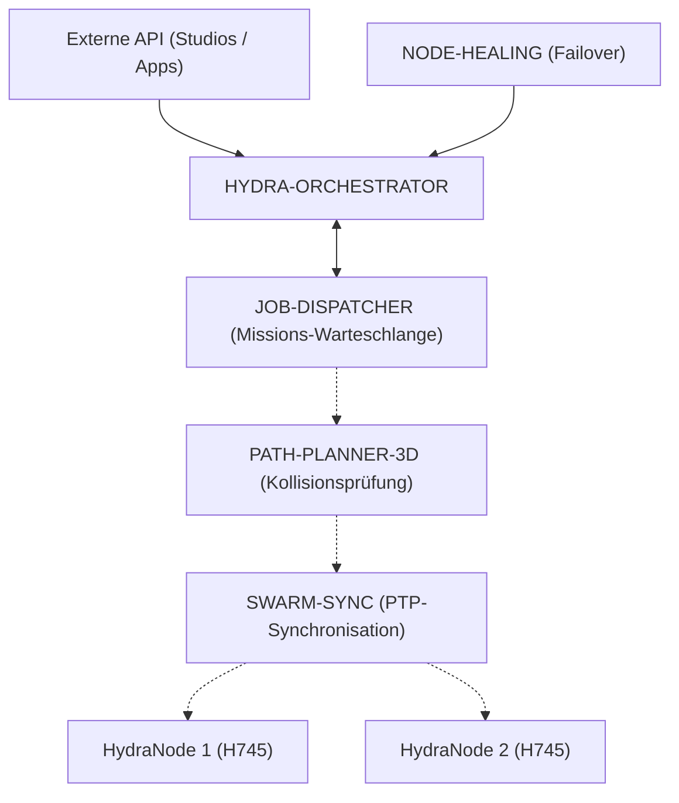

<!-- =============================================================================
HYDRA-UMC-ORCHESTRATOR - Mission coordinator
Copyright (C) JuanenRac (Electro Hobby 3D) <electrohobby3d@gmail.com>
GPL-3.0-or-later - see LICENSE
============================================================================= -->

<p align="center">
  
</p>

# 🕸️ HYDRA-UMC-ORCHESTRATOR

<p align="center"><a href="README.md">🇺🇸 English</a> | <a href="README_spa.md">🇪🇸 Español</a> | <a href="README_fra.md">🇫🇷 Français</a> | <a href="README_ita.md">🇮🇹 Italiano</a> | 🇩🇪 <b>Deutsch</b> | <a href="README_zho.md">🇨🇳 简体中文</a> | <a href="README_jpn.md">🇯🇵 日本語</a> | <a href="README_por.md">🇵🇹 Português</a></p>

### 🤖 Verteilter Schwarm-Manager & Multi-Knoten-Koordinator

<p align="center">
  
  
  
  
  
  
  
</p>

---

**Ehrlichkeitscheck - was heute wirklich läuft:** die Missions-Zustandsmaschine (`src/mission.rs`: `Mission`/`MissionRegistry`, jeder Übergang `Pending -> Dispatched -> InProgress -> Completed`/`Cancelled`/`Failed`, idempotenter Abbruch, Wiederherstellung bei Knotenausfall), ihre eigene Festplatten-Persistenz (`MissionRegistry::load`/`persist`, `data/missions.json`), das dauerhafte Outbox für ausstehende Remote-Abschlüsse (`src/outbox.rs`), der echte HTTP-Client zu HYDRA-UMC-JOB-DISPATCHER (`src/job_dispatcher.rs`) und der einfache JSON/HTTP-Server, der all das bereitstellt (`src/server.rs`, `tiny_http`, ohne Async-Runtime), sind real und getestet (144 Tests, `cargo test`). Der CLI-Unterbefehl `mission-demo` führt ein echtes End-to-End-Szenario gegen genau diese `MissionRegistry` aus - kein Mock. Was noch angestrebt, aber nicht umgesetzt ist: die "geplanten internen Schichten" in Abschnitt 3 weiter unten (API-Schicht, PTP-synchronisiertes Dispatching, Flotten-Gesundheitsaggregation als dauerhafter Dienst) beschreiben Designabsicht, keinen bereits existierenden Code; es gibt keine gRPC-Anbindung von diesem Repo an einen echten laufenden JOB-DISPATCHER oder NODE-HEALING-Prozess, keine PATH-PLANNER-3D-/SWARM-SYNC-Integration, und es lief noch nie eine echte Multi-Node-Flotte gegen dieses Binary - `docker-compose.yml` baut und startet die 3 Geschwisterdienste zusammen, das wurde aber nie gegen echte Roboter-Hardware getestet. Siehe `CHANGELOG.md` für genau das, was bisher ausgeliefert wurde, und die ROADMAP weiter unten für das, was noch offen ist.

---

> **Stand von Sicherheit (Safety) und Security:** Dieses Ökosystem ist kein zertifiziertes Sicherheitssystem. Es gibt noch keinen Hardware-E-STOP-Pfad, keine von der Firmware durchgesetzten Grenzen oder Verriegelungen und keinen verifizierten Bewegungsbefehl; Firmware-Images werden mit CRC-32 und einer Ed25519-Signatur geprüft, und ein Release-Build verweigert die veröffentlichten Entwicklungsschlüssel (die Werkzeugköpfe und Erweiterungsplatinen hinter dem Relais laufen noch mit URTC-Bootloadern, die statt einer Signatur ein HMAC-SHA256 mit gemeinsamem Schlüssel verwenden); TLS und gegenseitiges TLS sind optional und standardmäßig aus; noch keine eigene Platine wurde bestückt oder getestet. Lesen Sie die [Sicherheitsbasis](https://github.com/JuanenRac/HYDRA-UMC-DOCS/blob/main/docs/SECURITY_BASELINE.md) und das [Bedrohungsmodell](https://github.com/JuanenRac/HYDRA-UMC-DOCS/blob/main/docs/THREAT_MODEL.md), bevor Sie sich für die Sicherheit einer Person auf eine Aussage hier verlassen.

---

## 📋 Auf einen Blick

| | |
|---|---|
| Version | `0.1.9` |
| Reifegrad | Funktionsfähig |
| Tests | 144 (`cargo test`) |
| Technik | Rust / tiny_http / ureq / JSON/HTTP |
| Ziel | Der Raspberry Pi CM5 einer HYDRA-UMC-Zelle |
| Auf echter Hardware | Noch nicht: für diese Version ist kein Lauf auf echter Hardware vermerkt |

**Springe zu:** [Überblick](#-überblick) · [Architektur](#-architektur) · [Schnellstart](#-schnellstart) · [Tests](#-tests) · [Struktur des Repositorys](#-struktur-des-repositorys) · [Verwandte Projekte](#-verwandte-projekte)

## 🚦 Projektstatus

Jede Zeile ist ein Teil dieses Repositorys, und die Ampel sagt, wie weit er heute ist. Sie beruht auf dem, was das Repository zeigen kann (Tests, Builds, Läufe), nicht auf dem, was geplant ist.

🟢 Fertig und überprüft · 🟡 Funktioniert, mit bekannten Grenzen · 🟠 Teilweise fertig oder noch nicht überprüft · 🔴 Nicht gemacht oder funktioniert nicht

| Bereich | Stand | Was das hier bedeutet |
|---|---|---|
| Software | 🟡 | Funktioniert für seinen Hauptzweck; die Ehrlichkeitsprüfung oben nennt, was noch fehlt |
| Tests | 🟢 | 144 automatische Tests, bei jeder Änderung ausgeführt |
| Echte Hardware | 🔴 | Noch nicht: für diese Version ist kein Lauf auf echter Hardware vermerkt |
| Dokumentation | 🟢 | README in acht Sprachen, bei jeder Änderung gegen das Manifest geprüft |

## 🎯 Überblick

**HYDRA-UMC-ORCHESTRATOR** ist die übergeordnete Koordinationsschicht des HYDRA-UMC-Ökosystems. Er soll mehrere HydraNodes (Kinematik-Brains, Vision-Knoten und kognitive Knoten) als einen einzigen, einheitlichen Schwarm verwalten.

Geplant: globale Missionsplanung, Lastverteilung über die Flotte und Echtzeit-Synchronisation zwischen Robotern zur Vermeidung physischer Kollisionen. Heute verfolgt er Missionen mit einer Zustandsmaschine und übergibt sie an JOB-DISPATCHER; er synchronisiert keine Roboter, verhindert keine Kollisionen und garantiert keine Präzision.

### Hauptmerkmale:
* 🧭 **Ein Besitzer der Zuweisung:** Ist `--job-dispatcher-url` gesetzt, entscheidet JOB-DISPATCHER, welcher Roboter eine Mission bekommt, und dieser Orchestrator besitzt die Mission selbst (Lebenszyklus, Abschluss und Wiederherstellung). `POST /missions/:id/dispatch` (ein von Hand gewählter Knoten) wird dann mit 409 abgelehnt und verweist auf `POST /missions/:id/auto-dispatch`; ohne Job-Dispatcher funktioniert der manuelle Dispatch wie zuvor. *(implementiert)*
* 📜 **Ein schriftlicher Vertrag mit dem Job-Dispatcher, mit beiden echten Prozessen geprüft:** `docs/JOB_DISPATCHER_CONTRACT.md` sagt, wem was gehört (dem Dispatcher die Zuweisung der Arbeit an Roboter, diesem Orchestrator die Mission: ihr Lebenszyklus, ihr Abschluss und ihre Wiederherstellung) und was jede Seite der anderen zusagt, Schritt für Schritt. `tools/verify_dispatcher_contract.py` startet den echten Dispatcher (Go, aus dem Nachbar-Checkout) und den echten Orchestrator und lässt Missionen durch beide laufen: eine Mission ist ein wartender Auftrag, eine manuelle Zuweisung wird abgelehnt, der Dispatcher wählt den Roboter, Abschließen und Scheitern schließen den Auftrag, und das Wiederherstellen eines Knotens nimmt ihm seine Arbeit weg und sperrt einen verspäteten Bericht des verlorenen Versuchs. Es wird übersprungen (Exit 0), wenn Go, der Dispatcher oder der gebaute Orchestrator fehlt. *(implementiert, 23 Prüfungen)*
* 🕸️ **Schwarm-Koordination:** Orchestriert bis zu 32+ unabhängige Roboterarme über mehrere Controller. *(geplant)*
* ⚖️ **Lastausgleich:** Weist Missionen automatisch dem am besten verfügbaren oder am besten ausgestatteten Roboter zu.
* 🛡️ **Zentralisierte Sicherheit:** Globales E-STOP-Management und flottenweite Zustandsüberwachung. *(geplant)*
* 📡 **Einheitliche API:** Bietet einen einzigen Einstiegspunkt für Apps und Studios, um mit der gesamten Fabrik zu interagieren. *(geplant)*
* 🧩 **Echtes v0 - Missions-Zustandsautomat:** `mission.rs` verfolgt jede Mission durch `Pending -> Dispatched -> InProgress -> Completed` (plus die Endzustände `Cancelled`/`Failed`), mit idempotenter Stornierung und echter Wiederherstellung, wenn ein Knoten als nicht erreichbar/ungültig gemeldet wird - siehe `mission-demo` unten. Reine In-Memory-Logik - kein live gRPC-Partner mit JOB-DISPATCHER/NODE-HEALING nötig, um sie auszuführen oder zu testen.
* 🧱 **Standardmäßig sicher, und ein verspäteter Bericht kann keine Übergabe überschreiben (v0):** Die API lauscht auf `127.0.0.1:8114`, sofern nichts anderes angegeben ist; eine andere Adresse verlangt ein Bearer-Token (`--token` / `ORCHESTRATOR_TOKEN`; dann verlangt jede Route außer `GET /health` es) oder ein ausdrückliches `--allow-anonymous`, und Anfragekörper über 64 KB werden mit `413` abgelehnt. Jede Zuteilung erhöht den `attempt` der Mission; ein `start`/`complete`/`fail` mit veraltetem `attempt` (oder dem Namen eines Knotens, der die Mission nicht mehr hält) wird mit `409` abgelehnt, ohne die Mission anzufassen. So kann ein Knoten, der für nicht verfügbar erklärt wurde und aus einer Netzpartition zurückkehrt, den Knoten nicht überschreiben, an den die Mission übergeben wurde (`--require-attempt` macht das Feld verpflichtend). Missionsregister und Ausgangspuffer werden auf den Datenträger erzwungen, bevor sie die vorherige Datei ersetzen, die mitgelieferte systemd-Unit gibt dem Prozess jetzt ein beschreibbares Zustandsverzeichnis (zuvor machte `ProtectSystem=strict` das Standardverzeichnis `data` schreibgeschützt, und nichts überstand einen Neustart), und `docker-compose.yml` startet jetzt echte Dienste (`serve`-Befehle, Gesundheitsprüfungen, Pflicht-Token, fixierte Images, nur der Orchestrator veröffentlicht und nur auf dem Loopback des Hosts). *(implementiert)*
* 🔭 **Lesbarer Betrieb (optional):** `GET /stats` zeigt zusätzlich das Alter des ältesten unbestätigten Abschlusses (`oldestPendingCloseAgeSeconds`) sowie den letzten Erfolg und den letzten Fehler der Aufrufe an JOB-DISPATCHER; `--log-format json` schreibt pro Logzeile ein JSON-Objekt; `--keep-finished N` vergisst die ältesten beendeten Missionen, deren Abschluss bestätigt wurde, damit `missions.json` nicht endlos wächst; die Datei trägt eine `schema_version`, eine von einer neueren Version geschriebene wird abgelehnt; ein Abschluss teilt JOB-DISPATCHER mit, welchen Versuch er abschließt. Standardmäßig alles aus oder unverändert. *(implementiert)*

## 🧩 Rolle in HYDRA-UMC

**HYDRA-UMC-ORCHESTRATOR** ist der Missionskoordinator: ein Rust-Dienst, der Missionen in einer Zustandsmaschine verfolgt, sie an `HYDRA-UMC-JOB-DISPATCHER` übergibt und sie zurücknimmt, wenn `HYDRA-UMC-NODE-HEALING` einen Knoten als unerreichbar meldet. Er synchronisiert keine Roboter und verhindert keine Kollisionen.

## 🏛️ Architektur

<p align="center">
  
</p>

<details>
<summary>Textversion des Diagramms (Mermaid)</summary>



</details>

### ORCHESTRIERUNGSARCHITEKTUR

> Durchgezogene Pfeile gibt es heute (die HTTP-API, JOB-DISPATCHER und NODE-HEALING, das `POST /nodes/:node/recover` aufruft). Gepunktete Pfeile sind geplant, nicht umgesetzt: Kein Code ruft PATH-PLANNER-3D oder SWARM-SYNC auf.

### ARCHITEKTUR UND ENTSCHEIDUNGEN

> Die folgenden internen Schichten sind das geplante Design für die Logik
> hinter diesem Einstiegspunkt. Unter „🔧 BUILD UND AUSFÜHRUNG“ steht, was heute
> tatsächlich läuft: ein echter, rein im Speicher lebender
> Missions-Zustandsautomat (`mission.rs`), noch ohne einen echten
> Netzwerkpartner, mit dem er sprechen könnte.

**Geplante interne Schichten**, die schrittweise auf dem bereits
existierenden echten Zustandsautomaten aufgebaut werden:
* **API-Schicht** — empfängt Missionsanfragen von Studios/Apps und übersetzt
  sie in Aktionen auf Flottenebene.
* **Missionswarteschlangen-Integration** — schon jetzt real, nicht nur
  geplant: übergibt angenommene Missionen an JOB-DISPATCHER über
  denselben echten HTTP/JSON-Transport, den `server.rs` selbst nutzt
  (`src/job_dispatcher.rs`, dessen eigene `submit_job`/`close_job`/
  `requeue_job`/`run_dispatch`, bereits in jeden echten
  Missions-Lebenszyklus-Handler verdrahtet), und verfolgt ihren
  Lebenszyklus in der Flotte mit dem echten
  `Mission`/`MissionRegistry`-Zustandsautomaten, der bereits in
  `mission.rs` existiert, dauerhaft über einen echten Prozess-Neustart
  hinweg (`--data-dir`, standardmäßig `data/missions.json` - eine mitten im Ablauf neu geladene Mission wird `Unknown` und wieder in `Pending` eingereiht, nie stillschweigend als abgeschlossen angenommen). Diese
  Schicht hat niemals gRPC genutzt und das war auch nie geplant - der
  gemeinsame `HealthService`-Vertrag aus `proto/hydra_common.proto` ist
  eine eigene Angelegenheit (die echte Flotten-Gesundheitssonde von
  HYDRA-UMC-NODE-HEALING selbst), nicht die Missionsübergabe dieses
  Repositorys an JOB-DISPATCHER.
* **PTP-synchronisierte Verteilung** — koordiniert die Zeitsteuerung mit
  SWARM-SYNC, damit mehrere Roboter derselben Mission gemäß den Prüfungen von
  PATH-PLANNER-3D kollisionsfrei bleiben.
* **Aggregierte Flottengesundheit** — fasst NODE-HEALING-Signale je Knoten in
  einer Gesamtansicht zusammen und ruft
  `MissionRegistry::recover_node_unavailable()` (bereits echt) auf, sobald
  ein Signal eintrifft; über diesen Weg würde auch ein globales E-STOP alle
  Knoten zugleich erreichen.

### Warum Rust für diesen speziellen Dienst

Dieser Prozess besitzt die größte Autorität über die Flotte: Er würde einen
globalen E-STOP auslösen und Missionen den Robotern zuordnen. Dafür sind
deterministische Koordination mit niedriger Latenz ohne GC-Pausen sowie
Speicher- und Typsicherheit zur Compile-Zeit nötig. Ein Absturz oder Data Race
bliebe nicht lokal, sondern könnte den gesamten Schwarm während einer Mission
ohne Koordinator lassen. JOB-DISPATCHER und NODE-HEALING verwenden Go, was für
ihre einfacheren, isolierten Aufgaben passt, nicht jedoch für diesen Kernprozess.

### Designentscheidungen

* **Einziger Prozess mit familienweitem `docker-compose.yml`.** Als
  Integrationsvater von SWARM-SYNC, PATH-PLANNER-3D, JOB-DISPATCHER und
  NODE-HEALING beschreibt dieses Repository die gemeinsame Ausführung;
  jedes Kind bleibt auf seine eigene Aufgabe fokussiert.
* **Stellt eine „Unified API“ für Apps/Studios bereit.** Clients sprechen
  diesen stabilen Einstiegspunkt an statt direkt vier Kinddienste; intern kann
  er auf die jeweilige Implementierung weiterleiten.
* **Warum `cancel()` idempotent ist, statt bei einer bereits stornierten Mission zu scheitern.** Eine Stornierungsanfrage kann legitim zweimal eintreffen - ein Client, der nach einer verlorenen Antwort erneut versucht, ein Bediener, der erneut auf Stornieren klickt, bevor er die Bestätigung sieht. Den zweiten Aufruf als Erfolg zu behandeln (`AlreadyCancelled`, kein Fehler) bedeutet, dass der Aufrufer nie unterscheiden muss zwischen „meine Stornierung hat funktioniert“ und „die Stornierung von jemand anderem hat bereits funktioniert“ - beides ist dasselbe gute Ergebnis. Das Stornieren einer `Completed`/`Failed`-Mission bleibt weiterhin verweigert: Das ist eine wirklich andere, nicht-idempotente Situation (das Rückgängigmachen abgeschlossener Arbeit), kein erneuter Versuch.
* **Warum die Wiederherstellung nach Knotenausfall zu `Pending` zurückstellt, statt die Mission sofort scheitern zu lassen.** Ein Knoten, der `UNREACHABLE` meldet, könnte gerade neu starten, statt dauerhaft verschwunden zu sein (siehe die eigene, begrenzte Retry-Logik von `HYDRA-UMC-NODE-HEALING`, die vorübergehende Störungen bereits abfängt, bevor ein Knoten überhaupt als ausgefallen gemeldet wird) - eine auf diesem Knoten hängende Mission bekommt daher über `Pending` eine neue Chance auf einem anderen Knoten, statt beim ersten Anzeichen von Problemen als `Failed` markiert zu werden. `fail()` existiert weiterhin für den Fall, dass die Neuverteilung wirklich keine Optionen mehr hat.

Für jedes reale mission-demo/CLI-Beispiel (aus einer echten kompilierten Binärdatei aufgezeichnet) siehe [`docs/CLI_REFERENCE.md`](docs/CLI_REFERENCE.md). Für den gemeinsamen `hydra.common.v1`-gRPC-Vertrag selbst - was er definiert, warum er in diesem Repo liegt und wie jede Sprache ihre eigenen Bindings generiert - siehe [`proto/README.md`](proto/README.md).

## 🚀 Schnellstart

Benötigt die stabile Rust-Toolchain (Edition 2021) mit `cargo`.

```bash
./build.sh             # Linux, macOS (build.bat on Windows)
./run.sh mission-demo  # a real scenario of the mission state machine
cargo test
```

## 🧪 Tests

144 automatische Tests laufen mit `cargo test`. Sie brauchen weder Hardware noch etwas außerhalb dieses Rechners.

Die CI führt `HYDRA_UMC_CI=1 python tools/ci_validate.py` aus; das prüft das Manifest, die Dokumente, die acht READMEs und die Bilder.

## 🏗️ Build und Veröffentlichung

Der nackte Aufruf bleibt ein minimales Grundgerüst (gibt Identität aus,
beendet sich mit 0); der echte Missions-Zustandsautomat lässt sich schon
heute über `mission-demo` ausprobieren.

```bash
# Windows
build.bat
run.bat
run.bat mission-demo

# Linux / macOS
./build.sh
./run.sh
./run.sh mission-demo
```

`build.sh`/`build.bat` ändern die Version nie (nur `python tools/hydra_project_tool.py bump` erhöht sie) und führen anschließend
`cargo build --release` aus. `run.sh`/`run.bat` führen die resultierende
Binärdatei direkt aus.

`mission-demo` führt ein echtes Szenario Ende-zu-Ende gegen den
`MissionRegistry` aus `mission.rs` aus und gibt jede echte Zustandsänderung
aus:

```text
[orchestrator] mission-1: dispatched -> InProgress(node=node-a)
[orchestrator] mission-2: dispatched -> Dispatched(node=node-a)
[orchestrator] mission-3: dispatched -> InProgress(node=node-b)
[orchestrator] node-a reported UNREACHABLE by NODE-HEALING - recovering its missions
[orchestrator] mission-1: requeued -> Pending
[orchestrator] mission-2: requeued -> Pending
[orchestrator] mission-3: unaffected (different node) -> InProgress(node=node-b)
[orchestrator] mission-2: cancel() -> Cancelled -> Cancelled
[orchestrator] mission-2: cancel() again (idempotent) -> AlreadyCancelled -> Cancelled
[orchestrator] mission-3: complete() -> Completed(node=node-b)
[orchestrator] mission-4: fail() -> Failed(no healthy node accepted redispatch after 3 attempts)
[orchestrator] final registry state:
  mission-1: Pending (terminal=false)
  mission-2: Cancelled (terminal=true)
  mission-3: Completed(node=node-b) (terminal=true)
  mission-4: Failed(no healthy node accepted redispatch after 3 attempts) (terminal=true)
```

```bash
cargo test   # 144 Tests: die Zustandsänderungen/Ablehnungen ungültiger
             # Zustandsänderungen/idempotente Stornierung/Wiederherstellung
             # nach Knotenausfall aus mission.rs, plus die absturzsichere
             # Persistenz von outbox.rs, den echten HTTP-Client von
             # job_dispatcher.rs und die HTTP-Handler von server.rs
```

Als übergeordnetes Integrations-Repo des Ökosystems liefert dieses Repo auch
eine echte `docker-compose.yml`, die diesen Dienst zusammen mit seinen 3
Kindern (SWARM-SYNC, JOB-DISPATCHER, NODE-HEALING; PATH-PLANNER-3D, ein Kommandozeilenwerkzeug, bleibt hinter dem Profil `tools`) startet,
die als Geschwisterordner erwartet werden:

```bash
docker compose up --build
```

## 📂 Struktur des Repositorys

<p align="center">
  
</p>

<details>
<summary>Textversion des Baums</summary>

```text
HYDRA-UMC-ORCHESTRATOR/
├── tools/                              Quellcode
│   ├── build_test.py                   Nicht-versionierender Build-Check
│   ├── ci_validate.py                  Manifest/CHANGELOG/Docs-Validierung, von CI genutzt
│   ├── verify_dispatcher_contract.py   Lässt den echten Job-Dispatcher und den echten Orchestrator gegeneinander laufen und prüft den Vertrag
│   ├── verify_compose.py               Statische Prüfungen von docker-compose.yml (Befehle, fixierte Images, Loopback-Ports, Pflicht-Token)
│   ├── _doc_policy.py                  Von der Familie geteilte Dokumentationsregeln (Kopie der von HYDRA-UMC-SDK, synchron gehalten)
│   ├── _readme_parity.py               Prüfung, dass die acht READMEs dieselbe Struktur haben (Kopie der von HYDRA-UMC-SDK, synchron gehalten)
│   └── hydra_project_tool.py           Dieselben Befehle in jedem Repository: validate, test, ci, version, status, bump
├── src/                                Quellcode
├── proto/                              Gemeinsamer gRPC-Vertrag für Knoten-zu-Knoten-
├── docs/                               Dokumentation und Architekturleitfäden
├── images/                             Medien und Diagramme
├── systemd/                            Dienst-Unit
├── .github/                            CI-Workflow und Issue-Vorlagen
├── Cargo.toml                          Rust-Paketmanifest (Name, Version, Abhängigkeiten)
├── bump_version.py                     ausdrückliche Versionserhöhung
├── bump_manifest_version.py            Synchronisiert die Version von hydra-umc.project.json mit der nativen (--sync)
├── docker-compose.yml                  Integriert dieses Repo mit seinen 3 echten Kindern
├── nodes.compose.json                  Knotenregister, das NODE-HEALING im Compose-Stack nutzt
├── .env.example                        Token, die der Compose-Stack verlangt (nach .env kopieren)
├── CHANGELOG.md                        was sich in jeder Version geändert hat
├── build-test.sh                       Build-Prüfung ohne Änderungen
├── build.sh                            baut und prüft; ändert nie die Version
├── hydra-umc.project.json              Manifest: Version, Reifegrad, Familie
├── run.sh                              startet das Programm
└── test.sh                             führt die Tests aus
```

</details>

## 🗺️ Roadmap und bekannte Grenzen

**Bekannte Grenzen heute**

* **Phase 1:** Deterministische Schwarm-Synchronisation über TSN und Sub-ms-Jitter-Reduzierung.
* **Phase 2:** 3D-Pfadplanung mit dynamischer Hindernisvermeidung in Multi-Roboter-Zellen.
* **Phase 3:** Multi-Roboter-Job-Dispatching-Optimierung unter Berücksichtigung der Ressourcenverfügbarkeit in Echtzeit.
* **Phase 4:** Implementierung eines Hochverfügbarkeits-Failover-Clusters und Unterstützung heterogener Roboter.

## 🌍 Sprachen

Diese README und die Dokumente des Repositorys gibt es in acht Sprachen: Englisch, Spanisch, Deutsch, Französisch, Italienisch, Japanisch, Chinesisch und Portugiesisch (Portugal). Sie entstehen gemeinsam, und die CI prüft, dass die acht Dateien dieselben Abschnitte und dieselben Links haben. Dieses Repository hat weder eine eigene Oberfläche noch einen eigenen Meldungskatalog, es gibt also keine Oberflächentexte zu übersetzen.

## 🔗 Verwandte Projekte

Dieses Projekt ist Teil des HYDRA-UMC-Robotik-Ökosystems desselben Autors (JuanenRac / Electro Hobby 3D). Gut zu wissen, da eine Anfrage eigentlich eines dieser Projekte betreffen könnte statt dieses Repositorys.

**Untergeordnete Projekte** — jedes davon ist ein Dienst, den dieser Orchestrator koordiniert oder direkt versorgt
- **[HYDRA-UMC-SWARM-SYNC](https://github.com/JuanenRac/HYDRA-UMC-SWARM-SYNC)** — echte CRDT-LWW-Element-Map-Zustandssynchronisation, eigenschaftsgetestet auf Multi-Zellen-Konvergenz.
- **[HYDRA-UMC-PATH-PLANNER-3D](https://github.com/JuanenRac/HYDRA-UMC-PATH-PLANNER-3D)** — echter RRT-basierter 3D-Pfadplaner mit echter Hindernis-/Arbeitsraum-Kollisionsvalidierung.
- **[HYDRA-UMC-JOB-DISPATCHER](https://github.com/JuanenRac/HYDRA-UMC-JOB-DISPATCHER)** — echte prioritätsbasierte Job-Queue mit Deduplizierung, über eine echte HTTP-API.
- **[HYDRA-UMC-NODE-HEALING](https://github.com/JuanenRac/HYDRA-UMC-NODE-HEALING)** — echter gRPC-basierter Flotten-Health-Watchdog mit Retry/Backoff und Identitäts-Mismatch-Erkennung.

**Direkt verwandt**
- **[HYDRA-UMC-SERVER](https://github.com/JuanenRac/HYDRA-UMC-SERVER)** — das reale Headless-Backend (REST/WebSocket), mit dem jeder Steuerungsclient tatsächlich spricht; dieser Orchestrator koordiniert mehrere Instanzen davon.
- **[HYDRA-UMC-COGNITIVE-NODE](https://github.com/JuanenRac/HYDRA-UMC-COGNITIVE-NODE)** — Integrationsknoten für die Hailo-10-Cognitive-Pipeline (LLM-/VLA-/Sprach-Orchestrierung); erhält von hier aus Missionsaufträge.
- **[HYDRA-UMC-SUITE](https://github.com/JuanenRac/HYDRA-UMC-SUITE)** — Desktop-Schwarmleitstand (PySide6) für mehrere Server gleichzeitig, verpackt als eigenständige ausführbare Datei; der Schwarmleitstand, den dieser Orchestrator absichert.

**Ebenfalls Teil des Ökosystems**

*Kern-Hardware & Plattform*
- **[HYDRA-UMC](https://github.com/JuanenRac/HYDRA-UMC)** — der Entwurf des Motherboards des Roboterarms: CM5-Host + Dual-Core-STM32H745, gedacht zur Koordination von bis zu 8 Werkzeugarmen über CAN-OTA/SPI-OTA (Firmware in einer frühen Phase; noch keine bestückte Platine).
- **[HYDRA-UMC-OS](https://github.com/JuanenRac/HYDRA-UMC-OS)** — reproduzierbare Raspberry-Pi-OS-Produktschicht für den CM5: schreibgeschützter Agent, validierte Konfiguration/Profile, WiFi-Ersteinrichtung.
- **[HYDRA-UMC-SDK](https://github.com/JuanenRac/HYDRA-UMC-SDK)** — der gemeinsame JSON-Schema-Vertrag und die Software-Auftragsschranke, gegen die jede Bridge ihre Befehle validiert (keine zertifizierte Sicherheitsfunktion).
- **[HYDRA-UMC-CONNECTOR-HUB](https://github.com/JuanenRac/HYDRA-UMC-CONNECTOR-HUB)** — deklaratives Adapter-Manifest-Register und Validator für Konnektoren externer Maschinen; erweitert die eigene Vertragsidee des SDK auf externe Maschinen, ohne die Industrie-Gateway-Projekte zu ersetzen.

*Kern-Backend & Clients*
- **[HYDRA-UMC-STUDIO](https://github.com/JuanenRac/HYDRA-UMC-STUDIO)** — Web-Steuerungs-Dashboard mit Echtzeit-3D-Visualisierung mehrerer Roboter.
- **[HYDRA-UMC-ANDROID-CONTROL](https://github.com/JuanenRac/HYDRA-UMC-ANDROID-CONTROL)** — native Android-Steuerungs-App mit biometrischem Login und einer gekoppelten Wear-OS-Begleit-App.
- **[HYDRA-UMC-IOS-CONTROL](https://github.com/JuanenRac/HYDRA-UMC-IOS-CONTROL)** — iOS/iPadOS-Steuerungs-App (Flutter) mit Echtzeit-WebSocket-Synchronisierung.
- **[HYDRA-UMC-DSI](https://github.com/JuanenRac/HYDRA-UMC-DSI)** — native Touch-UI für das eingebaute 7"-DSI-Touchscreen, direkt auf dem CM5 eingebettet.
- **[HYDRA-UMC-EDITOR-URDF](https://github.com/JuanenRac/HYDRA-UMC-EDITOR-URDF)** — grafischer Desktop-URDF-Ersteller/-Editor, der fertige Modelle in STUDIOs eigenen Katalog überträgt.
- **[HYDRA-UMC-EDITOR-STL](https://github.com/JuanenRac/HYDRA-UMC-EDITOR-STL)** — Desktop-STL-Modelleditor, der echte Teile im selben Modellkatalog transformiert/ersetzt/entfernt/hinzufügt, den auch HYDRA-UMC-EDITOR-URDF bearbeitet.
- **[HYDRA-UMC-BRIDGE-AMR](https://github.com/JuanenRac/HYDRA-UMC-BRIDGE-AMR)** — Koordinationsschranke für AGV-/AMR-Flotten über einen VDA-5050-MQTT-Publisher (nur gegen eine emulierte Flotte getestet).
- **[HYDRA-UMC-BRIDGE-CNC](https://github.com/JuanenRac/HYDRA-UMC-BRIDGE-CNC)** — High-Level-Koordinator für CNC-Zellen mit GRBL-Status-/Steuerbyte-Zugriff (nur gegen einen Emulator getestet).
- **[HYDRA-UMC-BRIDGE-DROIDS](https://github.com/JuanenRac/HYDRA-UMC-BRIDGE-DROIDS)** — Koordinationsschranke für laufende/humanoide Droiden, mit einem Boston-Dynamics-Spot-Befehlssender (nur gegen einen Emulator getestet).
- **[HYDRA-UMC-BRIDGE-LASER](https://github.com/JuanenRac/HYDRA-UMC-BRIDGE-LASER)** — Koordinator für Laserzellen, liest 3 Schlüssel-/Gehäuse-/Verriegelungs-GPIO-Signale (nur gegen einen simulierten Chip getestet; kann keinen Laser scharfschalten oder auslösen).
- **[HYDRA-UMC-BRIDGE-OPENPNP](https://github.com/JuanenRac/HYDRA-UMC-BRIDGE-OPENPNP)** — sicherer High-Level-Koordinator für den Leiterplattenfluss von OpenPnP Pick-and-Place.
- **[HYDRA-UMC-BRIDGE-PRINTER3D](https://github.com/JuanenRac/HYDRA-UMC-BRIDGE-PRINTER3D)** — sichere Koordinationsschranke für Moonraker/Klipper-3D-Drucker, mit echten gesicherten Job-Befehlen.
- **[HYDRA-UMC-BRIDGE-ROS2](https://github.com/JuanenRac/HYDRA-UMC-BRIDGE-ROS2)** — Koordinator mit einem träge importierten rclpy-ROS-2-Transport (noch nicht gegen eine ROS-2-Installation ausgeführt).
- **[HYDRA-UMC-BRIDGE-UAV](https://github.com/JuanenRac/HYDRA-UMC-BRIDGE-UAV)** — Koordinationsschranke für kameraausgestattete UAVs, mit einem MAVLink-Befehlssender (nur gegen einen Emulator getestet).

*URTC-Werkzeugplattform*
- **[URTC](https://github.com/JuanenRac/URTC)** — Firmware für die physische Universal-Robot-Tool-Controller-Platine, 25+ Werkzeugprofile über CAN-Bus.
- **[URTC-FLASHER](https://github.com/JuanenRac/URTC-FLASHER)** — Desktop-GUI-Flash-Tool für URTC-Platinen, CAN-OTA plus Full-Chip-SWD/JTAG.
- **[URTC-TESTER](https://github.com/JuanenRac/URTC-TESTER)** — Desktop-Live-CAN-Bus-Diagnosetool für URTC-Platinen, ein Panel pro Werkzeugprofil.
- **[URTC-WEB-STUDIO](https://github.com/JuanenRac/URTC-WEB-STUDIO)** — browserbasierte Alternative zu URTC-TESTER über die Web-Serial-API, ohne lokale Installation.
- **[URTC-GATEWAY](https://github.com/JuanenRac/URTC-GATEWAY)** — Gateway vor dem CAN-Bus von URTC: Liste erlaubter Kennungen, Ratenbegrenzung und Sitzungsschlüssel; Software auf dem Computer getestet, noch nicht an einem echten Bus.

*Vision-KI-Knoten (Hailo-8)*
- **[HYDRA-UMC-VISION-NODE](https://github.com/JuanenRac/HYDRA-UMC-VISION-NODE)** — Integrationsknoten für die Hailo-8-Vision-Pipeline, mit einer echten stufenweisen Hardware-Bereitschaftsprüfung.
- **[HYDRA-UMC-DETECTION-HEF](https://github.com/JuanenRac/HYDRA-UMC-DETECTION-HEF)** — echte Registry für kompilierte Modelle mit Hailo-Architektur-/Prüfsummen-Safe-Load-Verifizierung.
- **[HYDRA-UMC-VISION-STREAMER](https://github.com/JuanenRac/HYDRA-UMC-VISION-STREAMER)** — echter GStreamer-Pipeline- + MediaMTX-Konfigurationsgenerator mit einer echten HailoRT-Integrationsschranke.
- **[HYDRA-UMC-VISUAL-SERVOING-API](https://github.com/JuanenRac/HYDRA-UMC-VISUAL-SERVOING-API)** — Position-Based-Visual-Servoing-Korrekturgesetz mit Freigabe abhängig vom Zonenstatus; noch keine Posenschätzung per Kamera.
- **[HYDRA-UMC-SAFETY-ZONES](https://github.com/JuanenRac/HYDRA-UMC-SAFETY-ZONES)** — v0-Logik für Zonenverletzung, Kalibrierungsaktualität und E-STOP-Anforderung, die Objektpositionen aus einer Datei nimmt; kein Detektor speist sie, und noch kein physischer E-STOP ist angeschlossen.

*Kognitiver KI-Knoten (Hailo-10)*
- **[HYDRA-UMC-VLA-ENGINE](https://github.com/JuanenRac/HYDRA-UMC-VLA-ENGINE)** — echte Aktions-Token-Kodierung/-Dekodierung und Trajektoriengenerierung für ein Vision-Language-Action-Modell.
- **[HYDRA-UMC-VOICE-UI](https://github.com/JuanenRac/HYDRA-UMC-VOICE-UI)** — echtes Sprach-Frontend (VAD + Intent-Parser) mit einem begrenzten, bestätigungsgesicherten Watch-Relay.
- **[HYDRA-UMC-SEMANTIC-PLANNER](https://github.com/JuanenRac/HYDRA-UMC-SEMANTIC-PLANNER)** — echte regelbasierte Aufgabenzerlegung und semantische Fehlerbehebung über MCU-Fehlercodes.
- **[HYDRA-UMC-DOCS-QA](https://github.com/JuanenRac/HYDRA-UMC-DOCS-QA)** — echte, nur auf der Standardbibliothek basierende TF-IDF-Dokumentensuche über die eigenen Markdown-Dokumente dieses Ökosystems.
- **[HYDRA-UMC-LOCAL-TECHNICIAN](https://github.com/JuanenRac/HYDRA-UMC-LOCAL-TECHNICIAN)** — lokaler, richtlinien-gesteuerter KI-Wartungstechniker für das Ökosystem selbst - beobachtet, diagnostiziert und schlägt Korrekturen vor; die zwei höchsten Risikostufen sind absichtlich noch nicht implementiert.

*Digitaler Zwilling & Simulation*
- **[HYDRA-UMC-TWIN](https://github.com/JuanenRac/HYDRA-UMC-TWIN)** — Integrationsknoten für die Digital-Twin-Engine, mit einem echten Versionskompatibilitäts-Sync-Vertrag.
- **[HYDRA-UMC-HIL-BRIDGE](https://github.com/JuanenRac/HYDRA-UMC-HIL-BRIDGE)** — Hardware-in-the-Loop-Router mit einer Software-Kollisionsverriegelung zwischen Simulation und echter Hardware (ohne echte Hardware getestet).
- **[HYDRA-UMC-PHYSICS-REPLICA](https://github.com/JuanenRac/HYDRA-UMC-PHYSICS-REPLICA)** — echte Vorwärtskinematik und Gelenkgrenzenvalidierung über eine echte URDF-Teilmenge.
- **[HYDRA-UMC-SYNTHETIC-DATA-GEN](https://github.com/JuanenRac/HYDRA-UMC-SYNTHETIC-DATA-GEN)** — echter prozeduraler 2D-Szenengenerator mit YOLO/COCO-Annotationsexport.

*Daten & Analytik*
- **[HYDRA-UMC-DATALAKE](https://github.com/JuanenRac/HYDRA-UMC-DATALAKE)** — echter sqlite3-gestützter Zeitreihenspeicher mit einer echten Ingest-/Abfrage-HTTP-API.
- **[HYDRA-UMC-ANOMALY-DETECTOR](https://github.com/JuanenRac/HYDRA-UMC-ANOMALY-DETECTOR)** — echter FFT- + statistischer Basislinien-Anomaliedetektor mit Drift-Überwachung.
- **[HYDRA-UMC-PRODUCTION-REPORTS](https://github.com/JuanenRac/HYDRA-UMC-PRODUCTION-REPORTS)** — echte OEE-/Verfügbarkeitsberechnung über den DATALAKE-Verlauf, mit reproduzierbarem CSV-Export.
- **[HYDRA-UMC-TELEMETRY-COLLECTOR](https://github.com/JuanenRac/HYDRA-UMC-TELEMETRY-COLLECTOR)** — echte CAN/WebSocket-Ingestion-Pipeline in DATALAKE, mit Sequenz-Deduplizierung.

*Industrie-Gateway*
- **[HYDRA-UMC-GATEWAY-INDUSTRIAL](https://github.com/JuanenRac/HYDRA-UMC-GATEWAY-INDUSTRIAL)** — Integrationsknoten, der zu Industrieprotokollen weiterleitet, mit einer echten Befehls-Allowlist-/Backpressure-Schicht.
- **[HYDRA-UMC-OPCUA-SERVER](https://github.com/JuanenRac/HYDRA-UMC-OPCUA-SERVER)** — echter OPC-UA-Adressraum, verifiziert mit einer echten Binärprotokoll-Client-Session.
- **[HYDRA-UMC-MQTT-BROKER](https://github.com/JuanenRac/HYDRA-UMC-MQTT-BROKER)** — echter MQTT-Broker mit optionaler Pro-Client-Authentifizierung und Topic-ACLs.
- **[HYDRA-UMC-MTCONNECT-ADAPTER](https://github.com/JuanenRac/HYDRA-UMC-MTCONNECT-ADAPTER)** — echte MTConnect-`/probe`- und `/current`-XML-Endpunkte mit Degraded-Mode-Ausgabe.

*Ergänzende Tools & Ökosystembetrieb*
- **[HYDRA-UMC-DASHBOARD-AI](https://github.com/JuanenRac/HYDRA-UMC-DASHBOARD-AI)** — Smart-Summaries- und Anomaly-Highlighting-Panels über DATALAKE/ANOMALY-DETECTOR, mit einem ehrlichen statistischen Fallback.
- **[HYDRA-UMC-TOOL-CLI](https://github.com/JuanenRac/HYDRA-UMC-TOOL-CLI)** — Flotten-CLI mit einem echten, stabilen Exit-Code-Vertrag, ein echter Live-Client der eigenen API von HYDRA-UMC-SERVER.
- **[HYDRA-UMC-WATCH](https://github.com/JuanenRac/HYDRA-UMC-WATCH)** — WearOS-Begleit-App mit haptischen Alarmmustern und einem Sprach-Relay zum gekoppelten Telefon (noch nicht auf einer physischen Uhr ausgeführt).
- **[URTC-SMART-RACK](https://github.com/JuanenRac/URTC-SMART-RACK)** — Firmware für ein Platinenmontagegestell mit echter Werkzeug-ID-Dekodierung und Smart-Idle-Vorheizlogik.
- **[URTC-VISION-TOOL](https://github.com/JuanenRac/URTC-VISION-TOOL)** — Firmware plus ein echter Python-Vision-Begleiter für einen Thermal-/RGB-Inspektionswerkzeugkopf.
- **[HYDRA-UMC-UPDATER](https://github.com/JuanenRac/HYDRA-UMC-UPDATER)** — administratives Desktop-Tool, das jedes Repository in diesem Ökosystem entdeckt, klont und aktualisiert.
- **[HYDRA-UMC-OS-REBUILDER](https://github.com/JuanenRac/HYDRA-UMC-OS-REBUILDER)** — Windows/Linux-Desktop-Tool, das ein flashbereites CM5-Image baut, vorgeladen mit den aktuellsten Versionen des Ökosystems, mit Ersteinrichtungs-Konfiguration für WLAN/Benutzer/SSH im Stil von Raspberry Pi Imager.
- **[HYDRA-UMC-OPS-AGENT](https://github.com/JuanenRac/HYDRA-UMC-OPS-AGENT)** — Wartungsvorfall-Koordinator: eine Edge-Rolle mit niedrigem Privileg sammelt einen bereinigten Inventar-/Gesundheits-Snapshot, eine Control-Plane-Rolle rendert ihn schreibgeschützt und bittet einen KI-Anbieter um einen Diagnosevorschlag - wendet nie einen Patch an und stellt nie etwas bereit.
- **[HYDRA-UMC-DEV-SERVER](https://github.com/JuanenRac/HYDRA-UMC-DEV-SERVER)** — reproduzierbarer Entwicklungshost (Raspberry Pi 5 / CM5), der den Quellcode des Ökosystems vorhält und begrenzte Build-/Test-Aufgaben über eine dauerhafte Warteschlange ausführt; eine dedizierte Entwicklerrolle, ausdrücklich kein operativer CM5.

## 📚 Dokumentation

Hier steht mehr:

* [Sicherheitsgrundlage des Ökosystems](https://github.com/JuanenRac/HYDRA-UMC-DOCS/blob/main/docs/SECURITY_BASELINE.md)
* [Bedrohungsmodell des Ökosystems](https://github.com/JuanenRac/HYDRA-UMC-DOCS/blob/main/docs/THREAT_MODEL.md)
* [Änderungsprotokoll dieses Repositorys](CHANGELOG.md)
* [Lizenz dieses Repositorys](LICENSE.md)

## 🤝 Mitwirken und Community

* Führe vor einem Pull Request `HYDRA_UMC_CI=1 py -3 tools/ci_validate.py` (oder `HYDRA_UMC_CI=1 python3 tools/ci_validate.py`) aus: Es muss `CI_VALIDATION=PASS` ausgeben. Führe dafür nicht `build.sh` oder `build.bat` aus; Bauen ist keine Prüfung.
* Die acht READMEs entstehen aus einer einzigen Quelle in HYDRA-UMC-DOCS; bearbeite sie nicht von Hand. Ändere die Quelle und schreibe sie mit `tools/make_readmes.py` neu.
* Behaupte in einer README nichts, was nicht gelaufen ist: Schreibe „simuliert“ oder „nicht auf Hardware erprobt“, wo das stimmt.
* Siehe [CONTRIBUTING.md](CONTRIBUTING.md), den [Verhaltenskodex](CODE_OF_CONDUCT.md), [SECURITY.md](SECURITY.md) und [SUPPORT.md](SUPPORT.md).

## 👤 AUTOR

**JuanenRac (Electro Hobby 3D)** · electrohobby3d@gmail.com

## 📜 LIZENZ

GPL-3.0-or-later - [LICENSE](LICENSE).
