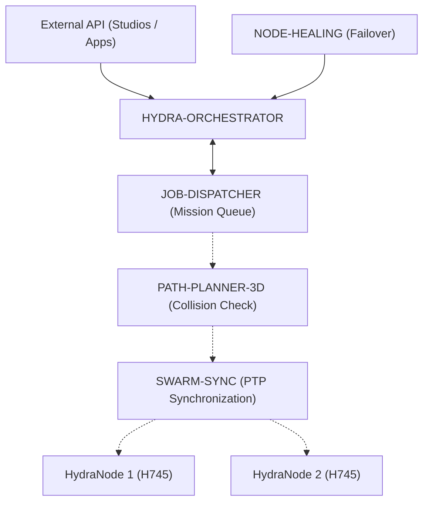

<!-- =============================================================================
HYDRA-UMC-ORCHESTRATOR - Mission coordinator
Copyright (C) JuanenRac (Electro Hobby 3D) <electrohobby3d@gmail.com>
GPL-3.0-or-later - see LICENSE
============================================================================= -->

<p align="center">
  
</p>

# 🕸️ HYDRA-UMC-ORCHESTRATOR

<p align="center"><a href="README.md">🇺🇸 English</a> | <a href="README_spa.md">🇪🇸 Español</a> | <a href="README_fra.md">🇫🇷 Français</a> | <a href="README_ita.md">🇮🇹 Italiano</a> | <a href="README_deu.md">🇩🇪 Deutsch</a> | <a href="README_zho.md">🇨🇳 简体中文</a> | 🇯🇵 <b>日本語</b> | <a href="README_por.md">🇵🇹 Português</a></p>

### 🤖 分散型スウォームマネージャー & マルチノードコーディネーター

<p align="center">
  
  
  
  
  
  
  
</p>

---

**正直な現状確認 - 実際に今動くもの:** ミッション状態機械（`src/mission.rs`: `Mission`/`MissionRegistry`、`Pending -> Dispatched -> InProgress -> Completed`/`Cancelled`/`Failed` の全遷移、冪等なキャンセル、ノード障害時の復旧）、その独自のディスク永続化（`MissionRegistry::load`/`persist`、`data/missions.json`）、保留中のリモートクローズを扱う永続outbox（`src/outbox.rs`）、HYDRA-UMC-JOB-DISPATCHER への実際のHTTPクライアント（`src/job_dispatcher.rs`）、そしてこれらすべてを公開するシンプルなJSON/HTTPサーバー（`src/server.rs`、`tiny_http`、非同期ランタイムなし）は本物であり、テスト済みです（77件のテスト、`cargo test`）。CLIサブコマンド `mission-demo` は、モックではなく、まさにこの `MissionRegistry` に対して実際のシナリオをエンドツーエンドで実行します。まだ構想段階にとどまっているもの: 下記セクション3の「計画中の内部レイヤー」（APIレイヤー、PTP同期ディスパッチ、常駐サービスとしてのフリート健全性集約）は設計意図を記したものであり、すでに存在するコードではありません。本リポジトリから実際に稼働中のJOB-DISPATCHERやNODE-HEALINGプロセスへのgRPC配線は存在せず、PATH-PLANNER-3D/SWARM-SYNCとの統合もなく、このバイナリに対して実際のマルチノード・フリートが動いたことも一度もありません - `docker-compose.yml` は4つの兄弟サービスをまとめてビルド・起動しますが、実機のロボットハードウェアに対しては検証されていません。これまでに実際に出荷されたものの詳細は `CHANGELOG.md` を、残っている未完了事項は下記のROADMAPを参照してください。

---

> **安全性とセキュリティの現状:** このエコシステムは認証された安全システムではありません。ハードウェアの E-STOP 経路、ファームウェアが強制する制限やインターロック、検証済みの動作コマンドはまだありません。ファームウェアイメージは CRC-32 と Ed25519 署名で検査し、リリースビルドは公開済みの開発用鍵を拒否します(リレーの先のツールヘッドと拡張ボードは引き続き URTC のブートローダーを使い、署名ではなく共有鍵の HMAC-SHA256 を使います)。TLS と相互 TLS は任意で、既定では無効です。独自基板はまだ実装も試験もされていません。ここに書かれた内容を人の安全のために頼る前に、[セキュリティベースライン](https://github.com/JuanenRac/HYDRA-UMC-DOCS/blob/main/docs/SECURITY_BASELINE.md)と[脅威モデル](https://github.com/JuanenRac/HYDRA-UMC-DOCS/blob/main/docs/THREAT_MODEL.md)をお読みください。

---

## 📋 ひと目で

| | |
|---|---|
| バージョン | `0.2.1` |
| 成熟度 | 機能する |
| テスト | 144 (`cargo test`) |
| 技術 | Rust / tiny_http / ureq / JSON/HTTP |
| 対象 | HYDRA-UMC セルの Raspberry Pi CM5 |
| 実機での確認 | まだです：このバージョンについて実機での動作記録はありません |

**移動：** [概要](#-概要) · [アーキテクチャ](#-アーキテクチャ) · [クイックスタート](#-クイックスタート) · [テスト](#-テスト) · [リポジトリの構成](#-リポジトリの構成) · [関連プロジェクト](#-関連プロジェクト)

## 🚦 プロジェクトの状況

各行はこのリポジトリの一部分で、信号は今日どこまで進んでいるかを示します。計画ではなく、リポジトリが示せるもの（テスト、ビルド、実行）に基づいて書かれています。

🟢 完了・検証済み · 🟡 動作する（既知の制限あり） · 🟠 一部のみ、または未検証 · 🔴 未実装または動作しない

| 領域 | 状態 | ここでの意味 |
|---|---|---|
| ソフトウェア | 🟡 | 主な目的では動作します。足りない点は上の正直さの確認に書かれています |
| テスト | 🟢 | 自動テスト 144 件。変更のたびに実行されます |
| 実機 | 🔴 | まだです：このバージョンについて実機での動作記録はありません |
| ドキュメント | 🟢 | 8 言語の README。変更のたびにマニフェストと照合されます |

## 🎯 概要

**HYDRA-UMC-ORCHESTRATOR** は、HYDRA-UMC エコシステムの高レベル調整層です。複数の HydraNode(Kinematic Brain、Vision Node、Cognitive Node)を 1 つの統合されたスウォームとして管理することを目指しています。

計画中:グローバルなミッション計画、フリート全体の負荷分散、物理的な衝突を防ぐためのロボット間のリアルタイム同期。現時点ではステートマシンでミッションを追跡して JOB-DISPATCHER に渡すだけで、ロボットの同期も衝突の防止も精度の保証も行いません。

### 主な機能：
* 🧭 **割り当ての所有者は一つ：** `--job-dispatcher-url` を設定すると、どのロボットがミッションを受けるかは JOB-DISPATCHER が決め、このオーケストレーターはミッション自体（ライフサイクル、完了処理、復旧）を所有します。手動で選んだノードの `POST /missions/:id/dispatch` は 409 で拒否され、`POST /missions/:id/auto-dispatch` を案内します。job-dispatcher がなければ手動 dispatch は従来どおり動作します。*(実装済み)*
* 📜 **job-dispatcher との文書化された契約を、実際の 2 つのプロセスで検証:** `docs/JOB_DISPATCHER_CONTRACT.md` は、何を誰が持つか(dispatcher はロボットへの作業の割り当て、このオーケストレーターはミッション:そのライフサイクル、終了処理、復旧)と、双方が互いに何を約束するかを手順ごとに定めます。`tools/verify_dispatcher_contract.py` は実際の dispatcher(Go、隣のチェックアウトから)と実際のオーケストレーターを起動し、ミッションを通します。ミッションは保留中のジョブであり、手動の割り当ては拒否され、dispatcher がロボットを選び、完了と失敗はジョブを閉じ、ノードの復旧はその作業を取り戻して失われた試行の遅れた報告を遮断します。Go、dispatcher、またはビルド済みのオーケストレーターがなければスキップします(終了コード 0)。*(実装済み、23 項目の検証)*
* 🕸️ **スウォーム調整：** 複数のコントローラーにまたがる最大 32 台以上の独立したロボットアームをオーケストレートします。 *（計画中）*
* ⚖️ **負荷分散：** 最も空いている、または最適な装備を持つロボットに自動的にミッションを割り当てます。
* 🛡️ **集中安全管理：** グローバル E-STOP 管理とフリート全体の健全性監視。 *（計画中）*
* 📡 **統一 API：** アプリと Studio が工場全体とやり取りするための単一のエントリポイントを提供します。 *（計画中）*
* 🧩 **実装済み v0 —— ミッション状態機械：** `mission.rs` が各ミッションを `Pending -> Dispatched -> InProgress -> Completed`（および終端状態の `Cancelled`/`Failed`）を通じて追跡し、冪等なキャンセルと、ノードが到達不能/無効と報告された場合の実際のリカバリーを備えています——下記の `mission-demo` を参照してください。純粋なインメモリロジックであり、実行やテストに JOB-DISPATCHER/NODE-HEALING とのライブ gRPC ピアは不要です。
* 🧱 **デフォルトで安全。遅れて届いた報告は引き継ぎを上書きできません（v0）：** API は指定がなければ `127.0.0.1:8114` で待ち受け、別のアドレスにはベアラートークン（`--token` / `ORCHESTRATOR_TOKEN`。設定すると `GET /health` 以外のすべてのルートが要求します）か、明示的な `--allow-anonymous` が必要です。64 KB を超えるリクエストボディは `413` で拒否されます。ディスパッチのたびにミッションの `attempt` が増え、古い `attempt`（またはもうそのミッションを保持していないノードの名前）を持つ `start`/`complete`/`fail` は、ミッションに触れずに `409` で拒否されます。利用不可と宣言されたノードがネットワーク分断から戻ってきても、ミッションの引き継ぎ先ノードを上書きできません（`--require-attempt` でこのフィールドを必須にできます）。ミッションレジストリとアウトボックスは、前のファイルを置き換える前にディスクへ強制書き込みされ、同梱の systemd ユニットはプロセスに書き込み可能な状態ディレクトリを与えます（以前は `ProtectSystem=strict` により既定の `data` ディレクトリが読み取り専用になり、再起動で何も残りませんでした）。また `docker-compose.yml` は実際にサービスを起動します（`serve` コマンド、ヘルスチェック、必須トークン、固定イメージ、公開されるのはオーケストレーターのみでホストのループバックだけ）。*（実装済み）*
* 🔭 **読みやすい運用(任意):** `GET /stats` は、確認されていない最も古いクローズの経過時間(`oldestPendingCloseAgeSeconds`)と、JOB-DISPATCHER への呼び出しの最後の成功と最後の失敗も示します。`--log-format json` はログ 1 行につき JSON オブジェクト 1 つを書き出します。`--keep-finished N` はクローズが確認済みの最も古い完了ミッションを忘れ、`missions.json` が際限なく増えないようにします。ファイルには `schema_version` があり、より新しいバージョンが書いたものは拒否されます。クローズは、どの試行を閉じるかを JOB-DISPATCHER に伝えます。すべて既定では無効または変更なしです。 *(実装済み)*

## 🧩 HYDRA-UMC での役割

**HYDRA-UMC-ORCHESTRATOR** はミッションのコーディネーターです。Rust のサービスで、ミッションをステートマシンで追跡し、`HYDRA-UMC-JOB-DISPATCHER` に渡し、`HYDRA-UMC-NODE-HEALING` がノードを到達不能と報告したときはそのミッションを取り戻します。ロボットの同期や衝突の回避は行いません。

## 🏛️ アーキテクチャ

<p align="center">
  
</p>

<details>
<summary>図のテキスト版（Mermaid）</summary>



</details>

### オーケストレーションアーキテクチャ

> 実線の矢印は現在存在します（HTTP API、JOB-DISPATCHER、`POST /nodes/:node/recover` を呼び出す NODE-HEALING）。点線の矢印は計画中で、未実装です。PATH-PLANNER-3D や SWARM-SYNC を呼び出すコードはありません。

### アーキテクチャと設計上の決定

> 以下の内部レイヤーは、このエントリポイントの背後に置かれる予定のロジック
> の計画設計です——今日実際に動くものについては、さらに下の「🔧 ビルドと
> 実行」を参照してください：実際の、純粋にインメモリで動作するミッション
> 状態機械（`mission.rs`）であり、まだ話し相手となるライブのネットワーク
> ピアはありません。

すでに存在する実際の状態機械の上に段階的に構築される**計画中の内部
レイヤー**：
* **API 層** — Studio/アプリから高レベルのミッションリクエストを受け取り、フリートレベルのアクションに変換します。
* **ミッションキュー統合** — 計画中ではなく、今すでに実際に動作しています: `server.rs` 自身が使うのと同じ実際の HTTP/JSON トランスポート(`src/job_dispatcher.rs` 自身の `submit_job`/`close_job`/`requeue_job`/`run_dispatch`、各ミッションライフサイクルの実際のハンドラーにすでに配線済み)を通じて、受理されたミッションを JOB-DISPATCHER に引き渡し、`mission.rs` にすでに存在する実際の `Mission`/`MissionRegistry` 状態機械を使って、実際のプロセス再起動をまたいで永続化されたまま(`--data-dir`、デフォルトは `data/missions.json`。実行中に再読み込みされたミッションは `Unknown` になり `Pending` に再キューされ、黙って完了とみなされることはありません)フリート全体にわたってそのライフサイクルを追跡します。このレイヤーは gRPC を一度も使ったことがなく、使う計画もありませんでした - `proto/hydra_common.proto` 自身の共有 `HealthService` 契約は別の話です(HYDRA-UMC-NODE-HEALING 自身の実際のフリート健全性プローブ)、この本リポジトリの JOB-DISPATCHER への引き渡しとは別物です。
* **PTP 同期ディスパッチ** — SWARM-SYNC とタイミングを協調させ、同一ミッションを実行する複数のロボットが PATH-PLANNER-3D のチェックに従って衝突のない状態を維持します。
* **フリート健全性の集約** — NODE-HEALING の各ノードからの信号を単一のフリート全体のビューに統合し、各信号が到着するたびに（すでに実際に動作する）`MissionRegistry::recover_node_unavailable()` を呼び出します。これはまた、グローバル E-STOP がすべてのノードに一度に到達するために通る経路でもあります。

### このサービスに特に Rust を採用した理由
このプロセスはフリートに対して最も大きな権限を持つものです：グローバル
E-STOP を発行し、どのロボットがどのミッションを担当するかを裁定します。
その役割には決定論的で低遅延な調整が必要です——安全に関わる停止を遅らせ
かねないガベージコレクションの一時停止は許容できません——また、コンパイル
時のメモリ/型安全性も必要です。なぜなら、ここでのクラッシュやデータ競合は
局所的に留まらず、ミッション実行中にスウォーム全体をコーディネーター不在
の状態に陥れる可能性があるからです。本オーケストレーター自身の 2 つの
子プロジェクト（JOB-DISPATCHER、NODE-HEALING）は代わりに Go を使用して
おり、それらのよりシンプルで独立したタスクにはよく適合しています。それは
この特定の「ブレイン」プロセスが必要とするトレードオフではありません。

### 設計上の決定
* **ファミリー全体の `docker-compose.yml` を持つ唯一のプロセス。** SWARM-SYNC、PATH-PLANNER-3D、JOB-DISPATCHER、NODE-HEALING の統合親プロジェクトとして、本リポジトリはファミリー全体がどのように連携して動作するかを記述する自然な場所です——各子プロジェクト自身のリポジトリは自分自身に集中したままにできます。
* **アプリ/Studio 向けに「統一 API」を公開。** すべてのクライアント（モバイルアプリ、デスクトップ版 Studio）が 4 つの独立した子サービスと直接やり取りするのではなく、ここにある 1 つの安定したエントリポイントとやり取りします。このエントリポイントは、その下層で変化する子実装のいずれにも自由にルーティングできます。
* **`cancel()` が、すでにキャンセル済みのミッションでエラーにするのではなく冪等である理由。** キャンセルリクエストは正当に二度届くことがあります——応答が失われた後にクライアントが再試行する場合や、確認を見る前にオペレーターが再度キャンセルをクリックする場合です。2 回目の呼び出しを成功（`AlreadyCancelled`、エラーではない）として扱うことで、呼び出し元は「自分のキャンセルが効いた」のか「誰か他の人のキャンセルがすでに効いていた」のかを決して区別する必要がなくなります——どちらも同じ良い結果だからです。`Completed`/`Failed` からのキャンセルは引き続き拒否されます：これは本当に異なる、非冪等な状況(完了した作業を取り消すこと)であり、再試行ではありません。
* **ノード障害からのリカバリーがミッションを即座に失敗させるのではなく `Pending` に再キューする理由。** `UNREACHABLE` を報告するノードは、永久に失われたのではなく、再起動中である可能性があります(`HYDRA-UMC-NODE-HEALING` 自身の上限付きリトライロジックを参照してください。そもそもノードがダウンしていると報告される前に、一時的な不調をすでに吸収しています)——そのため、そのノードで止まっていたミッションは、最初のトラブルの兆候で `Failed` にマークされるのではなく、`Pending` を通じて別のノードで新たなチャンスを得ます。再ディスパッチが本当に選択肢を使い果たした場合のために、`fail()` は引き続き存在します。

実際にビルドされたバイナリから取得した mission-demo/CLI の実例については [`docs/CLI_REFERENCE.md`](docs/CLI_REFERENCE.md) を参照してください。共有 `hydra.common.v1` gRPC 契約そのもの——その定義内容、このリポジトリに置かれている理由、各言語が自身のバインディングを生成する方法——については [`proto/README.md`](proto/README.md) を参照してください。

**Operation からのミッション。** `POST /missions` は SDK 共通の Operation（`operation_id` を持つボディ）も受け付けます。これはセマンティックプランナーが渡す形で、オペレーションの id がミッションの id になり、`params` の `priority`・`required_tool`・`location`・`depends_on` がジョブの値になります。状態が `received` のオペレーションだけが受け付けられ、同じオペレーションを再送しても同じミッションです。

## 🚀 クイックスタート

安定版の Rust ツールチェーン（エディション 2021）と `cargo` が必要です。

```bash
./build.sh             # Linux, macOS (build.bat on Windows)
./run.sh mission-demo  # a real scenario of the mission state machine
cargo test
```

## 🧪 テスト

`cargo test` で自動テスト 144 件を実行します。 ハードウェアも、このマシンの外にあるものも必要ありません。

CI は `HYDRA_UMC_CI=1 python tools/ci_validate.py` を実行し、マニフェスト、文書、8 つの README、図を検査します。

## 🏗️ ビルドとリリース

素の呼び出しは引き続き最小限のスケルトンのままです(識別情報を表示し、
終了コード 0 で終了)。実際のミッション状態機械は、今日 `mission-demo`
経由ですでに試すことができます。

```bash
# Windows
build.bat
run.bat
run.bat mission-demo

# Linux / macOS
./build.sh
./run.sh
./run.sh mission-demo
```

`build.sh`/`build.bat` はバージョンを変更せず（上げるのは `python tools/hydra_project_tool.py bump` だけです）、
その後 `cargo build --release` を実行します。`run.sh`/`run.bat` は
生成されたバイナリを直接実行します。

`mission-demo` は `mission.rs` の `MissionRegistry` に対して実際の
シナリオをエンドツーエンドで実行し、実際の状態遷移をすべて表示します：

```text
[orchestrator] mission-1: dispatched -> InProgress(node=node-a)
[orchestrator] mission-2: dispatched -> Dispatched(node=node-a)
[orchestrator] mission-3: dispatched -> InProgress(node=node-b)
[orchestrator] node-a reported UNREACHABLE by NODE-HEALING - recovering its missions
[orchestrator] mission-1: requeued -> Pending
[orchestrator] mission-2: requeued -> Pending
[orchestrator] mission-3: unaffected (different node) -> InProgress(node=node-b)
[orchestrator] mission-2: cancel() -> Cancelled -> Cancelled
[orchestrator] mission-2: cancel() again (idempotent) -> AlreadyCancelled -> Cancelled
[orchestrator] mission-3: complete() -> Completed(node=node-b)
[orchestrator] mission-4: fail() -> Failed(no healthy node accepted redispatch after 3 attempts)
[orchestrator] final registry state:
  mission-1: Pending (terminal=false)
  mission-2: Cancelled (terminal=true)
  mission-3: Completed(node=node-b) (terminal=true)
  mission-4: Failed(no healthy node accepted redispatch after 3 attempts) (terminal=true)
```

```bash
cargo test   # 144 件のテスト：mission.rs の全状態遷移・不正な遷移の拒否・
             # 冪等なキャンセル・ノード障害後のリカバリーに加え、
             # outbox.rs のクラッシュに強い永続化、job_dispatcher.rs の
             # 実際のHTTPクライアント、server.rs のHTTPハンドラー
```

エコシステムの統合親プロジェクトとして、本リポジトリは実際の
`docker-compose.yml` も提供しており、これにより本プロジェクトをその
3 つの子プロジェクト（SWARM-SYNC、JOB-DISPATCHER、NODE-HEALING、兄弟フォルダとしてチェックアウト。PATH-PLANNER-3D はコマンドラインツールで、`tools` プロファイルの後ろにあります）とともにビルド・実行
できます：

```bash
docker compose up --build
```

## 📂 リポジトリの構成

<p align="center">
  
</p>

<details>
<summary>ツリーのテキスト版</summary>

```text
HYDRA-UMC-ORCHESTRATOR/
├── tools/                              ソースコード
│   ├── build_test.py                   バージョンを増やさないビルドチェック
│   ├── ci_validate.py                  CI が使用するマニフェスト/CHANGELOG/ドキュメント検証
│   ├── verify_dispatcher_contract.py   実際の job-dispatcher と実際のオーケストレーターを互いに動かして契約を検証
│   ├── verify_compose.py               docker-compose.yml の静的チェック（コマンド、固定されたイメージ、ループバックのポート、必須トークン）
│   ├── _doc_policy.py                  ファミリー共通のドキュメント規則 (HYDRA-UMC-SDK のコピーで、同期を維持)
│   ├── _readme_parity.py               8つの README が同じ構造であることの検査 (HYDRA-UMC-SDK のコピーで、同期を維持)
│   └── hydra_project_tool.py           すべてのリポジトリで共通のコマンド: validate、test、ci、version、status、bump
├── src/                                ソースコード
├── proto/                              エコシステム全体のノード間通信のための共有 gRPC
├── docs/                               ドキュメントとアーキテクチャガイド
├── images/                             メディアと図表
├── tests/                              cli_modes.rs: 識別バナー、ミッションデモの出力、serve の致命的な起動拒否
├── systemd/                            サービスユニット
├── .github/                            CI ワークフローと Issue テンプレート
├── Cargo.toml                          Rust パッケージマニフェスト（名前、バージョン、依存関係）
├── bump_version.py                     明示的なバージョン更新
├── bump_manifest_version.py            hydra-umc.project.json のバージョンをネイティブ版と同期(--sync)
├── docker-compose.yml                  本リポジトリを実際の 3 つの子プロジェクトと統合
├── nodes.compose.json                  compose スタック内で NODE-HEALING が使うノードレジストリ
├── .env.example                        compose スタックが要求するトークン（.env にコピー）
├── CHANGELOG.md                        各バージョンの変更点
├── build-test.sh                       変更を伴わないビルド確認
├── build.sh                            ビルドと検査。バージョンは変更しない
├── hydra-umc.project.json              マニフェスト：バージョン、成熟度、ファミリー
├── run.sh                              プログラムを起動
└── test.sh                             テストを実行
```

</details>

## 🗺️ ロードマップと既知の制限

**現時点の既知の制限**

* **フェーズ 1：** TSN による決定論的スウォーム同期とサブミリ秒ジッタの低減。
* **フェーズ 2：** マルチロボットセルにおける動的障害物回避を伴う 3D パスプランニング。
* **フェーズ 3：** リアルタイムのリソース可用性を用いたマルチロボットジョブディスパッチの最適化。
* **フェーズ 4：** 高可用性フェイルオーバークラスターの実装と異種ロボットのサポート。

## 🌍 言語

この README とリポジトリの文書は、英語・スペイン語・ドイツ語・フランス語・イタリア語・日本語・中国語・ポルトガル語（ポルトガル）の 8 言語で提供されています。8 つのファイルは同時に書かれ、同じ節と同じリンクを持つことを CI が確認します。 このリポジトリには独自の画面もメッセージカタログもないため、翻訳すべきインターフェース文字列はありません。

## 🔗 関連プロジェクト

本プロジェクトは、同じ作者(JuanenRac / Electro Hobby 3D)による HYDRA-UMC ロボティクスエコシステムの一部です。リクエストが実はこの中のどれかについてのものである可能性があるため、知っておく価値があります。

**子プロジェクト** —— いずれも、本オーケストレーターが調整または直接供給するサービスです
- **[HYDRA-UMC-SWARM-SYNC](https://github.com/JuanenRac/HYDRA-UMC-SWARM-SYNC)** — 複数セルの収束についてプロパティテストされた、実際の CRDT LWW-Element-Map 状態同期。
- **[HYDRA-UMC-PATH-PLANNER-3D](https://github.com/JuanenRac/HYDRA-UMC-PATH-PLANNER-3D)** — 実際の障害物/ワークスペース衝突検証を備えた、実際の RRT ベースの 3D 経路プランナー。
- **[HYDRA-UMC-JOB-DISPATCHER](https://github.com/JuanenRac/HYDRA-UMC-JOB-DISPATCHER)** — 実際の HTTP API 上に構築された、優先度ベースの実際のジョブキュー(重複排除付き)。
- **[HYDRA-UMC-NODE-HEALING](https://github.com/JuanenRac/HYDRA-UMC-NODE-HEALING)** — リトライ/バックオフとアイデンティティ不一致検出を備えた、実際の gRPC ベースのフリートヘルスウォッチドッグ。

**直接関連**
- **[HYDRA-UMC-SERVER](https://github.com/JuanenRac/HYDRA-UMC-SERVER)** — すべての制御クライアントが実際に通信する、本物のヘッドレスバックエンド(REST/WebSocket)。本オーケストレーターはその複数インスタンスを調整する。
- **[HYDRA-UMC-COGNITIVE-NODE](https://github.com/JuanenRac/HYDRA-UMC-COGNITIVE-NODE)** — Hailo-10 コグニティブパイプライン(LLM/VLA/音声オーケストレーション)の統合ハブ。ここからミッションレベルの指令を受け取る。
- **[HYDRA-UMC-SUITE](https://github.com/JuanenRac/HYDRA-UMC-SUITE)** — 複数のサーバーを同時に扱えるデスクトップ(PySide6)スウォームコマンドセンター、スタンドアロン実行ファイルとしてパッケージ化。本オーケストレーターが支えるスウォームコマンドセンター。

**エコシステムの他のプロジェクト**

*コアハードウェア&プラットフォーム*
- **[HYDRA-UMC](https://github.com/JuanenRac/HYDRA-UMC)** — ロボットアームのマザーボードの設計——CM5 ホスト + デュアルコア STM32H745、CAN-OTA/SPI-OTA 経由で最大 8 本のツールアームを統括することを目指す(ファームウェアは初期段階で、実装済みの基板はまだない)。
- **[HYDRA-UMC-OS](https://github.com/JuanenRac/HYDRA-UMC-OS)** — CM5 向けの再現可能な Raspberry Pi OS プロダクト層——読み取り専用エージェント、検証済み設定/プロファイル、WiFi 初回接続プロビジョニング。
- **[HYDRA-UMC-SDK](https://github.com/JuanenRac/HYDRA-UMC-SDK)** — すべてのブリッジが自身のコマンドを検証する共有 JSON-Schema 契約とソフトウェアのジョブゲート境界(認証済みの安全機能ではない)。
- **[HYDRA-UMC-CONNECTOR-HUB](https://github.com/JuanenRac/HYDRA-UMC-CONNECTOR-HUB)** — 外部マシン用コネクタのための宣言的アダプターマニフェストのレジストリとバリデーター。SDK 自身の契約という発想を外部マシンにまで拡張し、産業用ゲートウェイ系のプロジェクトを置き換えることはありません。

*コアバックエンド&クライアント*
- **[HYDRA-UMC-STUDIO](https://github.com/JuanenRac/HYDRA-UMC-STUDIO)** — リアルタイムのマルチロボット 3D 可視化を備えたウェブ制御ダッシュボード。
- **[HYDRA-UMC-ANDROID-CONTROL](https://github.com/JuanenRac/HYDRA-UMC-ANDROID-CONTROL)** — 生体認証ログインとペアリングされた Wear OS コンパニオンを備えたネイティブ Android 制御アプリ。
- **[HYDRA-UMC-IOS-CONTROL](https://github.com/JuanenRac/HYDRA-UMC-IOS-CONTROL)** — リアルタイム WebSocket 同期を備えた iOS/iPadOS 制御アプリ(Flutter)。
- **[HYDRA-UMC-DSI](https://github.com/JuanenRac/HYDRA-UMC-DSI)** — 本体搭載の 7 インチ DSI タッチスクリーン向けネイティブタッチ UI、CM5 自体に組み込み。
- **[HYDRA-UMC-EDITOR-URDF](https://github.com/JuanenRac/HYDRA-UMC-EDITOR-URDF)** — 完成したモデルを STUDIO 自身のカタログへ送信するデスクトップ用グラフィカル URDF 作成/編集ツール。
- **[HYDRA-UMC-EDITOR-STL](https://github.com/JuanenRac/HYDRA-UMC-EDITOR-STL)** — HYDRA-UMC-EDITOR-URDF も編集する同じモデルカタログ内で、実在するパーツを変換/置換/削除/追加するデスクトップ STL モデルエディタ。
- **[HYDRA-UMC-BRIDGE-AMR](https://github.com/JuanenRac/HYDRA-UMC-BRIDGE-AMR)** — VDA 5050 MQTT パブリッシャーによる AGV/AMR フリートの調整境界(エミュレートしたフリートに対してのみテスト済み)。
- **[HYDRA-UMC-BRIDGE-CNC](https://github.com/JuanenRac/HYDRA-UMC-BRIDGE-CNC)** — GRBL ステータス/制御バイトへのアクセスを持つ、CNC セルの高レベルコーディネーター(エミュレーターに対してのみテスト済み)。
- **[HYDRA-UMC-BRIDGE-DROIDS](https://github.com/JuanenRac/HYDRA-UMC-BRIDGE-DROIDS)** — Boston Dynamics Spot コマンド送信機能を持つ、脚型/ヒューマノイドドロイドの調整境界(エミュレーターに対してのみテスト済み)。
- **[HYDRA-UMC-BRIDGE-LASER](https://github.com/JuanenRac/HYDRA-UMC-BRIDGE-LASER)** — キー/筐体/インターロックの GPIO 信号 3 系統を読み取るレーザーセルのコーディネーター(模擬チップに対してのみテスト済み。レーザーの武装や発射はできない)。
- **[HYDRA-UMC-BRIDGE-OPENPNP](https://github.com/JuanenRac/HYDRA-UMC-BRIDGE-OPENPNP)** — OpenPnP ピックアンドプレースの基板フローを安全に統括する高レベルコーディネーター。
- **[HYDRA-UMC-BRIDGE-PRINTER3D](https://github.com/JuanenRac/HYDRA-UMC-BRIDGE-PRINTER3D)** — 実際にゲート制御されたジョブコマンドを持つ、Moonraker/Klipper 3D プリンター向けの安全な調整境界。
- **[HYDRA-UMC-BRIDGE-ROS2](https://github.com/JuanenRac/HYDRA-UMC-BRIDGE-ROS2)** — 遅延インポートの rclpy ROS 2 トランスポートを持つコーディネーター(ROS 2 環境ではまだ実行していない)。
- **[HYDRA-UMC-BRIDGE-UAV](https://github.com/JuanenRac/HYDRA-UMC-BRIDGE-UAV)** — MAVLink コマンド送信機能を持つ、カメラ搭載 UAV の調整境界(エミュレーターに対してのみテスト済み)。

*URTC ツールプラットフォーム*
- **[URTC](https://github.com/JuanenRac/URTC)** — 物理的な Universal Robot Tool Controller 基板向けファームウェア、CAN バス経由の 25 以上のツールプロファイル。
- **[URTC-FLASHER](https://github.com/JuanenRac/URTC-FLASHER)** — URTC 基板用のデスクトップ GUI 書き込みツール、CAN-OTA およびフルチップ SWD/JTAG。
- **[URTC-TESTER](https://github.com/JuanenRac/URTC-TESTER)** — URTC 基板向けのデスクトップ CAN バスライブ診断ツール、ツールプロファイルごとに 1 パネル。
- **[URTC-WEB-STUDIO](https://github.com/JuanenRac/URTC-WEB-STUDIO)** — Web Serial API を使ったブラウザベースの URTC-TESTER の代替、ローカルインストール不要。
- **[URTC-GATEWAY](https://github.com/JuanenRac/URTC-GATEWAY)** — URTC の CAN バスの前に置くゲートウェイ：許可する識別子のリスト、レート制限、セッション鍵。コンピューター上でテスト済みで、実際のバスではまだ試していません。

*ビジョン AI ノード(Hailo-8)*
- **[HYDRA-UMC-VISION-NODE](https://github.com/JuanenRac/HYDRA-UMC-VISION-NODE)** — Hailo-8 ビジョンパイプラインの統合ハブ、段階ごとの実際のハードウェア準備状況チェック付き。
- **[HYDRA-UMC-DETECTION-HEF](https://github.com/JuanenRac/HYDRA-UMC-DETECTION-HEF)** — Hailo アーキテクチャ/チェックサムによる安全読み込み検証を備えた、実際のコンパイル済みモデルレジストリ。
- **[HYDRA-UMC-VISION-STREAMER](https://github.com/JuanenRac/HYDRA-UMC-VISION-STREAMER)** — 実際の HailoRT 統合境界を持つ、実際の GStreamer パイプライン + MediaMTX 設定生成器。
- **[HYDRA-UMC-VISUAL-SERVOING-API](https://github.com/JuanenRac/HYDRA-UMC-VISUAL-SERVOING-API)** — ゾーン状態を条件に承認する Position-Based Visual Servoing 補正則。カメラによる姿勢推定はまだない。
- **[HYDRA-UMC-SAFETY-ZONES](https://github.com/JuanenRac/HYDRA-UMC-SAFETY-ZONES)** — ファイルから物体位置を受け取る、ゾーン侵入・キャリブレーション鮮度・E-STOP 要求の v0 ロジック。検出器は接続されておらず、物理 E-STOP もまだ配線されていない。

*コグニティブ AI ノード(Hailo-10)*
- **[HYDRA-UMC-VLA-ENGINE](https://github.com/JuanenRac/HYDRA-UMC-VLA-ENGINE)** — Vision-Language-Action モデル向けの、実際のアクショントークンのエンコード/デコードと軌道生成。
- **[HYDRA-UMC-VOICE-UI](https://github.com/JuanenRac/HYDRA-UMC-VOICE-UI)** — 確認ゲート付きの限定的な Watch リレーを備えた、実際の音声フロントエンド(VAD + 意図解析)。
- **[HYDRA-UMC-SEMANTIC-PLANNER](https://github.com/JuanenRac/HYDRA-UMC-SEMANTIC-PLANNER)** — MCU エラーコードに対する、実際のルールベースのタスク分解と意味的エラー復旧。
- **[HYDRA-UMC-DOCS-QA](https://github.com/JuanenRac/HYDRA-UMC-DOCS-QA)** — このエコシステム自身の Markdown ドキュメントに対する、標準ライブラリのみの実際の TF-IDF 文書検索。
- **[HYDRA-UMC-LOCAL-TECHNICIAN](https://github.com/JuanenRac/HYDRA-UMC-LOCAL-TECHNICIAN)** — エコシステム自身のための、ローカルでポリシーゲート付きのAIメンテナンス技術者 — 観察、診断し、修正を提案する;最上位の2つのリスクレベルは意図的にまだ実装されていない。

*デジタルツイン&シミュレーション*
- **[HYDRA-UMC-TWIN](https://github.com/JuanenRac/HYDRA-UMC-TWIN)** — 実際のバージョン互換性同期契約を持つ、デジタルツインエンジンの統合ハブ。
- **[HYDRA-UMC-HIL-BRIDGE](https://github.com/JuanenRac/HYDRA-UMC-HIL-BRIDGE)** — シミュレーションと実機の間にソフトウェアの衝突インターロックを備えたハードウェア・イン・ザ・ループのルーター(実機なしでテスト済み)。
- **[HYDRA-UMC-PHYSICS-REPLICA](https://github.com/JuanenRac/HYDRA-UMC-PHYSICS-REPLICA)** — 実際の URDF サブセットに対する、実際の順運動学と関節限界検証。
- **[HYDRA-UMC-SYNTHETIC-DATA-GEN](https://github.com/JuanenRac/HYDRA-UMC-SYNTHETIC-DATA-GEN)** — YOLO/COCO アノテーションのエクスポート機能を持つ、実際のプロシージャル 2D シーンジェネレーター。

*データ&分析*
- **[HYDRA-UMC-DATALAKE](https://github.com/JuanenRac/HYDRA-UMC-DATALAKE)** — 実際の取り込み/クエリ HTTP API を備えた、実際の sqlite3 ベースの時系列ストア。
- **[HYDRA-UMC-ANOMALY-DETECTOR](https://github.com/JuanenRac/HYDRA-UMC-ANOMALY-DETECTOR)** — ドリフト監視を備えた、実際の FFT + 統計ベースラインによる異常検知器。
- **[HYDRA-UMC-PRODUCTION-REPORTS](https://github.com/JuanenRac/HYDRA-UMC-PRODUCTION-REPORTS)** — DATALAKE の履歴に対する実際の OEE/稼働率計算、再現可能な CSV エクスポート付き。
- **[HYDRA-UMC-TELEMETRY-COLLECTOR](https://github.com/JuanenRac/HYDRA-UMC-TELEMETRY-COLLECTOR)** — シーケンス重複排除機能を備えた、DATALAKE への実際の CAN/WebSocket 取り込みパイプライン。

*産業用ゲートウェイ*
- **[HYDRA-UMC-GATEWAY-INDUSTRIAL](https://github.com/JuanenRac/HYDRA-UMC-GATEWAY-INDUSTRIAL)** — 実際のコマンド許可リスト/バックプレッシャー層を持つ、産業用プロトコルへ中継する統合ハブ。
- **[HYDRA-UMC-OPCUA-SERVER](https://github.com/JuanenRac/HYDRA-UMC-OPCUA-SERVER)** — 実際のバイナリプロトコルクライアントセッションで検証された、実際の OPC-UA アドレス空間。
- **[HYDRA-UMC-MQTT-BROKER](https://github.com/JuanenRac/HYDRA-UMC-MQTT-BROKER)** — クライアント単位のオプション認証とトピック ACL を備えた、実際の MQTT ブローカー。
- **[HYDRA-UMC-MTCONNECT-ADAPTER](https://github.com/JuanenRac/HYDRA-UMC-MTCONNECT-ADAPTER)** — 縮退モード出力を備えた、実際の MTConnect `/probe` および `/current` XML エンドポイント。

*補完ツール&エコシステム運用*
- **[HYDRA-UMC-DASHBOARD-AI](https://github.com/JuanenRac/HYDRA-UMC-DASHBOARD-AI)** — 誠実な統計フォールバックを備えた、DATALAKE/ANOMALY-DETECTOR 上のスマートサマリーと異常ハイライトパネル。
- **[HYDRA-UMC-TOOL-CLI](https://github.com/JuanenRac/HYDRA-UMC-TOOL-CLI)** — 実際の安定した終了コード契約を持つフリート CLI、HYDRA-UMC-SERVER 自身の API の本物のライブクライアント。
- **[HYDRA-UMC-WATCH](https://github.com/JuanenRac/HYDRA-UMC-WATCH)** — 触覚アラートのパターンとペアリング済みスマートフォンへの音声リレーを備えた WearOS コンパニオンアプリ(物理的なウォッチではまだ実行していない)。
- **[URTC-SMART-RACK](https://github.com/JuanenRac/URTC-SMART-RACK)** — 実際の工具 ID デコードと Smart Idle 予熱ロジックを備えた、基板搭載ラック用ファームウェア。
- **[URTC-VISION-TOOL](https://github.com/JuanenRac/URTC-VISION-TOOL)** — サーマル/RGB 検査ツールヘッド向けの、ファームウェアと実際の Python ビジョンコンパニオン。
- **[HYDRA-UMC-UPDATER](https://github.com/JuanenRac/HYDRA-UMC-UPDATER)** — このエコシステム内のすべてのリポジトリを検出・クローン・更新する、管理用デスクトップツール。
- **[HYDRA-UMC-OS-REBUILDER](https://github.com/JuanenRac/HYDRA-UMC-OS-REBUILDER)** — エコシステムの最新バージョンをプリロードした、書き込み可能なCM5イメージを構築するWindows/Linuxデスクトップツール。Raspberry Pi Imager方式の初回起動Wi-Fi/ユーザー/SSH設定を備える。
- **[HYDRA-UMC-OPS-AGENT](https://github.com/JuanenRac/HYDRA-UMC-OPS-AGENT)** — 保守インシデントコーディネーター: 低権限のエッジ役割がサニタイズされたインベントリ/ヘルスのスナップショットを収集し、コントロールプレーン役割がそれを読み取り専用でレンダリングして AI プロバイダーに診断の提案を依頼します - パッチを適用することも、何かをデプロイすることも決してありません。
- **[HYDRA-UMC-DEV-SERVER](https://github.com/JuanenRac/HYDRA-UMC-DEV-SERVER)** — 再現可能な開発ホスト（Raspberry Pi 5 / CM5）。エコシステムのソースコードを保管し、永続キューのもとで境界の明確なビルド/テストタスクを実行する。運用中の CM5 とは明確に異なる、開発専用の役割。

## 📚 ドキュメント

さらに読むには：

* [エコシステムのセキュリティ基準](https://github.com/JuanenRac/HYDRA-UMC-DOCS/blob/main/docs/SECURITY_BASELINE.md)
* [エコシステムの脅威モデル](https://github.com/JuanenRac/HYDRA-UMC-DOCS/blob/main/docs/THREAT_MODEL.md)
* [このリポジトリの変更履歴](CHANGELOG.md)
* [このリポジトリのライセンス](LICENSE.md)

## 🤝 コントリビュートとコミュニティ

* プルリクエストの前に `HYDRA_UMC_CI=1 py -3 tools/ci_validate.py`（または `HYDRA_UMC_CI=1 python3 tools/ci_validate.py`）を実行してください。`CI_VALIDATION=PASS` と表示される必要があります。この確認に `build.sh` や `build.bat` は使わないでください。ビルドは検査ではありません。
* 8 つの README は HYDRA-UMC-DOCS の 1 つのソースから書かれます。手で編集しないでください。ソースを変更し、`tools/make_readmes.py` で書き直します。
* 実行していないことを README に書かないでください。事実であれば「シミュレーションのみ」「実機では未確認」と書きます。
* [CONTRIBUTING.md](CONTRIBUTING.md)、[行動規範](CODE_OF_CONDUCT.md)、[SECURITY.md](SECURITY.md)、[SUPPORT.md](SUPPORT.md) を参照してください。

## 👤 作者

**JuanenRac (Electro Hobby 3D)** · electrohobby3d@gmail.com

## 📜 ライセンス

GPL-3.0-or-later - [LICENSE](LICENSE).
