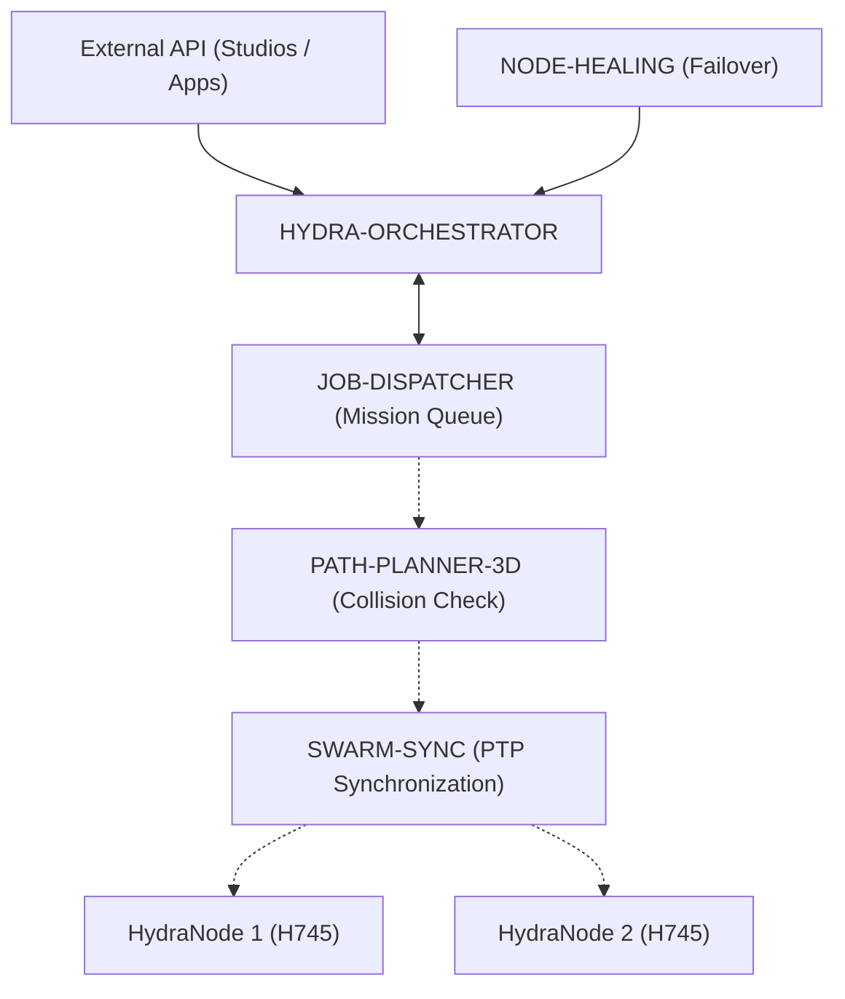

<!-- =============================================================================
HYDRA-UMC-ORCHESTRATOR - Mission coordinator
Copyright (C) JuanenRac (Electro Hobby 3D) <electrohobby3d@gmail.com>
GPL-3.0-or-later - see LICENSE
============================================================================= -->

<p align="center">
  
</p>

# 🕸️ HYDRA-UMC-ORCHESTRATOR

<p align="center"><a href="README.md">🇺🇸 English</a> | <a href="README_spa.md">🇪🇸 Español</a> | <a href="README_fra.md">🇫🇷 Français</a> | <a href="README_ita.md">🇮🇹 Italiano</a> | <a href="README_deu.md">🇩🇪 Deutsch</a> | <a href="README_zho.md">🇨🇳 简体中文</a> | <a href="README_jpn.md">🇯🇵 日本語</a> | 🇵🇹 <b>Português</b></p>

### 🤖 Gestor distribuído de enxame e coordenador multinó

<p align="center">
  
  
  
  
  
  
  
</p>

---

**Verificação de honestidade - o que realmente funciona hoje:** a máquina de estados das missões (`src/mission.rs`: `Mission`/`MissionRegistry`, cada transição `Pending -> Dispatched -> InProgress -> Completed`/`Cancelled`/`Failed`, cancelamento idempotente, recuperação perante a falha de um nó), a sua própria persistência em disco (`MissionRegistry::load`/`persist`, `data/missions.json`), a caixa de saída durável de fechos remotos pendentes (`src/outbox.rs`), o cliente HTTP real do HYDRA-UMC-JOB-DISPATCHER (`src/job_dispatcher.rs`) e o servidor JSON/HTTP simples que expõe tudo isso (`src/server.rs`, `tiny_http`, sem runtime assíncrono) são reais e testados (144 testes, `cargo test`). O subcomando de CLI `mission-demo` executa um cenário real de ponta a ponta sobre esse mesmo `MissionRegistry` - não é uma simulação. O que continua a ser aspiracional: as «camadas internas planeadas» da secção 3 (camada de API, despacho sincronizado por PTP, agregação de saúde da frota como serviço permanente) descrevem a intenção de design, não código que já exista; não há ligação gRPC deste repositório a um processo JOB-DISPATCHER ou NODE-HEALING em execução, nem integração com PATH-PLANNER-3D/SWARM-SYNC, e nunca correu nenhuma frota multinó real contra este binário - o `docker-compose.yml` compila e arranca em conjunto os 3 serviços irmãos, mas isso não foi exercitado contra hardware de robôs real. Consulte o `CHANGELOG.md` para saber exatamente o que já foi entregue e o ROTEIRO abaixo para o que fica em aberto.

---

> **Estado de segurança (safety e security):** este ecossistema não é um sistema de segurança certificado. Ainda não existe um caminho de E-STOP por hardware, nem limites ou interlocks impostos pelo firmware, nem um comando de movimento verificado; as imagens de firmware são verificadas com CRC-32 e uma assinatura Ed25519, e uma compilação de versão recusa as chaves de desenvolvimento publicadas (as cabeças de ferramenta e as placas de expansão atrás do relé ainda usam os bootloaders do URTC, que aceitam um HMAC-SHA256 de chave partilhada em vez de uma assinatura); TLS e TLS mútuo são opcionais e estão desativados por defeito; nenhuma placa própria foi ainda montada ou testada. Leia a [base de segurança](https://github.com/JuanenRac/HYDRA-UMC-DOCS/blob/main/docs/SECURITY_BASELINE.md) e o [modelo de ameaças](https://github.com/JuanenRac/HYDRA-UMC-DOCS/blob/main/docs/THREAT_MODEL.md) antes de confiar em qualquer afirmação aqui para a segurança de uma pessoa.

---

## 📋 Num relance

| | |
|---|---|
| Versão | `0.2.0` |
| Maturidade | Funcional |
| Testes | 144 (`cargo test`) |
| Tecnologia | Rust / tiny_http / ureq / JSON/HTTP |
| Destino | O Raspberry Pi CM5 de uma célula HYDRA-UMC |
| Em hardware real | Ainda não: não há registo de execução em hardware real para esta versão |

**Ir para:** [Visão geral](#-visão-geral) · [Arquitetura](#-arquitetura) · [Início rápido](#-início-rápido) · [Testes](#-testes) · [Estrutura do repositório](#-estrutura-do-repositório) · [Projetos relacionados](#-projetos-relacionados)

## 🚦 Estado do projeto

Cada linha é uma parte deste repositório e a luz diz até onde chega hoje. É escrita com o que o repositório consegue demonstrar (testes, compilações, execuções), não com o que está previsto.

🟢 Feito e verificado · 🟡 Funciona, com limites conhecidos · 🟠 Feito a meio ou ainda por verificar · 🔴 Por fazer ou a não funcionar

| Área | Estado | O que significa aqui |
|---|---|---|
| Software | 🟡 | Funciona para o seu propósito principal; a verificação de honestidade acima lista o que ainda falta |
| Testes | 🟢 | 144 testes automáticos, executados a cada alteração |
| Hardware real | 🔴 | Ainda não: não há registo de execução em hardware real para esta versão |
| Documentação | 🟢 | README em oito idiomas, verificado contra o manifesto a cada alteração |

## 🎯 Visão geral

O **HYDRA-UMC-ORCHESTRATOR** é a camada de coordenação de alto nível do ecossistema HYDRA-UMC. Destina-se a gerir vários HydraNodes (cérebros cinemáticos, nós de visão e nós cognitivos) como um único enxame unificado.

Previsto: planeamento global de missões, equilíbrio de carga na frota e sincronização em tempo real entre robôs para evitar colisões físicas. Hoje acompanha as missões com uma máquina de estados e entrega-as ao JOB-DISPATCHER; não sincroniza robôs, não evita colisões nem garante qualquer precisão.

### Funcionalidades principais:
* 🧭 **Um só dono da atribuição:** com `--job-dispatcher-url` configurado, o JOB-DISPATCHER decide que robô recebe uma missão e este orquestrador é dono da própria missão (ciclo de vida, encerramento e recuperação). `POST /missions/:id/dispatch` (um nó escolhido à mão) é então recusado com 409 e remete para `POST /missions/:id/auto-dispatch`; sem job-dispatcher o dispatch manual funciona como antes. *(implementado)*
* 📜 **Um contrato escrito com o job-dispatcher, verificado com os dois processos reais:** `docs/JOB_DISPATCHER_CONTRACT.md` diz quem é dono de quê (o dispatcher, da atribuição do trabalho aos robôs; este orquestrador, da missão: o seu ciclo de vida, o fecho e a recuperação) e o que cada parte promete à outra, passo a passo. `tools/verify_dispatcher_contract.py` arranca o dispatcher real (Go, do seu checkout irmão) e o orquestrador real e faz passar missões por eles: uma missão é um trabalho pendente, uma atribuição manual é recusada, o dispatcher escolhe o robô, concluir e falhar fecham o trabalho, e recuperar um nó tira-lhe o trabalho e bloqueia um relatório tardio da tentativa perdida. É ignorado (saída 0) se faltar o Go, o dispatcher ou o orquestrador compilado. *(implementado, 23 verificações)*
* 🕸️ **Coordenação de enxame:** orquestra mais de 32 braços robóticos independentes em vários controladores. *(planeado)*
* ⚖️ **Equilíbrio de carga:** atribui automaticamente as missões ao robô mais disponível ou mais bem equipado.
* 🛡️ **Segurança centralizada:** gestão global de E-STOP e monitorização da saúde de toda a frota. *(planeado)*
* 📡 **API unificada:** oferece um único ponto de entrada para as Apps e os Studios interagirem com toda a fábrica. *(planeado)*
* 🧩 **v0 real - máquina de estados de missões:** o `mission.rs` acompanha cada missão por `Pending -> Dispatched -> InProgress -> Completed` (mais os estados terminais `Cancelled`/`Failed`), com cancelamento idempotente e recuperação real quando um nó é reportado como inalcançável/inválido - ver `mission-demo` abaixo. Lógica pura em memória - não precisa de um par gRPC JOB-DISPATCHER/NODE-HEALING em execução para correr ou ser testada.
* 🧱 **Seguro por defeito, e um relatório tardio não pode desfazer uma passagem de testemunho (v0):** a API escuta em `127.0.0.1:8114` salvo indicação em contrário; outro endereço exige um token bearer (`--token` / `ORCHESTRATOR_TOKEN`; então todas as rotas exceto `GET /health` o pedem) ou um `--allow-anonymous` explícito, e os corpos de pedido com mais de 64 KB são recusados com `413`. Cada despacho sobe o `attempt` da missão; um `start`/`complete`/`fail` com um `attempt` caducado (ou com o nome de um nó que já não tem a missão) é recusado com `409` sem tocar na missão, pelo que um nó declarado indisponível que regressa de uma partição de rede não pode pisar o nó a quem a missão foi passada (`--require-attempt` torna o campo obrigatório). O registo de missões e a caixa de saída são forçados para o disco antes de substituírem o ficheiro anterior, a unidade systemd incluída dá agora ao processo uma diretoria de estado gravável (antes, `ProtectSystem=strict` deixava a diretoria `data` por defeito só de leitura e nada sobrevivia a um reinício) e o `docker-compose.yml` arranca agora serviços a sério (comandos `serve`, verificações de saúde, tokens obrigatórios, imagens fixadas, e só o orquestrador publicado e só no loopback do anfitrião). *(implementado)*
* 🔭 **Operação legível (opcional):** o `GET /stats` mostra também a idade do fecho por confirmar mais antigo (`oldestPendingCloseAgeSeconds`) e o último sucesso e a última falha das chamadas ao JOB-DISPATCHER; `--log-format json` escreve um objeto JSON por linha de registo; `--keep-finished N` esquece as missões terminadas mais antigas cujo fecho foi confirmado, para que o `missions.json` não cresça sem fim; o ficheiro traz um `schema_version` e um escrito por uma versão mais recente é recusado; um fecho diz ao JOB-DISPATCHER que tentativa está a fechar. Tudo desligado ou sem alterações por defeito. *(implementado)*

## 🧩 Papel no HYDRA-UMC

O **HYDRA-UMC-ORCHESTRATOR** é o coordenador de missões: um serviço em Rust que acompanha as missões numa máquina de estados, entrega-as ao `HYDRA-UMC-JOB-DISPATCHER` e retoma-as quando o `HYDRA-UMC-NODE-HEALING` indica que um nó está inalcançável. Não sincroniza robôs nem evita colisões.

## 🏛️ Arquitetura

<p align="center">
  
</p>

<details>
<summary>Versão em texto do diagrama (Mermaid)</summary>



</details>

### ARQUITETURA DE ORQUESTRAÇÃO

> As setas contínuas existem hoje (a API HTTP, o JOB-DISPATCHER e o NODE-HEALING a chamar `POST /nodes/:node/recover`). As setas a tracejado estão planeadas, não implementadas: nenhum código chama o PATH-PLANNER-3D nem o SWARM-SYNC.

### ARQUITETURA E DECISÕES DE DESIGN

> As camadas internas abaixo são o design planeado para a lógica que ficará
> por trás deste ponto de entrada - consulte «🔧 COMPILAÇÃO E EXECUÇÃO» mais
> adiante para ver o que realmente funciona hoje: uma máquina de estados de
> missões real, pura e em memória (`mission.rs`), ainda sem qualquer par de
> rede em direto com quem falar.

**Camadas internas planeadas**, a construir de forma incremental sobre a
máquina de estados real que já existe:
* **Camada de API** — recebe pedidos de missão de alto nível dos Studios/Apps
  e traduz-os em ações ao nível da frota.
* **Integração da fila de missões** — real agora, não planeada: entrega as
  missões aceites ao JOB-DISPATCHER sobre o mesmo transporte HTTP/JSON real
  que o próprio `server.rs` usa (`submit_job`/`close_job`/`requeue_job`/
  `run_dispatch` do `src/job_dispatcher.rs`, ligados a todos os handlers
  reais do ciclo de vida das missões), e acompanha o seu ciclo de vida na
  frota com a máquina de estados real `Mission`/`MissionRegistry` do
  `mission.rs`, durável perante um reinício real do processo (`--data-dir`,
  por defeito `data/missions.json` - uma missão recarregada a meio do voo
  passa a `Unknown` e é recolocada em `Pending`, nunca dada em silêncio como
  concluída). Esta camada nunca usou gRPC e nunca esteve planeada para usar -
  o contrato `HealthService` partilhado de `proto/hydra_common.proto` é uma
  questão à parte (a sonda real de saúde da frota do próprio
  HYDRA-UMC-NODE-HEALING), não a entrega deste repositório ao JOB-DISPATCHER.
* **Despacho sincronizado por PTP** — coordena os tempos com o SWARM-SYNC para
  que vários robôs que executam a mesma missão não colidam, segundo as
  verificações do PATH-PLANNER-3D.
* **Agregação de saúde da frota** — consome os sinais por nó do NODE-HEALING
  numa única vista de toda a frota e chama
  `MissionRegistry::recover_node_unavailable()` (já real) à medida que cada
  sinal chega; este é também o caminho que um E-STOP global percorreria para
  chegar a todos os nós de uma só vez.

### Porquê Rust para este serviço em concreto
Este processo é o que tem mais autoridade sobre a frota: é o que emitiria um
E-STOP global e arbitraria qual robô recebe qual missão. Esse papel exige
coordenação determinista e de baixa latência — sem pausas de coletor de lixo
que possam atrasar uma paragem crítica para a segurança — e segurança de
memória/tipos em tempo de compilação, pois uma falha ou uma corrida de dados
aqui não fica local: pode deixar todo o enxame sem o seu coordenador a meio
de uma missão. Dois dos filhos deste orquestrador (JOB-DISPATCHER,
NODE-HEALING) usam Go, que serve bem os seus trabalhos mais simples e mais
isolados; não é o compromisso de que este processo «cérebro» precisa.

### Decisões de design
* **Único processo com um `docker-compose.yml` de toda a família.** Como pai
  de integração do SWARM-SYNC, PATH-PLANNER-3D, JOB-DISPATCHER e
  NODE-HEALING, este repositório é o lugar natural para descrever como toda a
  família corre em conjunto — o repositório de cada filho continua focado em
  si mesmo.
* **Expõe uma «API unificada» para Apps/Studios.** Em vez de cada cliente
  (apps móveis, Studios de secretária) falar diretamente com 4 serviços filhos
  separados, todos falam com um único ponto de entrada estável aqui, que fica
  livre de encaminhar para a implementação de filho que mudar por baixo.
* **Porque é que o `cancel()` é idempotente em vez de dar erro numa missão já cancelada.** Um pedido de cancelamento pode legitimamente chegar duas vezes - um cliente que repete após uma resposta perdida, um operador que volta a clicar em cancelar antes de ver a confirmação. Tratar a segunda chamada como um sucesso (`AlreadyCancelled`, não um erro) significa que quem chama nunca tem de distinguir «o meu cancelamento funcionou» de «o cancelamento de outra pessoa já funcionou» - ambos são o mesmo bom resultado. Cancelar uma missão `Completed`/`Failed` continua a ser recusado: é uma situação genuinamente diferente e não idempotente (desfazer trabalho concluído), não uma repetição.
* **Porque é que a recuperação perante a falha de um nó recoloca em `Pending` em vez de falhar a missão logo.** Um nó que reporta `UNREACHABLE` pode estar a meio de um reinício em vez de ter desaparecido para sempre (ver a lógica de repetição limitada do próprio `HYDRA-UMC-NODE-HEALING`, que já absorve as falhas de rede transitórias antes de sequer reportar um nó como em baixo) - por isso uma missão apanhada nesse nó recebe uma nova oportunidade noutro nó através de `Pending`, em vez de ser marcada como `Failed` ao primeiro sinal de problemas. O `fail()` continua a existir para quando o redespacho realmente fica sem opções.

Para todos os exemplos reais de `mission-demo`/CLI (capturados de um binário realmente compilado), consulte o [`docs/CLI_REFERENCE.md`](docs/CLI_REFERENCE.md). Para o próprio contrato gRPC `hydra.common.v1` partilhado - o que define, porque vive neste repositório e como cada linguagem gera os seus próprios bindings a partir dele - consulte o [`proto/README.md`](proto/README.md).

**Missões a partir de uma Operation.** `POST /missions` aceita também a Operation comum do SDK (um corpo com `operation_id`), que é o que o planeador semântico entrega: o id da operação é o id da missão, e a `priority`, o `required_tool`, a `location` e o `depends_on` dos seus `params` são os do trabalho. Só é aceite uma operação no estado `received`, e enviar de novo a mesma operação dá a mesma missão.

## 🚀 Início rápido

Requer a cadeia de ferramentas Rust estável (edição 2021) com `cargo`.

```bash
./build.sh             # Linux, macOS (build.bat on Windows)
./run.sh mission-demo  # a real scenario of the mission state machine
cargo test
```

## 🧪 Testes

144 testes automáticos correm com `cargo test`. Não precisam de hardware nem de nada fora desta máquina.

A CI executa `HYDRA_UMC_CI=1 python tools/ci_validate.py`, que verifica o manifesto, os documentos, os oito README e as imagens.

## 🏗️ Compilação e publicação

A invocação sem argumentos continua a ser um esqueleto mínimo (imprime a identidade e termina com 0); a máquina de estados real das missões já se pode exercitar hoje com `mission-demo`.

```bash
# Windows
build.bat
run.bat
run.bat mission-demo

# Linux / macOS
./build.sh
./run.sh
./run.sh mission-demo
```

`build.sh`/`build.bat` nunca altera a versão (só `python tools/hydra_project_tool.py bump` a sobe) e depois executa `cargo build --release`. O `run.sh`/`run.bat` executa diretamente o binário resultante.

O `mission-demo` executa um cenário real de ponta a ponta sobre o `MissionRegistry` do `mission.rs` e imprime cada transição real:

```text
[orchestrator] mission-1: dispatched -> InProgress(node=node-a)
[orchestrator] mission-2: dispatched -> Dispatched(node=node-a)
[orchestrator] mission-3: dispatched -> InProgress(node=node-b)
[orchestrator] node-a reported UNREACHABLE by NODE-HEALING - recovering its missions
[orchestrator] mission-1: requeued -> Pending
[orchestrator] mission-2: requeued -> Pending
[orchestrator] mission-3: unaffected (different node) -> InProgress(node=node-b)
[orchestrator] mission-2: cancel() -> Cancelled -> Cancelled
[orchestrator] mission-2: cancel() again (idempotent) -> AlreadyCancelled -> Cancelled
[orchestrator] mission-3: complete() -> Completed(node=node-b)
[orchestrator] mission-4: fail() -> Failed(no healthy node accepted redispatch after 3 attempts)
[orchestrator] final registry state:
  mission-1: Pending (terminal=false)
  mission-2: Cancelled (terminal=true)
  mission-3: Completed(node=node-b) (terminal=true)
  mission-4: Failed(no healthy node accepted redispatch after 3 attempts) (terminal=true)
```

```bash
cargo test   # 144 testes: as transições/rejeições de transição inválida/
             # cancelamento idempotente/recuperação perante a falha de um nó
             # do mission.rs, mais a persistência à prova de falhas do
             # outbox.rs, o cliente HTTP real do job_dispatcher.rs e os
             # handlers HTTP do server.rs
```

Como projeto pai de integração do ecossistema, este repositório inclui também um `docker-compose.yml` real que compila e executa este serviço juntamente com os seus 3 filhos (SWARM-SYNC, JOB-DISPATCHER, NODE-HEALING; PATH-PLANNER-3D, uma ferramenta de linha de comandos, fica atrás do perfil `tools`), esperados como pastas irmãs:

```bash
docker compose up --build
```

## 📂 Estrutura do repositório

<p align="center">
  
</p>

<details>
<summary>Versão em texto da árvore</summary>

```text
HYDRA-UMC-ORCHESTRATOR/
├── tools/                              código-fonte
│   ├── build_test.py                   Verificação de compilação sem alterar versões
│   ├── ci_validate.py                  Validação de manifesto/CHANGELOG/docs usada pelo CI
│   ├── verify_dispatcher_contract.py   Corre o job-dispatcher real e o orquestrador real um contra o outro e verifica o contrato
│   ├── verify_compose.py               Verificações estáticas do docker-compose.yml (comandos, imagens fixadas, portas em loopback, tokens obrigatórios)
│   ├── _doc_policy.py                  Regras de documentação partilhadas pela família (cópia da de HYDRA-UMC-SDK, mantida em sincronia)
│   ├── _readme_parity.py               Verificação de que os oito README partilham a mesma estrutura (cópia da de HYDRA-UMC-SDK, mantida em sincronia)
│   └── hydra_project_tool.py           Os mesmos comandos em todos os repositórios: validate, test, ci, version, status, bump
├── src/                                código-fonte
├── proto/                              Contrato gRPC partilhado para o tráfego nó a nó
├── docs/                               Documentação e guias de arquitetura
├── images/                             Multimédia e diagramas
├── systemd/                            unidade de serviço
├── .github/                            fluxo de CI e modelos de problemas
├── Cargo.toml                          Manifesto do pacote Rust (nome, versão, dependências)
├── bump_version.py                     Subida de versão ao estilo conta-quilómetros (executada só pelo comando `bump` explícito)
├── bump_manifest_version.py            Sincroniza a versão do hydra-umc.project.json com a nativa (--sync)
├── docker-compose.yml                  Integra este repositório com os seus 3 filhos reais
├── nodes.compose.json                  Registo de nós que o NODE-HEALING usa dentro da stack compose
├── .env.example                        Tokens que a stack compose exige (copiar para .env)
├── CHANGELOG.md                        o que mudou em cada versão
├── build-test.sh                       verificação de compilação sem alterações
├── build.sh                            compila e verifica; nunca muda a versão
├── hydra-umc.project.json              manifesto: versão, maturidade, família
├── run.sh                              arranca o programa
└── test.sh                             executa os testes
```

</details>

## 🗺️ Roteiro e limites conhecidos

**Limites conhecidos hoje**

* **Fase 1:** Sincronização determinista do enxame sobre TSN e redução de jitter abaixo do milissegundo.
* **Fase 2:** Planeamento de caminhos 3D com evitação dinâmica de obstáculos em células multirrobô.
* **Fase 3:** Otimização do despacho de trabalhos multirrobô com a disponibilidade de recursos em tempo real.
* **Fase 4:** Implementação de um cluster de failover de alta disponibilidade e suporte a robôs heterogéneos.

## 🌍 Idiomas

Este README e os documentos do repositório existem em oito idiomas: inglês, espanhol, alemão, francês, italiano, japonês, chinês e português (Portugal). São escritos em conjunto e a CI verifica que os oito ficheiros têm as mesmas secções e as mesmas ligações. Este repositório não tem ecrã nem catálogo de mensagens próprios, por isso não há textos de interface para traduzir.

## 🔗 Projetos relacionados

Este projeto faz parte do ecossistema de robótica HYDRA-UMC do mesmo autor (JuanenRac / Electro Hobby 3D). Vale a pena conhecê-los, porque um pedido pode ser, na verdade, sobre um destes e não sobre este repositório.

**Projetos filhos** — cada um é um serviço que este orquestrador coordena ou alimenta diretamente
- **[HYDRA-UMC-SWARM-SYNC](https://github.com/JuanenRac/HYDRA-UMC-SWARM-SYNC)** — sincronização real de estado CRDT LWW-Element-Map, testada por propriedades para a convergência de várias células.
- **[HYDRA-UMC-PATH-PLANNER-3D](https://github.com/JuanenRac/HYDRA-UMC-PATH-PLANNER-3D)** — planeador real de trajetórias 3D baseado em RRT com validação real de colisões com obstáculos e espaço de trabalho.
- **[HYDRA-UMC-JOB-DISPATCHER](https://github.com/JuanenRac/HYDRA-UMC-JOB-DISPATCHER)** — fila real de trabalhos por prioridade com deduplicação, sobre uma API HTTP real.
- **[HYDRA-UMC-NODE-HEALING](https://github.com/JuanenRac/HYDRA-UMC-NODE-HEALING)** — vigilante real de saúde da frota por gRPC com repetição/recuo e deteção de identidade incoerente.

**Diretamente relacionados**
- **[HYDRA-UMC-SERVER](https://github.com/JuanenRac/HYDRA-UMC-SERVER)** — o back-end headless real (REST/WebSocket) com que todos os clientes de controlo realmente comunicam; este orquestrador coordena várias instâncias dele.
- **[HYDRA-UMC-COGNITIVE-NODE](https://github.com/JuanenRac/HYDRA-UMC-COGNITIVE-NODE)** — hub de integração do pipeline cognitivo Hailo-10 (orquestração de LLM/VLA/voz); recebe daqui as ordens ao nível das missões.
- **[HYDRA-UMC-SUITE](https://github.com/JuanenRac/HYDRA-UMC-SUITE)** — centro de comando de enxame de secretária (PySide6) para vários servidores em simultâneo, empacotado como executável autónomo; o centro de comando de enxame que este orquestrador suporta.

**Também fazem parte do ecossistema**

*Hardware e plataforma centrais*
- **[HYDRA-UMC](https://github.com/JuanenRac/HYDRA-UMC)** — o desenho da placa-mãe do braço robótico: anfitrião CM5 + STM32H745 de dois núcleos, pensado para orquestrar até 8 braços de ferramenta por CAN-OTA/SPI-OTA (firmware numa fase inicial; ainda sem placa montada).
- **[HYDRA-UMC-OS](https://github.com/JuanenRac/HYDRA-UMC-OS)** — camada de produto reproduzível do Raspberry Pi OS para o CM5: agente só de leitura, configuração/perfis validados, aprovisionamento Wi-Fi de primeiro contacto.
- **[HYDRA-UMC-SDK](https://github.com/JuanenRac/HYDRA-UMC-SDK)** — o contrato JSON-Schema partilhado e a fronteira de software de controlo de trabalhos contra a qual cada bridge valida os seus comandos (não é uma função de segurança certificada).
- **[HYDRA-UMC-CONNECTOR-HUB](https://github.com/JuanenRac/HYDRA-UMC-CONNECTOR-HUB)** — registo declarativo de manifestos de adaptador e validador para conectores de máquinas externas; estende a ideia de contrato do SDK a máquinas externas sem substituir os projetos de gateway industrial.

*Backend central e clientes*
- **[HYDRA-UMC-STUDIO](https://github.com/JuanenRac/HYDRA-UMC-STUDIO)** — painel web de controlo com visualização 3D em tempo real de vários robôs.
- **[HYDRA-UMC-ANDROID-CONTROL](https://github.com/JuanenRac/HYDRA-UMC-ANDROID-CONTROL)** — aplicação Android nativa de controlo, com início de sessão biométrico e um companheiro Wear OS emparelhado.
- **[HYDRA-UMC-IOS-CONTROL](https://github.com/JuanenRac/HYDRA-UMC-IOS-CONTROL)** — aplicação de controlo para iOS/iPadOS (Flutter) com sincronização WebSocket em tempo real.
- **[HYDRA-UMC-DSI](https://github.com/JuanenRac/HYDRA-UMC-DSI)** — interface tátil nativa para o ecrã tátil DSI de 7" integrado, executada no próprio CM5.
- **[HYDRA-UMC-EDITOR-URDF](https://github.com/JuanenRac/HYDRA-UMC-EDITOR-URDF)** — criador/editor gráfico de URDF para desktop que envia os modelos concluídos para o catálogo do STUDIO.
- **[HYDRA-UMC-EDITOR-STL](https://github.com/JuanenRac/HYDRA-UMC-EDITOR-STL)** — editor de modelos STL para desktop que transforma/substitui/remove/adiciona peças reais no mesmo catálogo de modelos que o HYDRA-UMC-EDITOR-URDF também edita.
- **[HYDRA-UMC-BRIDGE-AMR](https://github.com/JuanenRac/HYDRA-UMC-BRIDGE-AMR)** — fronteira de coordenação para frotas AGV/AMR através de um publicador MQTT VDA 5050 (testado apenas contra uma frota emulada).
- **[HYDRA-UMC-BRIDGE-CNC](https://github.com/JuanenRac/HYDRA-UMC-BRIDGE-CNC)** — coordenador de células CNC de alto nível com acesso ao estado GRBL e aos bytes de controlo (testado apenas contra um emulador).
- **[HYDRA-UMC-BRIDGE-DROIDS](https://github.com/JuanenRac/HYDRA-UMC-BRIDGE-DROIDS)** — fronteira de coordenação para droides com patas/humanoides, com um emissor de comandos para o Boston Dynamics Spot (testado apenas contra um emulador).
- **[HYDRA-UMC-BRIDGE-LASER](https://github.com/JuanenRac/HYDRA-UMC-BRIDGE-LASER)** — coordenador de células laser que lê 3 sinais GPIO (chave, caixa e interlock) (testado apenas contra um chip simulado; não pode armar nem disparar um laser).
- **[HYDRA-UMC-BRIDGE-OPENPNP](https://github.com/JuanenRac/HYDRA-UMC-BRIDGE-OPENPNP)** — coordenador seguro de fluxo de placa de alto nível para pick-and-place com OpenPnP.
- **[HYDRA-UMC-BRIDGE-PRINTER3D](https://github.com/JuanenRac/HYDRA-UMC-BRIDGE-PRINTER3D)** — fronteira de coordenação segura para impressoras 3D Moonraker/Klipper, com comandos de trabalho reais protegidos por portas.
- **[HYDRA-UMC-BRIDGE-ROS2](https://github.com/JuanenRac/HYDRA-UMC-BRIDGE-ROS2)** — coordenador com um transporte ROS 2 baseado em rclpy importado sob demanda (ainda não executado contra uma instalação ROS 2).
- **[HYDRA-UMC-BRIDGE-UAV](https://github.com/JuanenRac/HYDRA-UMC-BRIDGE-UAV)** — fronteira de coordenação para UAV com câmara, com um emissor de comandos MAVLink (testado apenas contra um emulador).

*Plataforma de ferramentas URTC*
- **[URTC](https://github.com/JuanenRac/URTC)** — firmware da placa física Universal Robot Tool Controller, mais de 25 perfis de ferramenta por barramento CAN.
- **[URTC-FLASHER](https://github.com/JuanenRac/URTC-FLASHER)** — ferramenta gráfica de gravação para desktop das placas URTC, por CAN-OTA e também SWD/JTAG de chip completo.
- **[URTC-TESTER](https://github.com/JuanenRac/URTC-TESTER)** — ferramenta de diagnóstico CAN em tempo real para desktop das placas URTC, com um painel por perfil de ferramenta.
- **[URTC-WEB-STUDIO](https://github.com/JuanenRac/URTC-WEB-STUDIO)** — alternativa no navegador ao URTC-TESTER através da Web Serial API, sem instalação local.
- **[URTC-GATEWAY](https://github.com/JuanenRac/URTC-GATEWAY)** — gateway à frente do barramento CAN do URTC: lista de identificadores permitidos, limite de taxa e chave de sessão; software testado num computador, ainda não num barramento real.

*Nó de IA de visão (Hailo-8)*
- **[HYDRA-UMC-VISION-NODE](https://github.com/JuanenRac/HYDRA-UMC-VISION-NODE)** — centro de integração do pipeline de visão Hailo-8, com uma verificação real de prontidão de hardware por fase.
- **[HYDRA-UMC-DETECTION-HEF](https://github.com/JuanenRac/HYDRA-UMC-DETECTION-HEF)** — registo real de modelos compilados com verificação segura de carga por arquitetura Hailo e soma de verificação.
- **[HYDRA-UMC-VISION-STREAMER](https://github.com/JuanenRac/HYDRA-UMC-VISION-STREAMER)** — pipeline GStreamer real e gerador de configuração MediaMTX com uma fronteira de integração HailoRT real.
- **[HYDRA-UMC-VISUAL-SERVOING-API](https://github.com/JuanenRac/HYDRA-UMC-VISUAL-SERVOING-API)** — lei de correção de servovisão baseada em posição com autorização condicionada ao estado da zona; ainda sem estimativa de pose por câmara.
- **[HYDRA-UMC-SAFETY-ZONES](https://github.com/JuanenRac/HYDRA-UMC-SAFETY-ZONES)** — lógica v0 de violação de zonas, atualidade da calibração e pedido de E-STOP que lê as posições dos objetos de um ficheiro; nenhum detetor a alimenta e ainda não há E-STOP físico ligado.

*Nó de IA cognitiva (Hailo-10)*
- **[HYDRA-UMC-VLA-ENGINE](https://github.com/JuanenRac/HYDRA-UMC-VLA-ENGINE)** — codificação/descodificação real de tokens de ação e geração de trajetórias para um modelo Visão-Linguagem-Ação.
- **[HYDRA-UMC-VOICE-UI](https://github.com/JuanenRac/HYDRA-UMC-VOICE-UI)** — front-end de voz real (VAD + analisador de intenções) com um relé para o relógio limitado e protegido por confirmação.
- **[HYDRA-UMC-SEMANTIC-PLANNER](https://github.com/JuanenRac/HYDRA-UMC-SEMANTIC-PLANNER)** — decomposição real de tarefas baseada em regras e recuperação semântica de erros sobre os códigos de erro do MCU.
- **[HYDRA-UMC-DOCS-QA](https://github.com/JuanenRac/HYDRA-UMC-DOCS-QA)** — pesquisa real de documentos TF-IDF só com a biblioteca padrão sobre a documentação Markdown deste ecossistema.
- **[HYDRA-UMC-LOCAL-TECHNICIAN](https://github.com/JuanenRac/HYDRA-UMC-LOCAL-TECHNICIAN)** — técnico de manutenção de IA local, protegido por políticas, para o próprio ecossistema: observa, diagnostica e propõe correções; os dois níveis de maior risco não estão implementados de propósito.

*Gémeo digital e simulação*
- **[HYDRA-UMC-TWIN](https://github.com/JuanenRac/HYDRA-UMC-TWIN)** — centro de integração do motor de gémeo digital, com um contrato real de sincronização de compatibilidade de versões.
- **[HYDRA-UMC-HIL-BRIDGE](https://github.com/JuanenRac/HYDRA-UMC-HIL-BRIDGE)** — encaminhador hardware-in-the-loop com um interlock de software de colisão entre a simulação e o hardware real (testado sem hardware real).
- **[HYDRA-UMC-PHYSICS-REPLICA](https://github.com/JuanenRac/HYDRA-UMC-PHYSICS-REPLICA)** — cinemática direta real e validação de limites de juntas sobre um subconjunto real de URDF.
- **[HYDRA-UMC-SYNTHETIC-DATA-GEN](https://github.com/JuanenRac/HYDRA-UMC-SYNTHETIC-DATA-GEN)** — gerador procedural real de cenas 2D com exportação de anotações YOLO/COCO.

*Dados e análise*
- **[HYDRA-UMC-DATALAKE](https://github.com/JuanenRac/HYDRA-UMC-DATALAKE)** — armazém real de séries temporais sobre sqlite3 com uma API HTTP real de ingestão/consulta.
- **[HYDRA-UMC-ANOMALY-DETECTOR](https://github.com/JuanenRac/HYDRA-UMC-ANOMALY-DETECTOR)** — detetor real de anomalias por FFT e linha de base estatística, com monitorização de deriva.
- **[HYDRA-UMC-PRODUCTION-REPORTS](https://github.com/JuanenRac/HYDRA-UMC-PRODUCTION-REPORTS)** — cálculo real de OEE/disponibilidade sobre o histórico do DATALAKE, com exportação CSV reprodutível.
- **[HYDRA-UMC-TELEMETRY-COLLECTOR](https://github.com/JuanenRac/HYDRA-UMC-TELEMETRY-COLLECTOR)** — pipeline real de ingestão CAN/WebSocket para o DATALAKE, com deduplicação por sequência.

*Gateway industrial*
- **[HYDRA-UMC-GATEWAY-INDUSTRIAL](https://github.com/JuanenRac/HYDRA-UMC-GATEWAY-INDUSTRIAL)** — centro de integração que retransmite para protocolos industriais, com uma camada real de lista de comandos permitidos e contrapressão.
- **[HYDRA-UMC-OPCUA-SERVER](https://github.com/JuanenRac/HYDRA-UMC-OPCUA-SERVER)** — espaço de endereços OPC-UA real, verificado com uma sessão de cliente real do protocolo binário.
- **[HYDRA-UMC-MQTT-BROKER](https://github.com/JuanenRac/HYDRA-UMC-MQTT-BROKER)** — broker MQTT real com autenticação opcional por cliente e ACL de tópicos.
- **[HYDRA-UMC-MTCONNECT-ADAPTER](https://github.com/JuanenRac/HYDRA-UMC-MTCONNECT-ADAPTER)** — endpoints XML MTConnect `/probe` e `/current` reais com saída em modo degradado.

*Ferramentas complementares e operações do ecossistema*
- **[HYDRA-UMC-DASHBOARD-AI](https://github.com/JuanenRac/HYDRA-UMC-DASHBOARD-AI)** — painéis de Resumos Inteligentes e Realce de Anomalias sobre o DATALAKE/ANOMALY-DETECTOR, com um recurso estatístico honesto.
- **[HYDRA-UMC-TOOL-CLI](https://github.com/JuanenRac/HYDRA-UMC-TOOL-CLI)** — CLI da frota com um contrato de códigos de saída real e estável, um cliente vivo genuíno da API do HYDRA-UMC-SERVER.
- **[HYDRA-UMC-WATCH](https://github.com/JuanenRac/HYDRA-UMC-WATCH)** — aplicação companheira WearOS com padrões de alerta tátil e um relé de voz para o telemóvel emparelhado (ainda não executada num relógio físico).
- **[URTC-SMART-RACK](https://github.com/JuanenRac/URTC-SMART-RACK)** — firmware de um rack de montagem de placas com descodificação real do ID da ferramenta e lógica de pré-aquecimento Smart Idle.
- **[URTC-VISION-TOOL](https://github.com/JuanenRac/URTC-VISION-TOOL)** — firmware mais um companheiro de visão em Python real para uma cabeça de ferramenta de inspeção térmica/RGB.
- **[HYDRA-UMC-UPDATER](https://github.com/JuanenRac/HYDRA-UMC-UPDATER)** — ferramenta administrativa de desktop que descobre, clona e atualiza todos os repositórios deste ecossistema.
- **[HYDRA-UMC-OS-REBUILDER](https://github.com/JuanenRac/HYDRA-UMC-OS-REBUILDER)** — ferramenta de desktop para Windows/Linux que constrói uma imagem do CM5 pronta a gravar com as versões mais recentes do ecossistema, com configuração de primeiro arranque de Wi-Fi/utilizador/SSH ao estilo do Raspberry Pi Imager.
- **[HYDRA-UMC-OPS-AGENT](https://github.com/JuanenRac/HYDRA-UMC-OPS-AGENT)** — coordenador de incidentes de manutenção: um papel de borda de poucos privilégios recolhe um inventário/estado higienizado, um papel de plano de controlo mostra-o só de leitura e pede a um fornecedor de IA que sugira um diagnóstico; nunca aplica um patch nem implanta nada.
- **[HYDRA-UMC-DEV-SERVER](https://github.com/JuanenRac/HYDRA-UMC-DEV-SERVER)** — anfitrião de desenvolvimento reproduzível (Raspberry Pi 5 / CM5) que guarda o código-fonte do ecossistema e executa tarefas limitadas de compilação/teste numa fila durável; um papel de desenvolvimento dedicado, explicitamente não um CM5 operacional.

## 📚 Documentação

Onde ler mais:

* [Base de segurança do ecossistema](https://github.com/JuanenRac/HYDRA-UMC-DOCS/blob/main/docs/SECURITY_BASELINE.md)
* [Modelo de ameaças do ecossistema](https://github.com/JuanenRac/HYDRA-UMC-DOCS/blob/main/docs/THREAT_MODEL.md)
* [Registo de alterações deste repositório](CHANGELOG.md)
* [Licença deste repositório](LICENSE.md)

## 🤝 Contribuir e comunidade

* Antes de um pull request execute `HYDRA_UMC_CI=1 py -3 tools/ci_validate.py` (ou `HYDRA_UMC_CI=1 python3 tools/ci_validate.py`): tem de imprimir `CI_VALIDATION=PASS`. Não execute `build.sh` nem `build.bat` para esta verificação; compilar não é verificar.
* Os oito README são escritos a partir de uma única fonte em HYDRA-UMC-DOCS; não os edite à mão. Altere a fonte e escreva-os de novo com `tools/make_readmes.py`.
* Não afirme num README o que não foi executado: diga «simulado» ou «não testado em hardware» quando for a verdade.
* Consulte [CONTRIBUTING.md](CONTRIBUTING.md), o [código de conduta](CODE_OF_CONDUCT.md), [SECURITY.md](SECURITY.md) e [SUPPORT.md](SUPPORT.md).

## 👤 AUTOR

**JuanenRac (Electro Hobby 3D)** · electrohobby3d@gmail.com

## 📜 LICENÇA

GPL-3.0-or-later - [LICENSE](LICENSE).
