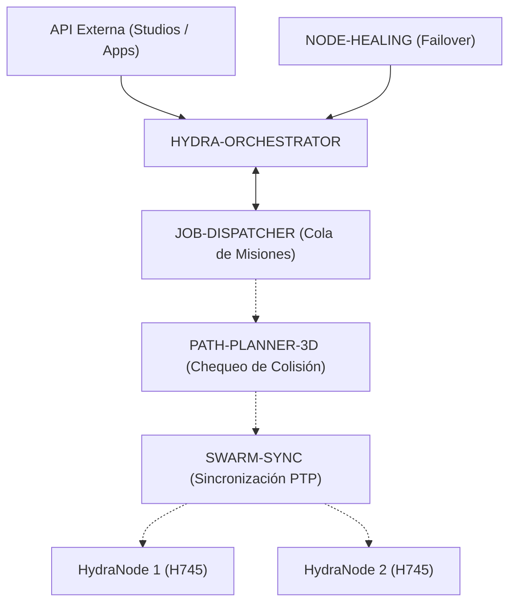

<!-- =============================================================================
HYDRA-UMC-ORCHESTRATOR - Mission coordinator
Copyright (C) JuanenRac (Electro Hobby 3D) <electrohobby3d@gmail.com>
GPL-3.0-or-later - see LICENSE
============================================================================= -->

<p align="center">
  
</p>

# 🕸️ HYDRA-UMC-ORCHESTRATOR

<p align="center"><a href="README.md">🇺🇸 English</a> | 🇪🇸 <b>Español</b> | <a href="README_fra.md">🇫🇷 Français</a> | <a href="README_ita.md">🇮🇹 Italiano</a> | <a href="README_deu.md">🇩🇪 Deutsch</a> | <a href="README_zho.md">🇨🇳 简体中文</a> | <a href="README_jpn.md">🇯🇵 日本語</a> | <a href="README_por.md">🇵🇹 Português</a></p>

### 🤖 Gestor de Enjambres Distribuido y Orquestador Multi-Nodo

<p align="center">
  
  
  
  
  
  
  
</p>

---

**Verificación de honestidad - qué funciona de verdad hoy:** la máquina de estados de misiones (`src/mission.rs`: `Mission`/`MissionRegistry`, cada transición `Pending -> Dispatched -> InProgress -> Completed`/`Cancelled`/`Failed`, cancelación idempotente, recuperación ante fallo de nodo), su propia persistencia en disco (`MissionRegistry::load`/`persist`, `data/missions.json`), el outbox duradero de cierres remotos pendientes (`src/outbox.rs`), el cliente HTTP real hacia HYDRA-UMC-JOB-DISPATCHER (`src/job_dispatcher.rs`) y el servidor JSON/HTTP plano que expone todo esto (`src/server.rs`, `tiny_http`, sin runtime async) son reales y están probados (144 tests, `cargo test`). El subcomando de CLI `mission-demo` ejecuta un escenario real de principio a fin contra ese mismo `MissionRegistry` - no es un mock. Lo que sigue siendo aspiracional: las "capas internas planeadas" de la sección 3 más abajo (capa de API, despacho sincronizado por PTP, agregación de salud de la flota como servicio permanente) describen intención de diseño, no código que ya exista; no hay cableado gRPC de este repo hacia un JOB-DISPATCHER o NODE-HEALING real en ejecución, no hay integración con PATH-PLANNER-3D/SWARM-SYNC, y nunca se ha ejecutado una flota multi-nodo real contra este binario - `docker-compose.yml` construye y arranca los 3 servicios hermanos juntos, pero eso no se ha probado contra hardware real de robots. Ver `CHANGELOG.md` para lo que ya se ha entregado exactamente, y el ROADMAP más abajo para lo que sigue abierto.

---

> **Estado de seguridad física y de ciberseguridad:** este ecosistema no es un sistema de seguridad certificado. Todavía no existe una ruta de E-STOP por hardware, ni límites ni enclavamientos aplicados por el firmware, ni un comando de movimiento verificado; las imágenes de firmware se comprueban con CRC-32 y una firma Ed25519, y una compilación de versión rechaza las claves de desarrollo publicadas (los cabezales de herramienta y las placas de expansión detrás del relé siguen con cargadores de URTC, que usan un HMAC-SHA256 de clave compartida en lugar de una firma); TLS y TLS mutuo son opcionales y están desactivados por defecto; aún no se ha poblado ni probado ninguna placa propia. Lee la [línea base de seguridad](https://github.com/JuanenRac/HYDRA-UMC-DOCS/blob/main/docs/SECURITY_BASELINE.md) y el [modelo de amenazas](https://github.com/JuanenRac/HYDRA-UMC-DOCS/blob/main/docs/THREAT_MODEL.md) antes de fiarte de cualquier afirmación de aquí para la seguridad de una persona.

---

## 📋 De un vistazo

| | |
|---|---|
| Versión | `0.2.0` |
| Madurez | Funcional |
| Tests | 144 (`cargo test`) |
| Tecnología | Rust / tiny_http / ureq / JSON/HTTP |
| Destino | La Raspberry Pi CM5 de una celda HYDRA-UMC |
| En hardware real | Todavía no: no consta ninguna ejecución en hardware real para esta versión |

**Ir a:** [Resumen](#-resumen) · [Arquitectura](#-arquitectura) · [Inicio rápido](#-inicio-rápido) · [Pruebas](#-pruebas) · [Estructura del repositorio](#-estructura-del-repositorio) · [Proyectos relacionados](#-proyectos-relacionados)

## 🚦 Estado del proyecto

Cada línea es una parte de este repositorio y la luz dice hasta dónde llega hoy. Se escribe con lo que el repositorio puede demostrar (pruebas, compilaciones, ejecuciones), no con lo previsto.

🟢 Hecho y verificado · 🟡 Funciona, con límites conocidos · 🟠 Hecho a medias o sin verificar · 🔴 Sin hacer o sin funcionar

| Área | Estado | Qué significa aquí |
|---|---|---|
| Software | 🟡 | Funciona para su propósito principal; la comprobación de honestidad de arriba lista lo que aún falta |
| Pruebas | 🟢 | 144 pruebas automáticas, ejecutadas en cada cambio |
| Hardware real | 🔴 | Todavía no: no consta ninguna ejecución en hardware real para esta versión |
| Documentación | 🟢 | README en ocho idiomas, comprobado contra el manifiesto en cada cambio |

## 🎯 Resumen

**HYDRA-UMC-ORCHESTRATOR** es la capa de coordinación de alto nivel del ecosistema HYDRA-UMC. Está pensado para gestionar múltiples HydraNodes (Kinematic Brains, Vision Nodes y Cognitive Nodes) como un enjambre único y unificado.

Previsto: planificación global de misiones, balanceo de carga en toda la flota y sincronización en tiempo real entre robots para evitar colisiones físicas. Hoy sigue las misiones con una máquina de estados y se las entrega a JOB-DISPATCHER; no sincroniza robots, no evita colisiones ni garantiza ninguna precisión.

### Características Clave:
* 🧭 **Un solo dueño de la asignación:** con `--job-dispatcher-url` configurado, JOB-DISPATCHER decide qué robot recibe una misión y este orquestador es dueño de la misión (su ciclo de vida, cierre y recuperación). `POST /missions/:id/dispatch` (un nodo elegido a mano) se rechaza entonces con 409 y remite a `POST /missions/:id/auto-dispatch`; sin job-dispatcher el dispatch manual funciona como antes. *(implementado)*
* 📜 **Un contrato escrito con el job-dispatcher, comprobado con los dos procesos reales:** `docs/JOB_DISPATCHER_CONTRACT.md` dice quién es dueño de qué (el dispatcher, de la asignación del trabajo a los robots; este orquestador, de la misión: su ciclo de vida, su cierre y su recuperación) y qué se promete cada parte, paso a paso. `tools/verify_dispatcher_contract.py` arranca el dispatcher real (Go, de su checkout hermano) y el orquestador real y pasa misiones por ellos: una misión es un trabajo pendiente, una asignación manual se rechaza, el dispatcher elige el robot, completar y fallar cierran el trabajo, y recuperar un nodo le quita su trabajo y bloquea un informe tardío del intento perdido. Se omite (salida 0) si falta Go, el dispatcher o el orquestador compilado. *(implementado, 23 comprobaciones)*
* 🕸️ **Coordinación de Enjambres:** Orquesta hasta 32+ brazos robóticos independientes a través de múltiples controladores. *(previsto)*
* ⚖️ **Balanceo de Carga:** Asigna misiones automáticamente al robot más disponible o mejor equipado.
* 🛡️ **Seguridad Centralizada:** Gestión global de E-STOP y monitorización de salud de toda la flota. *(previsto)*
* 📡 **API Unificada:** Proporciona un único punto de entrada para que las Apps y Studios interactúen con toda la fábrica. *(previsto)*
* 🧩 **Real v0 - Máquina de Estados de Misión:** `mission.rs` sigue cada misión a través de `Pending -> Dispatched -> InProgress -> Completed` (más los estados terminales `Cancelled`/`Failed`), con cancelación idempotente y recuperación real cuando un nodo se reporta inalcanzable/inválido - ver `mission-demo` más abajo. Lógica pura en memoria - no necesita un par gRPC en vivo con JOB-DISPATCHER/NODE-HEALING para ejecutarse ni testearse.
* 🧱 **Seguro por defecto, y un informe tardío no puede deshacer un traspaso (v0):** la API escucha en `127.0.0.1:8114` salvo que se indique otra cosa; otra dirección exige un token bearer (`--token` / `ORCHESTRATOR_TOKEN`; entonces todas las rutas salvo `GET /health` lo piden) o un `--allow-anonymous` explícito, y los cuerpos de petición de más de 64 KB se rechazan con `413`. Cada despacho sube el `attempt` de la misión; un `start`/`complete`/`fail` con un `attempt` caducado (o con el nombre de un nodo que ya no tiene la misión) se rechaza con `409` sin tocar la misión, de modo que un nodo declarado no disponible que vuelve de una partición de red no puede pisar al nodo al que se traspasó la misión (`--require-attempt` hace el campo obligatorio). El registro de misiones y el buzón de salida se fuerzan a disco antes de reemplazar el fichero anterior, la unidad systemd incluida ahora da al proceso un directorio de estado escribible (antes `ProtectSystem=strict` dejaba el directorio `data` por defecto en solo lectura y nada sobrevivía a un reinicio) y `docker-compose.yml` ahora arranca servicios de verdad (comandos `serve`, comprobaciones de salud, tokens obligatorios, imágenes fijadas, y solo el orquestador publicado y solo en el loopback del host). *(implementado)*
* 🔭 **Operación legible (opcional):** `GET /stats` muestra además la antigüedad del cierre sin confirmar más viejo (`oldestPendingCloseAgeSeconds`) y el último éxito y el último fallo de las llamadas a JOB-DISPATCHER; `--log-format json` escribe un objeto JSON por línea de registro; `--keep-finished N` olvida las misiones terminadas más antiguas cuyo cierre se confirmó, para que `missions.json` no crezca sin fin; el fichero lleva un `schema_version` y uno escrito por una versión más nueva se rechaza; un cierre le dice a JOB-DISPATCHER qué intento está cerrando. Todo desactivado o sin cambios por defecto. *(implementado)*

## 🧩 Papel en HYDRA-UMC

**HYDRA-UMC-ORCHESTRATOR** es el coordinador de misiones: un servicio en Rust que sigue las misiones en una máquina de estados, se las entrega a `HYDRA-UMC-JOB-DISPATCHER` y las recupera cuando `HYDRA-UMC-NODE-HEALING` informa de que un nodo es inalcanzable. No sincroniza robots ni evita colisiones.

## 🏛️ Arquitectura

<p align="center">
  
</p>

<details>
<summary>Versión en texto del diagrama (Mermaid)</summary>



</details>

### ARQUITECTURA DE ORQUESTACIÓN

> Las flechas continuas existen hoy (la API HTTP, JOB-DISPATCHER y NODE-HEALING llamando a `POST /nodes/:node/recover`). Las flechas punteadas están previstas, no implementadas: ningún código llama a PATH-PLANNER-3D ni a SWARM-SYNC.

### ARQUITECTURA Y DECISIONES DE DISEÑO

> Las capas internas siguientes son el diseño previsto para la lógica que se
> situará detrás de este punto de entrada. Consulta «🔧 BUILD Y EJECUCIÓN» más abajo
> para conocer lo que funciona hoy: una máquina de estados de misión real y
> pura en memoria (`mission.rs`), todavía sin ningún par de red en vivo con
> quien hablar.

**Capas internas planificadas**, que se desarrollarán de forma incremental
sobre la máquina de estados real que ya existe:
* **Capa API** — recibe solicitudes de misión de alto nivel desde Studios y
  aplicaciones, y las traduce a acciones de flota.
* **Integración con la cola de misiones** — real ya, no planificada:
  entrega las misiones aceptadas a JOB-DISPATCHER a través del mismo
  transporte real HTTP/JSON que usa el propio `server.rs`
  (`src/job_dispatcher.rs`, sus propios `submit_job`/`close_job`/
  `requeue_job`/`run_dispatch`, ya cableados en cada manejador real del
  ciclo de vida de misión), y sigue su ciclo de vida en toda la flota
  usando la máquina de estados real `Mission`/`MissionRegistry` que ya
  existe en `mission.rs`, duradera ante un reinicio real del proceso
  (`--data-dir`, `data/missions.json` por defecto - una misión recargada a mitad de vuelo pasa a `Unknown` y se reencola a `Pending`, nunca se da por completada en silencio). Esta capa nunca usó
  gRPC ni estaba planificado que lo hiciera - el contrato compartido
  `HealthService` de `proto/hydra_common.proto` es un asunto aparte (la
  propia sonda real de salud de flota de HYDRA-UMC-NODE-HEALING), no la
  entrega de misiones a JOB-DISPATCHER de este repositorio.
* **Despacho sincronizado por PTP** — coordina la temporización con
  SWARM-SYNC para que varios robots que ejecuten la misma misión permanezcan
  libres de colisiones según las comprobaciones de PATH-PLANNER-3D.
* **Agregación de salud de la flota** — integra las señales por nodo de
  NODE-HEALING en una única vista global y llama a
  `MissionRegistry::recover_node_unavailable()` (ya real) en cuanto llega
  cada señal; este es también el camino que recorrería un E-STOP global
  para llegar a todos los nodos a la vez.

### Por qué Rust para este servicio concreto

Este proceso es el que tiene mayor autoridad sobre la flota: emitiría un
E-STOP global y decidiría qué robot recibe cada misión. Esa función necesita
coordinación determinista y de baja latencia —sin pausas de recolector de
basura que puedan retrasar una parada crítica— y seguridad de memoria y tipos
en compilación. Un fallo o una condición de carrera no quedaría aislado: puede
dejar a todo el enjambre sin coordinador durante una misión. Dos hijos de este
orquestador (JOB-DISPATCHER y NODE-HEALING) usan Go, adecuado para sus trabajos
más simples y aislados; no es el compromiso que necesita este proceso central.

### Decisiones de diseño

* **Único proceso con un `docker-compose.yml` para toda la familia.** Como
  padre de integración de SWARM-SYNC, PATH-PLANNER-3D, JOB-DISPATCHER y
  NODE-HEALING, este repositorio describe cómo se ejecuta la familia completa;
  cada repositorio hijo conserva su propio enfoque.
* **Expone una «API unificada» para aplicaciones y Studios.** En vez de que
  cada cliente se comunique directamente con cuatro servicios hijos, usa este
  punto de entrada estable, libre para enrutar internamente a cada hijo.
* **Por qué `cancel()` es idempotente en vez de fallar sobre una misión ya cancelada.** Una solicitud de cancelación puede llegar dos veces legítimamente - un cliente reintentando tras una respuesta perdida, un operador pulsando cancelar de nuevo antes de ver la confirmación. Tratar la segunda llamada como un éxito (`AlreadyCancelled`, no un error) significa que quien llama nunca tiene que distinguir "mi cancelación funcionó" de "la cancelación de otro ya funcionó" - ambos son el mismo buen resultado. Cancelar una misión `Completed`/`Failed` sigue rechazándose: eso sí es una situación genuinamente distinta, no idempotente (deshacer trabajo terminado), no un reintento.
* **Por qué la recuperación tras fallo de nodo reencola a `Pending` en vez de fallar la misión directamente.** Un nodo que reporta `UNREACHABLE` podría estar reiniciándose en vez de haber desaparecido permanentemente (ver la propia lógica de reintentos acotados de `HYDRA-UMC-NODE-HEALING`, que ya absorbe baches transitorios antes de reportar siquiera un nodo caído) - así que una misión atrapada en ese nodo recibe una nueva oportunidad en otro nodo vía `Pending`, en vez de marcarse `Failed` a la primera señal de problema. `fail()` sigue existiendo para cuando el reencolado agota genuinamente las opciones.

Para cada ejemplo real de mission-demo/CLI (capturado de un binario compilado real), ver [`docs/CLI_REFERENCE.md`](docs/CLI_REFERENCE.md). Para el contrato gRPC compartido `hydra.common.v1` en sí - qué define, por qué vive en este repo y cómo cada lenguaje genera sus propios bindings - ver [`proto/README.md`](proto/README.md).

**Misiones desde una Operation.** `POST /missions` también acepta la Operation común del SDK (un cuerpo con `operation_id`), que es lo que entrega el planificador semántico: el id de la operación es el id de la misión, y la `priority`, `required_tool`, `location` y `depends_on` de sus `params` son los del trabajo. Solo se acepta una operación en el estado `received`, y enviar de nuevo la misma operación es la misma misión.

## 🚀 Inicio rápido

Requiere la cadena de herramientas estable de Rust (edición 2021) con `cargo`.

```bash
./build.sh             # Linux, macOS (build.bat on Windows)
./run.sh mission-demo  # a real scenario of the mission state machine
cargo test
```

## 🧪 Pruebas

144 pruebas automáticas se ejecutan con `cargo test`. No necesitan hardware ni nada fuera de esta máquina.

El CI ejecuta `HYDRA_UMC_CI=1 python tools/ci_validate.py`, que comprueba el manifiesto, los documentos, los ocho README y las imágenes.

## 🏗️ Compilación y publicación

La invocación básica sigue siendo un esqueleto mínimo (imprime identidad y
sale con 0); la máquina de estados de misión real se puede probar hoy vía
`mission-demo`.

```bash
# Windows
build.bat
run.bat
run.bat mission-demo

# Linux / macOS
./build.sh
./run.sh
./run.sh mission-demo
```

`build.sh`/`build.bat` nunca cambian la versión (solo `python tools/hydra_project_tool.py bump` la sube) y luego ejecutan
`cargo build --release`. `run.sh`/`run.bat` ejecutan directamente el binario
resultante.

`mission-demo` ejecuta un escenario real de principio a fin contra el
`MissionRegistry` de `mission.rs` e imprime cada transición real:

```text
[orchestrator] mission-1: dispatched -> InProgress(node=node-a)
[orchestrator] mission-2: dispatched -> Dispatched(node=node-a)
[orchestrator] mission-3: dispatched -> InProgress(node=node-b)
[orchestrator] node-a reported UNREACHABLE by NODE-HEALING - recovering its missions
[orchestrator] mission-1: requeued -> Pending
[orchestrator] mission-2: requeued -> Pending
[orchestrator] mission-3: unaffected (different node) -> InProgress(node=node-b)
[orchestrator] mission-2: cancel() -> Cancelled -> Cancelled
[orchestrator] mission-2: cancel() again (idempotent) -> AlreadyCancelled -> Cancelled
[orchestrator] mission-3: complete() -> Completed(node=node-b)
[orchestrator] mission-4: fail() -> Failed(no healthy node accepted redispatch after 3 attempts)
[orchestrator] final registry state:
  mission-1: Pending (terminal=false)
  mission-2: Cancelled (terminal=true)
  mission-3: Completed(node=node-b) (terminal=true)
  mission-4: Failed(no healthy node accepted redispatch after 3 attempts) (terminal=true)
```

```bash
cargo test   # 144 tests: las transiciones/rechazos de transición inválida/
             # cancelación idempotente/recuperación tras fallo de nodo de
             # mission.rs, más la persistencia a prueba de caídas de
             # outbox.rs, el cliente HTTP real de job_dispatcher.rs y los
             # handlers HTTP de server.rs
```

Como proyecto padre de integración del ecosistema, este repo también incluye
un `docker-compose.yml` real que levanta este servicio junto a sus 3 hijos
(SWARM-SYNC, JOB-DISPATCHER, NODE-HEALING; PATH-PLANNER-3D, una herramienta de línea de comandos, queda tras el perfil `tools`), esperados como
carpetas hermanas:

```bash
docker compose up --build
```

## 📂 Estructura del repositorio

<p align="center">
  
</p>

<details>
<summary>Versión en texto del árbol</summary>

```text
HYDRA-UMC-ORCHESTRATOR/
├── tools/                              código fuente
│   ├── build_test.py                   Comprobación de compilación sin versionado
│   ├── ci_validate.py                  Validación de manifiesto/CHANGELOG/docs usada por CI
│   ├── verify_dispatcher_contract.py   Ejecuta el job-dispatcher real y el orquestador real uno contra otro y comprueba el contrato
│   ├── verify_compose.py               Comprobaciones estáticas de docker-compose.yml (comandos, imágenes fijadas, puertos en loopback, tokens obligatorios)
│   ├── _doc_policy.py                  Reglas de documentación compartidas por la familia (copia de la de HYDRA-UMC-SDK, mantenida en sincronía)
│   ├── _readme_parity.py               Comprobación de que los ocho README comparten estructura (copia de la de HYDRA-UMC-SDK, mantenida en sincronía)
│   └── hydra_project_tool.py           Los mismos comandos en todos los repositorios: validate, test, ci, version, status, bump
├── src/                                código fuente
├── proto/                              Contrato gRPC compartido para tráfico nodo-a-nodo
├── docs/                               Documentación y guías de arquitectura
├── images/                             Medios y diagramas
├── tests/                              cli_modes.rs: el rótulo de identidad, la transcripción de la demo de misiones y los rechazos fatales de arranque de serve
├── systemd/                            unidad de servicio
├── .github/                            flujo de CI y plantillas de incidencias
├── Cargo.toml                          Manifiesto del paquete Rust (nombre, versión, deps)
├── bump_version.py                     Incremento de versión tipo cuentakilómetros (solo lo ejecuta el comando `bump` explícito)
├── bump_manifest_version.py            Sincroniza la versión de hydra-umc.project.json con la nativa (--sync)
├── docker-compose.yml                  Integra este repo con sus 3 hijos reales
├── nodes.compose.json                  Registro de nodos que NODE-HEALING usa dentro del stack compose
├── .env.example                        Tokens que exige el stack compose (copiar a .env)
├── CHANGELOG.md                        qué cambió en cada versión
├── build-test.sh                       comprobación de compilación sin cambios
├── build.sh                            compila y comprueba; nunca cambia la versión
├── hydra-umc.project.json              manifiesto: versión, madurez, familia
├── run.sh                              arranca el programa
└── test.sh                             ejecuta las pruebas
```

</details>

## 🗺️ Hoja de ruta y límites conocidos

**Límites conocidos hoy**

* **Fase 1:** Sincronización determinista de enjambre sobre TSN y reducción de jitter sub-ms.
* **Fase 2:** Planificación de trayectorias 3D con evitación dinámica de obstáculos en celdas multi-robot.
* **Fase 3:** Optimización del despacho de trabajos multi-robot utilizando disponibilidad de recursos en tiempo real.
* **Fase 4:** Implementación de clúster de failover de alta disponibilidad y soporte para robots heterogéneos.

## 🌍 Idiomas

Este README y los documentos del repositorio existen en ocho idiomas: inglés, español, alemán, francés, italiano, japonés, chino y portugués (Portugal). Se escriben a la vez y el CI comprueba que los ocho ficheros tengan las mismas secciones y los mismos enlaces. Este repositorio no tiene pantalla ni catálogo de mensajes propios, así que no hay cadenas de interfaz que traducir.

## 🔗 Proyectos relacionados

Este proyecto es parte del ecosistema de robótica HYDRA-UMC del mismo autor (JuanenRac / Electro Hobby 3D). Vale la pena conocerlo, ya que una petición podría en realidad ser sobre alguno de estos en vez de sobre este repositorio.

**Proyectos Hijos** — cada uno es un servicio que este orquestador coordina o alimenta directamente
- **[HYDRA-UMC-SWARM-SYNC](https://github.com/JuanenRac/HYDRA-UMC-SWARM-SYNC)** — sincronización de estado real mediante CRDT LWW-Element-Map, con pruebas de propiedades para convergencia multi-celda.
- **[HYDRA-UMC-PATH-PLANNER-3D](https://github.com/JuanenRac/HYDRA-UMC-PATH-PLANNER-3D)** — planificador de rutas 3D real basado en RRT, con validación real de colisión de obstáculos/espacio de trabajo.
- **[HYDRA-UMC-JOB-DISPATCHER](https://github.com/JuanenRac/HYDRA-UMC-JOB-DISPATCHER)** — cola de trabajos real basada en prioridad con deduplicación, sobre una API HTTP real.
- **[HYDRA-UMC-NODE-HEALING](https://github.com/JuanenRac/HYDRA-UMC-NODE-HEALING)** — watchdog de salud de flota real basado en gRPC, con reintento/backoff y detección de discrepancia de identidad.

**Directamente Relacionados**
- **[HYDRA-UMC-SERVER](https://github.com/JuanenRac/HYDRA-UMC-SERVER)** — el backend headless real (REST/WebSocket) con el que habla de verdad cada cliente de control; este orquestador coordina varias instancias del mismo.
- **[HYDRA-UMC-COGNITIVE-NODE](https://github.com/JuanenRac/HYDRA-UMC-COGNITIVE-NODE)** — nodo de integración para el pipeline cognitivo Hailo-10 (orquestación de LLM/VLA/voz); recibe órdenes a nivel de misión desde aquí.
- **[HYDRA-UMC-SUITE](https://github.com/JuanenRac/HYDRA-UMC-SUITE)** — centro de mando de enjambre de escritorio (PySide6) para varios servidores a la vez, empaquetado como ejecutable independiente; el centro de mando de enjambre que respalda este orquestador.

**También Forma Parte del Ecosistema**

*Hardware y Plataforma Base*
- **[HYDRA-UMC](https://github.com/JuanenRac/HYDRA-UMC)** — el diseño de la placa madre del brazo robótico: host CM5 + coprocesador STM32H745 de doble núcleo, pensado para coordinar hasta 8 brazos herramienta por CAN-OTA/SPI-OTA (firmware en fase temprana; todavía no hay ninguna placa poblada).
- **[HYDRA-UMC-OS](https://github.com/JuanenRac/HYDRA-UMC-OS)** — capa de producto reproducible sobre Raspberry Pi OS para el CM5: agente de solo lectura, config/perfiles validados, aprovisionamiento WiFi de primer contacto.
- **[HYDRA-UMC-SDK](https://github.com/JuanenRac/HYDRA-UMC-SDK)** — el contrato JSON-Schema compartido y la barrera de software de puerta de trabajos contra la que cada bridge valida sus comandos (no es una función de seguridad certificada).
- **[HYDRA-UMC-CONNECTOR-HUB](https://github.com/JuanenRac/HYDRA-UMC-CONNECTOR-HUB)** — registro declarativo y validador de manifiestos de adaptador para conectores de máquinas externas; extiende la propia idea de contrato del SDK a máquinas externas sin sustituir a los proyectos de pasarela industrial.

*Backend Central y Clientes*
- **[HYDRA-UMC-STUDIO](https://github.com/JuanenRac/HYDRA-UMC-STUDIO)** — panel de control web con visualización 3D multi-robot en tiempo real.
- **[HYDRA-UMC-ANDROID-CONTROL](https://github.com/JuanenRac/HYDRA-UMC-ANDROID-CONTROL)** — app nativa de control para Android con inicio de sesión biométrico y un compañero Wear OS emparejado.
- **[HYDRA-UMC-IOS-CONTROL](https://github.com/JuanenRac/HYDRA-UMC-IOS-CONTROL)** — app de control para iOS/iPadOS (Flutter) con sincronización en tiempo real por WebSocket.
- **[HYDRA-UMC-DSI](https://github.com/JuanenRac/HYDRA-UMC-DSI)** — interfaz táctil nativa para la pantalla táctil DSI de 7" a bordo, embebida en el propio CM5.
- **[HYDRA-UMC-EDITOR-URDF](https://github.com/JuanenRac/HYDRA-UMC-EDITOR-URDF)** — creador/editor gráfico de URDF de escritorio que envía los modelos terminados al propio catálogo de STUDIO.
- **[HYDRA-UMC-EDITOR-STL](https://github.com/JuanenRac/HYDRA-UMC-EDITOR-STL)** — editor de escritorio de modelos STL, que transforma/reemplaza/quita/añade piezas reales en el mismo catálogo de modelos que también edita HYDRA-UMC-EDITOR-URDF.
- **[HYDRA-UMC-BRIDGE-AMR](https://github.com/JuanenRac/HYDRA-UMC-BRIDGE-AMR)** — barrera de coordinación para flotas AGV/AMR mediante un publicador MQTT VDA 5050 (probado solo contra una flota emulada).
- **[HYDRA-UMC-BRIDGE-CNC](https://github.com/JuanenRac/HYDRA-UMC-BRIDGE-CNC)** — coordinador de alto nivel para celdas CNC con acceso a estado/bytes de control GRBL (probado solo contra un emulador).
- **[HYDRA-UMC-BRIDGE-DROIDS](https://github.com/JuanenRac/HYDRA-UMC-BRIDGE-DROIDS)** — barrera de coordinación para droides con patas/humanoides, con un emisor de comandos para Boston Dynamics Spot (probado solo contra un emulador).
- **[HYDRA-UMC-BRIDGE-LASER](https://github.com/JuanenRac/HYDRA-UMC-BRIDGE-LASER)** — coordinador de celdas láser que lee 3 señales GPIO de llave/carcasa/enclavamiento (probado solo contra un chip simulado; no puede armar ni disparar un láser).
- **[HYDRA-UMC-BRIDGE-OPENPNP](https://github.com/JuanenRac/HYDRA-UMC-BRIDGE-OPENPNP)** — coordinador de alto nivel seguro para el flujo de placas de pick-and-place OpenPnP.
- **[HYDRA-UMC-BRIDGE-PRINTER3D](https://github.com/JuanenRac/HYDRA-UMC-BRIDGE-PRINTER3D)** — barrera de coordinación segura para impresoras 3D Moonraker/Klipper, con comandos de trabajo reales y controlados.
- **[HYDRA-UMC-BRIDGE-ROS2](https://github.com/JuanenRac/HYDRA-UMC-BRIDGE-ROS2)** — coordinador con un transporte ROS 2 rclpy importado de forma perezosa (todavía no ejecutado contra una instalación de ROS 2).
- **[HYDRA-UMC-BRIDGE-UAV](https://github.com/JuanenRac/HYDRA-UMC-BRIDGE-UAV)** — barrera de coordinación para UAV equipados con cámara, con un emisor de comandos MAVLink (probado solo contra un emulador).

*Plataforma de Herramientas URTC*
- **[URTC](https://github.com/JuanenRac/URTC)** — firmware para la placa física del Universal Robot Tool Controller, más de 25 perfiles de herramienta por bus CAN.
- **[URTC-FLASHER](https://github.com/JuanenRac/URTC-FLASHER)** — herramienta de escritorio con GUI para flashear placas URTC, CAN-OTA más SWD/JTAG de chip completo.
- **[URTC-TESTER](https://github.com/JuanenRac/URTC-TESTER)** — herramienta de escritorio de diagnóstico CAN-bus en vivo para placas URTC, un panel por perfil de herramienta.
- **[URTC-WEB-STUDIO](https://github.com/JuanenRac/URTC-WEB-STUDIO)** — alternativa basada en navegador a URTC-TESTER mediante la Web Serial API, sin instalación local.
- **[URTC-GATEWAY](https://github.com/JuanenRac/URTC-GATEWAY)** — pasarela delante del bus CAN de URTC: lista de identificadores permitidos, límite de tasa y clave de sesión; software probado en ordenador, aún no en un bus real.

*Nodo IA de Visión (Hailo-8)*
- **[HYDRA-UMC-VISION-NODE](https://github.com/JuanenRac/HYDRA-UMC-VISION-NODE)** — nodo de integración para el pipeline de visión Hailo-8, con una comprobación real de disponibilidad de hardware por etapa.
- **[HYDRA-UMC-DETECTION-HEF](https://github.com/JuanenRac/HYDRA-UMC-DETECTION-HEF)** — registro real de modelos compilados con verificación de carga segura por arquitectura Hailo/checksum.
- **[HYDRA-UMC-VISION-STREAMER](https://github.com/JuanenRac/HYDRA-UMC-VISION-STREAMER)** — generador real de pipeline GStreamer + config MediaMTX, con una frontera de integración HailoRT real.
- **[HYDRA-UMC-VISUAL-SERVOING-API](https://github.com/JuanenRac/HYDRA-UMC-VISUAL-SERVOING-API)** — ley de corrección Position-Based Visual Servoing con autorización condicionada al estado de zona; todavía sin estimación de pose por cámara.
- **[HYDRA-UMC-SAFETY-ZONES](https://github.com/JuanenRac/HYDRA-UMC-SAFETY-ZONES)** — lógica v0 de invasión de zona, vigencia de calibración y solicitud de E-STOP que toma las posiciones de los objetos de un fichero; ningún detector la alimenta y todavía no hay un E-STOP físico conectado.

*Nodo IA Cognitivo (Hailo-10)*
- **[HYDRA-UMC-VLA-ENGINE](https://github.com/JuanenRac/HYDRA-UMC-VLA-ENGINE)** — codificación/decodificación real de tokens de acción y generación de trayectoria para un modelo Vision-Language-Action.
- **[HYDRA-UMC-VOICE-UI](https://github.com/JuanenRac/HYDRA-UMC-VOICE-UI)** — front-end de voz real (VAD + analizador de intención) con un relé a Watch acotado y con confirmación.
- **[HYDRA-UMC-SEMANTIC-PLANNER](https://github.com/JuanenRac/HYDRA-UMC-SEMANTIC-PLANNER)** — descomposición real de tareas basada en reglas y recuperación semántica de errores sobre códigos de error del MCU.
- **[HYDRA-UMC-DOCS-QA](https://github.com/JuanenRac/HYDRA-UMC-DOCS-QA)** — búsqueda real de documentos TF-IDF (solo librería estándar) sobre los propios documentos Markdown de este ecosistema.
- **[HYDRA-UMC-LOCAL-TECHNICIAN](https://github.com/JuanenRac/HYDRA-UMC-LOCAL-TECHNICIAN)** — técnico de mantenimiento con IA local y con puertas de política para el propio ecosistema - observa, diagnostica y propone arreglos; los dos niveles de riesgo más altos están deliberadamente sin implementar todavía.

*Gemelo Digital y Simulación*
- **[HYDRA-UMC-TWIN](https://github.com/JuanenRac/HYDRA-UMC-TWIN)** — nodo de integración para el motor de gemelo digital, con un contrato real de sincronización por compatibilidad de versión.
- **[HYDRA-UMC-HIL-BRIDGE](https://github.com/JuanenRac/HYDRA-UMC-HIL-BRIDGE)** — enrutador hardware-in-the-loop con un enclavamiento de software por colisión entre simulación y hardware real (probado sin hardware real).
- **[HYDRA-UMC-PHYSICS-REPLICA](https://github.com/JuanenRac/HYDRA-UMC-PHYSICS-REPLICA)** — cinemática directa real y validación de límites articulares sobre un subconjunto real de URDF.
- **[HYDRA-UMC-SYNTHETIC-DATA-GEN](https://github.com/JuanenRac/HYDRA-UMC-SYNTHETIC-DATA-GEN)** — generador real de escenas 2D procedurales con exportación de anotaciones YOLO/COCO.

*Datos y Analítica*
- **[HYDRA-UMC-DATALAKE](https://github.com/JuanenRac/HYDRA-UMC-DATALAKE)** — almacén de series temporales real respaldado por sqlite3, con una API HTTP real de ingesta/consulta.
- **[HYDRA-UMC-ANOMALY-DETECTOR](https://github.com/JuanenRac/HYDRA-UMC-ANOMALY-DETECTOR)** — detector de anomalías real basado en FFT + línea base estadística, con monitorización de deriva.
- **[HYDRA-UMC-PRODUCTION-REPORTS](https://github.com/JuanenRac/HYDRA-UMC-PRODUCTION-REPORTS)** — cálculo real de OEE/disponibilidad sobre el histórico de DATALAKE, con exportación CSV reproducible.
- **[HYDRA-UMC-TELEMETRY-COLLECTOR](https://github.com/JuanenRac/HYDRA-UMC-TELEMETRY-COLLECTOR)** — pipeline real de ingesta CAN/WebSocket hacia DATALAKE, con deduplicación por secuencia.

*Pasarela Industrial*
- **[HYDRA-UMC-GATEWAY-INDUSTRIAL](https://github.com/JuanenRac/HYDRA-UMC-GATEWAY-INDUSTRIAL)** — nodo de integración que retransmite a protocolos industriales, con una capa real de lista blanca de comandos/contrapresión.
- **[HYDRA-UMC-OPCUA-SERVER](https://github.com/JuanenRac/HYDRA-UMC-OPCUA-SERVER)** — espacio de direcciones OPC-UA real, verificado con una sesión de cliente real del protocolo binario.
- **[HYDRA-UMC-MQTT-BROKER](https://github.com/JuanenRac/HYDRA-UMC-MQTT-BROKER)** — broker MQTT real con autenticación por cliente opcional y ACL de tópicos.
- **[HYDRA-UMC-MTCONNECT-ADAPTER](https://github.com/JuanenRac/HYDRA-UMC-MTCONNECT-ADAPTER)** — endpoints XML reales `/probe` y `/current` de MTConnect, con salida en modo degradado.

*Herramientas Complementarias y Operaciones del Ecosistema*
- **[HYDRA-UMC-DASHBOARD-AI](https://github.com/JuanenRac/HYDRA-UMC-DASHBOARD-AI)** — paneles de Resúmenes Inteligentes y Resaltado de Anomalías sobre DATALAKE/ANOMALY-DETECTOR, con un respaldo estadístico honesto.
- **[HYDRA-UMC-TOOL-CLI](https://github.com/JuanenRac/HYDRA-UMC-TOOL-CLI)** — CLI de flota con un contrato real y estable de códigos de salida, cliente real y en vivo de la propia API de HYDRA-UMC-SERVER.
- **[HYDRA-UMC-WATCH](https://github.com/JuanenRac/HYDRA-UMC-WATCH)** — app compañera de WearOS con patrones de alerta háptica y un relé de voz al teléfono emparejado (todavía no ejecutada en un reloj físico).
- **[URTC-SMART-RACK](https://github.com/JuanenRac/URTC-SMART-RACK)** — firmware para un rack de montaje de placas con decodificación real de ID de herramienta y lógica de precalentamiento Smart Idle.
- **[URTC-VISION-TOOL](https://github.com/JuanenRac/URTC-VISION-TOOL)** — firmware más un compañero de visión real en Python para un cabezal de inspección térmica/RGB.
- **[HYDRA-UMC-UPDATER](https://github.com/JuanenRac/HYDRA-UMC-UPDATER)** — herramienta administrativa de escritorio que descubre, clona y actualiza cada repositorio de este ecosistema.
- **[HYDRA-UMC-OS-REBUILDER](https://github.com/JuanenRac/HYDRA-UMC-OS-REBUILDER)** — herramienta de escritorio Windows/Linux que construye una imagen de la CM5 lista para grabar, precargada con las versiones más actuales del ecosistema, con configuración de primer arranque de Wi-Fi/usuario/SSH al estilo de Raspberry Pi Imager.
- **[HYDRA-UMC-OPS-AGENT](https://github.com/JuanenRac/HYDRA-UMC-OPS-AGENT)** — coordinador de incidencias de mantenimiento: un rol edge de bajo privilegio recopila un snapshot de inventario/salud saneado, un rol control-plane lo renderiza de solo lectura y pide a un proveedor de IA que sugiera un diagnóstico - nunca aplica un parche ni despliega nada.
- **[HYDRA-UMC-DEV-SERVER](https://github.com/JuanenRac/HYDRA-UMC-DEV-SERVER)** — host de desarrollo reproducible (Raspberry Pi 5 / CM5) que almacena el código del ecosistema y ejecuta tareas acotadas de compilación/pruebas bajo una cola duradera; un rol de desarrollo dedicado, explícitamente distinto de un CM5 operativo.

## 📚 Documentación

Dónde leer más:

* [Base de seguridad del ecosistema](https://github.com/JuanenRac/HYDRA-UMC-DOCS/blob/main/docs/SECURITY_BASELINE.md)
* [Modelo de amenazas del ecosistema](https://github.com/JuanenRac/HYDRA-UMC-DOCS/blob/main/docs/THREAT_MODEL.md)
* [Historial de cambios de este repositorio](CHANGELOG.md)
* [Licencia de este repositorio](LICENSE.md)

## 🤝 Contribuir y comunidad

* Antes de un pull request ejecuta `HYDRA_UMC_CI=1 py -3 tools/ci_validate.py` (o `HYDRA_UMC_CI=1 python3 tools/ci_validate.py`): debe imprimir `CI_VALIDATION=PASS`. No ejecutes `build.sh` ni `build.bat` para esta comprobación; compilar no es comprobar.
* Los ocho README se escriben desde una sola fuente en HYDRA-UMC-DOCS; no los edites a mano. Cambia la fuente y vuelve a escribirlos con `tools/make_readmes.py`.
* No afirmes en un README lo que no se ha ejecutado: di «simulado» o «sin probar en hardware» cuando esa sea la verdad.
* Mira [CONTRIBUTING.md](CONTRIBUTING.md), el [código de conducta](CODE_OF_CONDUCT.md), [SECURITY.md](SECURITY.md) y [SUPPORT.md](SUPPORT.md).

## 👤 AUTOR

**JuanenRac (Electro Hobby 3D)** · electrohobby3d@gmail.com

## 📜 LICENCIA

GPL-3.0-or-later - [LICENSE](LICENSE).
