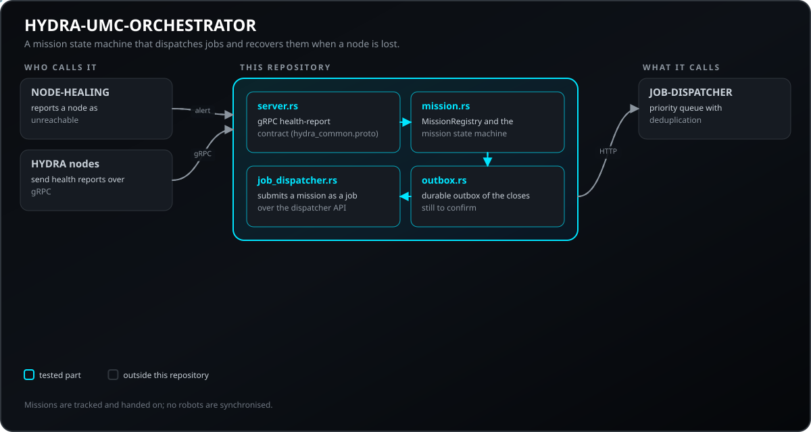
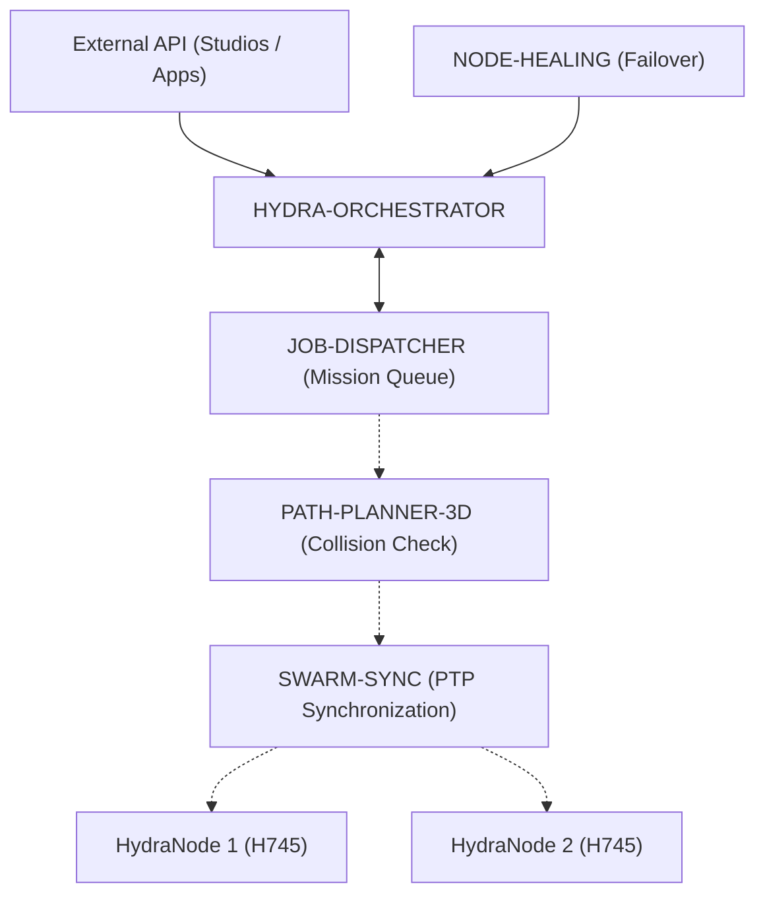
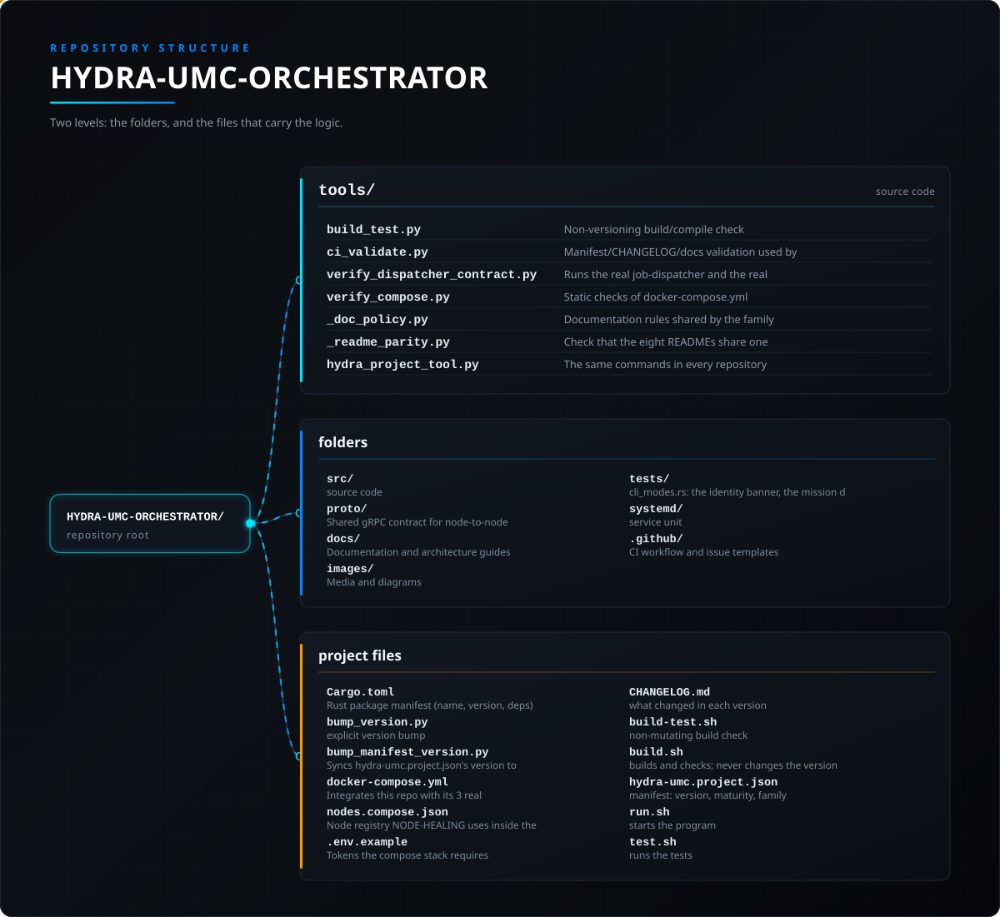

<!-- =============================================================================
HYDRA-UMC-ORCHESTRATOR - Mission coordinator
Copyright (C) JuanenRac (Electro Hobby 3D) <electrohobby3d@gmail.com>
GPL-3.0-or-later - see LICENSE
============================================================================= -->

<p align="center">
  
</p>

# 🕸️ HYDRA-UMC-ORCHESTRATOR

<p align="center"><a href="README.md">🇺🇸 English</a> | <a href="README_spa.md">🇪🇸 Español</a> | <a href="README_fra.md">🇫🇷 Français</a> | <a href="README_ita.md">🇮🇹 Italiano</a> | <a href="README_deu.md">🇩🇪 Deutsch</a> | 🇨🇳 <b>简体中文</b> | <a href="README_jpn.md">🇯🇵 日本語</a> | <a href="README_por.md">🇵🇹 Português</a></p>

### 🤖 分布式集群管理器与多节点协调器

<p align="center">
  
  
  
  
  
  
  
</p>

---

**诚实核查——今天真正能跑起来的部分：** 任务状态机（`src/mission.rs`：`Mission`/`MissionRegistry`，每一次 `Pending -> Dispatched -> InProgress -> Completed`/`Cancelled`/`Failed` 转换、幂等取消、节点故障恢复）、它自己的磁盘持久化（`MissionRegistry::load`/`persist`，`data/missions.json`）、持久化的远程关闭待办outbox（`src/outbox.rs`）、指向 HYDRA-UMC-JOB-DISPATCHER 的真实 HTTP 客户端（`src/job_dispatcher.rs`），以及把这一切暴露出来的简单 JSON/HTTP 服务器（`src/server.rs`，`tiny_http`，没有异步运行时）都是真实且经过测试的（144 个测试，`cargo test`）。`mission-demo` CLI 子命令针对同一个 `MissionRegistry` 运行一个真实的端到端场景——不是模拟（mock）。仍然只是设想、尚未实现的部分：下面第 3 节中的"计划中的内部层"（API 层、PTP 同步调度、作为常驻服务的舰队健康聚合）描述的是设计意图，不是已经存在的代码；本仓库目前没有到真实运行中的 JOB-DISPATCHER 或 NODE-HEALING 进程的 gRPC 连接，没有与 PATH-PLANNER-3D/SWARM-SYNC 的集成，也从未有过真实的多节点舰队跑在这个二进制文件上——`docker-compose.yml` 会一起构建并启动这 3 个兄弟服务，但这从未在真实机器人硬件上验证过。已交付的具体内容见 `CHANGELOG.md`，尚未完成的部分见下面的 ROADMAP。

---

> **安全与安防现状:**本生态系统不是经认证的安全系统。目前尚无硬件 E-STOP 通路,没有由固件强制执行的限位或联锁,也没有经过验证的运动指令;固件映像使用 CRC-32 和 Ed25519 签名校验,发布构建会拒绝已公开的开发密钥(中继之后的工具头和扩展板仍运行 URTC 的引导程序,它们使用共享密钥的 HMAC-SHA256 而不是签名);TLS 与双向 TLS 均为可选项,默认关闭;自制电路板尚未组装或测试。在依赖此处任何说法来保障人身安全之前,请先阅读[安全基线](https://github.com/JuanenRac/HYDRA-UMC-DOCS/blob/main/docs/SECURITY_BASELINE.md)和[威胁模型](https://github.com/JuanenRac/HYDRA-UMC-DOCS/blob/main/docs/THREAT_MODEL.md)。

---

## 📋 速览

| | |
|---|---|
| 版本 | `0.1.9` |
| 成熟度 | 可用 |
| 测试 | 144 (`cargo test`) |
| 技术栈 | Rust / tiny_http / ureq / JSON/HTTP |
| 目标 | HYDRA-UMC 工作单元的 Raspberry Pi CM5 |
| 真实硬件 | 尚未：此版本没有在真实硬件上运行的记录 |

**跳转：** [概述](#-概述) · [架构](#-架构) · [快速开始](#-快速开始) · [测试](#-测试) · [仓库结构](#-仓库结构) · [相关项目](#-相关项目)

## 🚦 项目状态

每一行是本仓库的一个部分，灯号表示它今天做到了哪一步。内容依据仓库能够展示的证据（测试、构建、运行），而不是计划。

🟢 已完成并验证 · 🟡 可用，有已知限制 · 🟠 部分完成或尚未验证 · 🔴 未完成或不可用

| 领域 | 状态 | 在这里的含义 |
|---|---|---|
| 软件 | 🟡 | 主要用途可用；上面的诚实性检查列出了仍然缺少的内容 |
| 测试 | 🟢 | 144 项自动测试，每次变更都会运行 |
| 真实硬件 | 🔴 | 尚未：此版本没有在真实硬件上运行的记录 |
| 文档 | 🟢 | 八种语言的 README，每次变更都会与清单核对 |

## 🎯 概述

**HYDRA-UMC-ORCHESTRATOR** 是 HYDRA-UMC 生态系统的高层协调层。它的目标是将多个 HydraNode(Kinematic Brain、Vision Node 和 Cognitive Node)作为一个统一的集群来管理。

计划中:全局任务规划、跨车队的负载均衡,以及为避免物理碰撞而在机器人之间进行的实时同步。目前它用状态机跟踪任务并交给 JOB-DISPATCHER;它不同步机器人、不防止碰撞,也不保证任何精度。

### 关键特性：
* 🧭 **分配只有一个所有者：** 配置了 `--job-dispatcher-url` 后，由 JOB-DISPATCHER 决定哪台机器人接收任务，而本编排器拥有任务本身（生命周期、收尾与恢复）。此时手动指定节点的 `POST /missions/:id/dispatch` 会被以 409 拒绝，并提示使用 `POST /missions/:id/auto-dispatch`；没有 job-dispatcher 时，手动 dispatch 与以前一样可用。*(已实现)*
* 📜 **与 job-dispatcher 的书面契约,用两个真实进程核验:** `docs/JOB_DISPATCHER_CONTRACT.md` 写明谁拥有什么(dispatcher 拥有把工作分配给机器人;本编排器拥有任务:其生命周期、收尾和恢复)以及双方逐步向对方承诺什么。`tools/verify_dispatcher_contract.py` 启动真实的 dispatcher(Go,来自相邻的检出目录)和真实的编排器,并让任务经过它们:任务是一个待处理的作业,手动指派被拒绝,由 dispatcher 选择机器人,完成和失败会关闭作业,而恢复节点会收回它的工作并拦截丢失尝试的迟到报告。缺少 Go、dispatcher 或已构建的编排器时跳过(退出码 0)。*(已实现,23 项检查)*
* 🕸️ **集群协调：** 跨多个控制器编排最多 32+ 台独立机械臂。 *（计划中）*
* ⚖️ **负载均衡：** 自动将任务分配给最空闲或最适合的机器人。
* 🛡️ **集中式安全：** 全局 E-STOP 管理与全车队健康监控。 *（计划中）*
* 📡 **统一 API：** 为应用程序和 Studio 与整个工厂交互提供单一入口点。 *（计划中）*
* 🧩 **真实 v0 —— 任务状态机：** `mission.rs` 通过 `Pending -> Dispatched -> InProgress -> Completed`（外加 `Cancelled`/`Failed` 两个终止状态）跟踪每个任务，具备幂等取消和节点被报告为不可达/无效时的真实恢复——见下方 `mission-demo`。纯内存逻辑——运行或测试都不需要与 JOB-DISPATCHER/NODE-HEALING 的实时 gRPC 对端。
* 🧱 **默认安全，迟到的报告无法覆盖交接结果（v0）：** API 默认只监听 `127.0.0.1:8114`，使用其他地址需要 bearer 令牌（`--token` / `ORCHESTRATOR_TOKEN`；设置后除 `GET /health` 外的所有路由都要求它）或显式的 `--allow-anonymous`；超过 64 KB 的请求体会被以 `413` 拒绝。每次派发都会让任务的 `attempt` 加一；携带过期 `attempt`（或已不再持有该任务的节点名称）的 `start`/`complete`/`fail` 会被以 `409` 拒绝，且不会改动任务，因此被宣告不可用、之后从网络分区中恢复的节点无法覆盖任务被交接到的节点（`--require-attempt` 可将该字段设为必填）。任务注册表和发件箱在替换旧文件之前会被强制写入磁盘；随附的 systemd 单元现在为进程提供可写的状态目录（此前 `ProtectSystem=strict` 使默认的 `data` 目录只读，重启后什么都保留不下来）；`docker-compose.yml` 现在启动真正的服务（`serve` 命令、健康检查、必填令牌、固定镜像，只发布编排器，且只绑定宿主机回环地址）。*（已实现）*
* 🔭 **可读的运维（可选）：** `GET /stats` 还显示最旧的未确认关闭已等待多久（`oldestPendingCloseAgeSeconds`），以及对 JOB-DISPATCHER 调用的最近一次成功与失败；`--log-format json` 每行日志写一个 JSON 对象；`--keep-finished N` 会忘记关闭已确认的最旧的已结束任务，使 `missions.json` 不会无限增长；文件带有 `schema_version`，由更新版本写入的文件会被拒绝；关闭时会告诉 JOB-DISPATCHER 正在关闭哪一次尝试。全部默认关闭或保持不变。 *(已实现)*

## 🧩 在 HYDRA-UMC 中的角色

**HYDRA-UMC-ORCHESTRATOR** 是任务协调器：一个 Rust 服务，用状态机跟踪任务，把任务交给 `HYDRA-UMC-JOB-DISPATCHER`，并在 `HYDRA-UMC-NODE-HEALING` 报告节点不可达时收回任务。它不同步机器人，也不避免碰撞。

## 🏛️ 架构

<p align="center">
  
</p>

<details>
<summary>图表的文本版本（Mermaid）</summary>



</details>

### 编排架构

> 实线箭头今天已存在（HTTP API、JOB-DISPATCHER，以及调用 `POST /nodes/:node/recover` 的 NODE-HEALING）。虚线箭头仅为计划，尚未实现：没有任何代码调用 PATH-PLANNER-3D 或 SWARM-SYNC。

### 架构与设计决策

> 下方的内部分层是本入口点背后逻辑的规划设计——目前实际运行的内容请见
> 下方"🔧 构建与运行"部分：一个真实的、纯内存中的任务状态机
> （`mission.rs`），目前还没有任何实时网络对端可供通信。

**计划中的内部分层**，将在已经存在的真实状态机基础上逐步构建：
* **API 层** —— 接收来自 Studio/应用程序的高层任务请求，并将其转化为车队级操作。
* **任务队列集成** —— 现在已经是真实的，而不只是计划：通过与 `server.rs` 自身使用的同一个真实 HTTP/JSON 传输（`src/job_dispatcher.rs` 自身的 `submit_job`/`close_job`/`requeue_job`/`run_dispatch`，早已接入每一个真实的任务生命周期处理程序）将已接受的任务移交给 JOB-DISPATCHER，并使用 `mission.rs` 中已经存在的真实 `Mission`/`MissionRegistry` 状态机在整个车队中跟踪其生命周期，即使在真实的进程重启后依然持久保存（`--data-dir`，默认 `data/missions.json`；中途重新加载的任务会变为 `Unknown` 并重新排回 `Pending`，绝不会被默默视为已完成）。这一层从未使用过 gRPC，也从未计划使用——`proto/hydra_common.proto` 自身共享的 `HealthService` 契约是另一回事（HYDRA-UMC-NODE-HEALING 自身真实的车队健康探测），并非本仓库向 JOB-DISPATCHER 移交任务的机制。
* **PTP 同步调度** —— 与 SWARM-SYNC 协调时序，使执行同一任务的多台机器人根据 PATH-PLANNER-3D 的检查结果保持无碰撞状态。
* **车队健康聚合** —— 将 NODE-HEALING 提供的各节点信号整合为统一的全车队视图，并在每个信号到达时调用（已经真实的）`MissionRegistry::recover_node_unavailable()`；这也是全局 E-STOP 到达每个节点所经过的路径。

### 为何这项特定服务使用 Rust
这个进程是对整个车队拥有最高权限的进程：它将发出全局 E-STOP 并仲裁哪个
机器人执行哪项任务。这一角色需要确定性的、低延迟的协调——不能有任何可能
延迟安全关键停止的垃圾回收停顿——以及编译期的内存/类型安全，因为这里的
一次崩溃或数据竞争不会局限于本地：它可能导致整个集群在任务执行过程中
失去协调者。本编排器自身的两个子项目（JOB-DISPATCHER、NODE-HEALING）
则使用 Go，这非常适合它们更简单、更独立的任务；但这并非本"大脑"进程所
需要的权衡取舍。

### 设计决策
* **唯一拥有全族 `docker-compose.yml` 的进程。** 作为 SWARM-SYNC、PATH-PLANNER-3D、JOB-DISPATCHER 和 NODE-HEALING 的集成父项目，本仓库是描述整个项目族如何协同运行的自然场所——每个子项目自身的仓库则专注于自身。
* **为应用程序/Studio 暴露"统一 API"。** 与其让每个客户端（移动应用程序、桌面版 Studio）直接与 4 个独立的子服务通信，不如让它们与这里的一个稳定入口点通信，该入口点可自由路由到底层任何变化的子实现。
* **为何 `cancel()` 是幂等的，而不是在已取消的任务上报错。** 一个取消请求完全可能合法地到达两次——客户端在响应丢失后重试，或操作员在看到确认之前再次点击取消。将第二次调用视为成功（`AlreadyCancelled`，而非错误）意味着调用方永远不需要区分「我的取消生效了」和「别人的取消已经生效了」——两者是同一个好结果。取消一个 `Completed`/`Failed` 的任务仍然会被拒绝：那是一种真正不同、非幂等的情形（撤销已完成的工作），而不是一次重试。
* **为何节点故障恢复是重新排队为 `Pending`，而不是直接判任务失败。** 一个报告 `UNREACHABLE` 的节点可能只是正在重启，而非永久消失（参见 `HYDRA-UMC-NODE-HEALING` 自身的限次重试逻辑，它在报告节点宕机之前就已经吸收了瞬时故障）——因此卡在该节点上的任务会通过 `Pending` 在另一个节点上获得新的机会，而不是在第一个问题迹象出现时就被标记为 `Failed`。`fail()` 仍然保留，用于重新调度真正耗尽所有选项的情形。

关于每个真实的 mission-demo/CLI 示例（取自实际编译的二进制文件），参见 [`docs/CLI_REFERENCE.md`](docs/CLI_REFERENCE.md)。关于共享的 `hydra.common.v1` gRPC 契约本身——它定义了什么、为何位于本仓库，以及各语言如何生成自己的绑定——参见 [`proto/README.md`](proto/README.md)。

**由 Operation 创建任务。** `POST /missions` 也接受 SDK 通用的 Operation（带有 `operation_id` 的请求体），这正是语义规划器交付的内容：操作的 id 就是任务的 id，其 `params` 中的 `priority`、`required_tool`、`location` 和 `depends_on` 就是作业的对应值。只接受状态为 `received` 的操作，重复提交同一个操作得到的还是同一个任务。

## 🚀 快速开始

需要稳定版 Rust 工具链（2021 版）及 `cargo`。

```bash
./build.sh             # Linux, macOS (build.bat on Windows)
./run.sh mission-demo  # a real scenario of the mission state machine
cargo test
```

## 🧪 测试

运行 `cargo test` 会执行 144 个自动测试。 不需要硬件，也不需要这台机器以外的任何东西。

CI 运行 `HYDRA_UMC_CI=1 python tools/ci_validate.py`，检查清单、文档、八个 README 和图片。

## 🏗️ 构建与发布

裸调用仍然是一个最小骨架（打印身份信息，退出码 0）；真实的任务状态机
今天已经可以通过 `mission-demo` 体验。

```bash
# Windows
build.bat
run.bat
run.bat mission-demo

# Linux / macOS
./build.sh
./run.sh
./run.sh mission-demo
```

`build.sh`/`build.bat` 不会更改版本号（只有 `python tools/hydra_project_tool.py bump` 才会提升），然后执行 `cargo build --release`。
`run.sh`/`run.bat` 直接执行生成的二进制文件。

`mission-demo` 会针对 `mission.rs` 的 `MissionRegistry` 完整运行一个真实
场景，并打印每一次真实的状态转换：

```text
[orchestrator] mission-1: dispatched -> InProgress(node=node-a)
[orchestrator] mission-2: dispatched -> Dispatched(node=node-a)
[orchestrator] mission-3: dispatched -> InProgress(node=node-b)
[orchestrator] node-a reported UNREACHABLE by NODE-HEALING - recovering its missions
[orchestrator] mission-1: requeued -> Pending
[orchestrator] mission-2: requeued -> Pending
[orchestrator] mission-3: unaffected (different node) -> InProgress(node=node-b)
[orchestrator] mission-2: cancel() -> Cancelled -> Cancelled
[orchestrator] mission-2: cancel() again (idempotent) -> AlreadyCancelled -> Cancelled
[orchestrator] mission-3: complete() -> Completed(node=node-b)
[orchestrator] mission-4: fail() -> Failed(no healthy node accepted redispatch after 3 attempts)
[orchestrator] final registry state:
  mission-1: Pending (terminal=false)
  mission-2: Cancelled (terminal=true)
  mission-3: Completed(node=node-b) (terminal=true)
  mission-4: Failed(no healthy node accepted redispatch after 3 attempts) (terminal=true)
```

```bash
cargo test   # 144 个测试：mission.rs 的每一次状态转换、每一次非法转换的
             # 拒绝、幂等取消、节点故障后的恢复，加上 outbox.rs 的
             # 抗崩溃持久化、job_dispatcher.rs 的真实 HTTP 客户端，
             # 以及 server.rs 的 HTTP 处理器
```

作为生态系统的集成父项目，本仓库还提供了一个真实的 `docker-compose.yml`，
可将本项目与其 3 个子项目（SWARM-SYNC、JOB-DISPATCHER、NODE-HEALING，作为同级文件夹检出；PATH-PLANNER-3D 是命令行工具，位于 `tools` 配置文件之后）一同构建和运行：

```bash
docker compose up --build
```

## 📂 仓库结构

<p align="center">
  
</p>

<details>
<summary>目录树的文本版本</summary>

```text
HYDRA-UMC-ORCHESTRATOR/
├── tools/                              源代码
│   ├── build_test.py                   不递增版本号的构建检查
│   ├── ci_validate.py                  CI 使用的清单/CHANGELOG/文档校验
│   ├── verify_dispatcher_contract.py   让真实的 job-dispatcher 与真实的编排器互相运行并核验契约
│   ├── verify_compose.py               docker-compose.yml 的静态检查（命令、固定镜像、回环端口、必需令牌）
│   ├── _doc_policy.py                  家族共享的文档规则 (HYDRA-UMC-SDK 的副本,保持同步)
│   ├── _readme_parity.py               检查八个 README 结构一致 (HYDRA-UMC-SDK 的副本,保持同步)
│   └── hydra_project_tool.py           每个仓库相同的命令: validate、test、ci、version、status、bump
├── src/                                源代码
├── proto/                              用于整个生态系统节点间通信的共享 gRPC 契约
├── docs/                               文档与架构指南
├── images/                             媒体与图表
├── systemd/                            服务单元
├── .github/                            CI 工作流和 Issue 模板
├── Cargo.toml                          Rust 包清单（名称、版本、依赖项）
├── bump_version.py                     显式提升版本
├── bump_manifest_version.py            将 hydra-umc.project.json 的版本与原生版本同步(--sync)
├── docker-compose.yml                  将本仓库与其 3 个实际子项目集成
├── nodes.compose.json                  NODE-HEALING 在 compose 栈中使用的节点注册表
├── .env.example                        compose 栈要求的令牌（复制为 .env）
├── CHANGELOG.md                        每个版本的变更
├── build-test.sh                       不修改内容的构建检查
├── build.sh                            构建并检查；从不改变版本
├── hydra-umc.project.json              清单：版本、成熟度、系列
├── run.sh                              启动程序
└── test.sh                             运行测试
```

</details>

## 🗺️ 路线图与已知限制

**当前已知限制**

* **第一阶段：** 基于 TSN 的确定性集群同步与亚毫秒级抖动降低。
* **第二阶段：** 多机器人单元中带动态避障的 3D 路径规划。
* **第三阶段：** 利用实时资源可用性进行多机器人任务分发优化。
* **第四阶段：** 高可用性故障转移集群的实现与异构机器人支持。

## 🌍 语言

本 README 和仓库文档提供八种语言：英语、西班牙语、德语、法语、意大利语、日语、中文和葡萄牙语（葡萄牙）。它们同时编写，并由 CI 检查八个文件拥有相同的章节和相同的链接。 本仓库没有自己的界面或消息目录，因此没有需要翻译的界面文字。

## 🔗 相关项目

本项目是同一作者(JuanenRac / Electro Hobby 3D)打造的 HYDRA-UMC 机器人生态系统的一部分。值得了解,因为某个请求实际上可能是关于这些项目之一,而非本仓库本身。

**子项目** —— 每一个都是本编排器直接协调或供给的服务
- **[HYDRA-UMC-SWARM-SYNC](https://github.com/JuanenRac/HYDRA-UMC-SWARM-SYNC)** —— 经过多单元收敛属性测试的真实 CRDT LWW-Element-Map 状态同步。
- **[HYDRA-UMC-PATH-PLANNER-3D](https://github.com/JuanenRac/HYDRA-UMC-PATH-PLANNER-3D)** —— 具备真实障碍物/工作空间碰撞校验的真实基于 RRT 的三维路径规划器。
- **[HYDRA-UMC-JOB-DISPATCHER](https://github.com/JuanenRac/HYDRA-UMC-JOB-DISPATCHER)** —— 基于真实 HTTP API 的真实优先级任务队列,支持去重。
- **[HYDRA-UMC-NODE-HEALING](https://github.com/JuanenRac/HYDRA-UMC-NODE-HEALING)** —— 具备重试/退避与身份不匹配检测的真实基于 gRPC 的车队健康看门狗。

**直接相关**
- **[HYDRA-UMC-SERVER](https://github.com/JuanenRac/HYDRA-UMC-SERVER)** —— 每个控制客户端真正通信的真实无头后端(REST/WebSocket);本编排器协调其多个实例。
- **[HYDRA-UMC-COGNITIVE-NODE](https://github.com/JuanenRac/HYDRA-UMC-COGNITIVE-NODE)** —— 面向 Hailo-10 认知流水线(LLM/VLA/语音编排)的集成中枢;它从这里接收任务级指令。
- **[HYDRA-UMC-SUITE](https://github.com/JuanenRac/HYDRA-UMC-SUITE)** —— 面向多台服务器的桌面(PySide6)集群指挥中心,打包为独立可执行文件;本编排器所支撑的集群指挥中心。

**生态系统中的其他项目**

*核心硬件与平台*
- **[HYDRA-UMC](https://github.com/JuanenRac/HYDRA-UMC)** —— 机器人手臂主板设计——CM5 主机 + 双核 STM32H745,目标是通过 CAN-OTA/SPI-OTA 协调最多 8 条工具臂(固件处于早期阶段,尚无已组装的电路板)。
- **[HYDRA-UMC-OS](https://github.com/JuanenRac/HYDRA-UMC-OS)** —— 面向 CM5 的可复现 Raspberry Pi OS 产品层——只读代理、经过验证的配置/配置文件、WiFi 首次配网。
- **[HYDRA-UMC-SDK](https://github.com/JuanenRac/HYDRA-UMC-SDK)** —— 每个桥接都据此校验自身指令的共享 JSON-Schema 契约与软件作业门限边界(并非经认证的安全功能)。
- **[HYDRA-UMC-CONNECTOR-HUB](https://github.com/JuanenRac/HYDRA-UMC-CONNECTOR-HUB)** — 面向外部机器连接器的声明式适配器清单注册与校验工具；把 SDK 自身的契约理念扩展到外部机器，而不取代工业网关类项目。

*核心后端与客户端*
- **[HYDRA-UMC-STUDIO](https://github.com/JuanenRac/HYDRA-UMC-STUDIO)** —— 具有实时多机器人 3D 可视化的网页控制面板。
- **[HYDRA-UMC-ANDROID-CONTROL](https://github.com/JuanenRac/HYDRA-UMC-ANDROID-CONTROL)** —— 具有生物识别登录和配对 Wear OS 伴侣应用的原生 Android 控制应用。
- **[HYDRA-UMC-IOS-CONTROL](https://github.com/JuanenRac/HYDRA-UMC-IOS-CONTROL)** —— 具有实时 WebSocket 同步的 iOS/iPadOS 控制应用(Flutter)。
- **[HYDRA-UMC-DSI](https://github.com/JuanenRac/HYDRA-UMC-DSI)** —— 面向机载 7 英寸 DSI 触摸屏的原生触控界面,直接嵌入 CM5 本体。
- **[HYDRA-UMC-EDITOR-URDF](https://github.com/JuanenRac/HYDRA-UMC-EDITOR-URDF)** —— 将完成的模型推送到 STUDIO 自身目录的桌面版图形化 URDF 创建/编辑工具。
- **[HYDRA-UMC-EDITOR-STL](https://github.com/JuanenRac/HYDRA-UMC-EDITOR-STL)** — 桌面 STL 模型编辑器，在 HYDRA-UMC-EDITOR-URDF 编辑的同一模型目录中变换/替换/移除/添加真实部件。
- **[HYDRA-UMC-BRIDGE-AMR](https://github.com/JuanenRac/HYDRA-UMC-BRIDGE-AMR)** —— 通过 VDA 5050 MQTT 发布者为 AGV/AMR 车队提供的协调边界(仅针对仿真车队测试)。
- **[HYDRA-UMC-BRIDGE-CNC](https://github.com/JuanenRac/HYDRA-UMC-BRIDGE-CNC)** —— 具备 GRBL 状态/控制字节访问能力的高层 CNC 单元协调器(仅针对模拟器测试)。
- **[HYDRA-UMC-BRIDGE-DROIDS](https://github.com/JuanenRac/HYDRA-UMC-BRIDGE-DROIDS)** —— 面向足式/人形机器人的协调边界,带有 Boston Dynamics Spot 指令发送器(仅针对模拟器测试)。
- **[HYDRA-UMC-BRIDGE-LASER](https://github.com/JuanenRac/HYDRA-UMC-BRIDGE-LASER)** —— 读取 3 路钥匙/外壳/联锁 GPIO 信号的激光单元协调器(仅针对模拟芯片测试;无法使激光器上膛或发射)。
- **[HYDRA-UMC-BRIDGE-OPENPNP](https://github.com/JuanenRac/HYDRA-UMC-BRIDGE-OPENPNP)** —— 面向 OpenPnP 贴片机板级流程的安全高层协调器。
- **[HYDRA-UMC-BRIDGE-PRINTER3D](https://github.com/JuanenRac/HYDRA-UMC-BRIDGE-PRINTER3D)** —— 面向 Moonraker/Klipper 3D 打印机的安全协调边界,具备真实的受控作业指令。
- **[HYDRA-UMC-BRIDGE-ROS2](https://github.com/JuanenRac/HYDRA-UMC-BRIDGE-ROS2)** —— 带有惰性导入 rclpy ROS 2 传输层的协调器(尚未在 ROS 2 环境中运行)。
- **[HYDRA-UMC-BRIDGE-UAV](https://github.com/JuanenRac/HYDRA-UMC-BRIDGE-UAV)** —— 面向搭载摄像头的无人机的协调边界,带有 MAVLink 指令发送器(仅针对模拟器测试)。

*URTC 工具平台*
- **[URTC](https://github.com/JuanenRac/URTC)** —— 面向实体 Universal Robot Tool Controller 板卡的固件,通过 CAN 总线支持 25 种以上工具配置。
- **[URTC-FLASHER](https://github.com/JuanenRac/URTC-FLASHER)** —— 面向 URTC 板卡的桌面图形烧录工具,支持 CAN-OTA 以及全芯片 SWD/JTAG。
- **[URTC-TESTER](https://github.com/JuanenRac/URTC-TESTER)** —— 面向 URTC 板卡的桌面实时 CAN 总线诊断工具,每种工具配置对应一个面板。
- **[URTC-WEB-STUDIO](https://github.com/JuanenRac/URTC-WEB-STUDIO)** —— 通过 Web Serial API 实现的浏览器版 URTC-TESTER 替代方案,无需本地安装。
- **[URTC-GATEWAY](https://github.com/JuanenRac/URTC-GATEWAY)** —— URTC CAN 总线前的网关：允许的标识符列表、速率限制和会话密钥；软件已在计算机上测试，尚未在真实总线上测试。

*视觉 AI 节点(Hailo-8)*
- **[HYDRA-UMC-VISION-NODE](https://github.com/JuanenRac/HYDRA-UMC-VISION-NODE)** —— 面向 Hailo-8 视觉流水线的集成中枢,具备逐阶段的真实硬件就绪检测。
- **[HYDRA-UMC-DETECTION-HEF](https://github.com/JuanenRac/HYDRA-UMC-DETECTION-HEF)** —— 具备 Hailo 架构/校验和安全加载验证的真实编译模型注册表。
- **[HYDRA-UMC-VISION-STREAMER](https://github.com/JuanenRac/HYDRA-UMC-VISION-STREAMER)** —— 具备真实 HailoRT 集成边界的真实 GStreamer 流水线 + MediaMTX 配置生成器。
- **[HYDRA-UMC-VISUAL-SERVOING-API](https://github.com/JuanenRac/HYDRA-UMC-VISUAL-SERVOING-API)** —— 以区域状态为授权条件的 Position-Based Visual Servoing 修正律;尚无摄像头位姿估计。
- **[HYDRA-UMC-SAFETY-ZONES](https://github.com/JuanenRac/HYDRA-UMC-SAFETY-ZONES)** —— 从文件读取物体位置的 v0 区域入侵、校准新鲜度与 E-STOP 请求逻辑;没有检测器为其供数,也尚未连接任何物理 E-STOP。

*认知 AI 节点(Hailo-10)*
- **[HYDRA-UMC-VLA-ENGINE](https://github.com/JuanenRac/HYDRA-UMC-VLA-ENGINE)** —— 面向 Vision-Language-Action 模型的真实动作 token 编解码与轨迹生成。
- **[HYDRA-UMC-VOICE-UI](https://github.com/JuanenRac/HYDRA-UMC-VOICE-UI)** —— 具备受限、需确认的 Watch 中继的真实语音前端(VAD + 意图解析)。
- **[HYDRA-UMC-SEMANTIC-PLANNER](https://github.com/JuanenRac/HYDRA-UMC-SEMANTIC-PLANNER)** —— 基于真实规则的任务分解,以及针对 MCU 错误码的语义化错误恢复。
- **[HYDRA-UMC-DOCS-QA](https://github.com/JuanenRac/HYDRA-UMC-DOCS-QA)** —— 面向本生态系统自身 Markdown 文档的真实纯标准库 TF-IDF 文档检索。
- **[HYDRA-UMC-LOCAL-TECHNICIAN](https://github.com/JuanenRac/HYDRA-UMC-LOCAL-TECHNICIAN)** — 面向生态系统自身的本地、按策略门控的 AI 维护技师——观察、诊断并提出修复建议;两个最高风险等级目前特意尚未实现。

*数字孪生与仿真*
- **[HYDRA-UMC-TWIN](https://github.com/JuanenRac/HYDRA-UMC-TWIN)** —— 面向数字孪生引擎的集成中枢,具备真实的版本兼容性同步契约。
- **[HYDRA-UMC-HIL-BRIDGE](https://github.com/JuanenRac/HYDRA-UMC-HIL-BRIDGE)** —— 在仿真与真实硬件之间带有软件碰撞联锁的硬件在环路由器(未在真实硬件上测试)。
- **[HYDRA-UMC-PHYSICS-REPLICA](https://github.com/JuanenRac/HYDRA-UMC-PHYSICS-REPLICA)** —— 面向真实 URDF 子集的真实正向运动学与关节限位校验。
- **[HYDRA-UMC-SYNTHETIC-DATA-GEN](https://github.com/JuanenRac/HYDRA-UMC-SYNTHETIC-DATA-GEN)** —— 具备 YOLO/COCO 标注导出功能的真实程序化 2D 场景生成器。

*数据与分析*
- **[HYDRA-UMC-DATALAKE](https://github.com/JuanenRac/HYDRA-UMC-DATALAKE)** —— 具备真实数据摄入/查询 HTTP API 的真实 sqlite3 时序数据存储。
- **[HYDRA-UMC-ANOMALY-DETECTOR](https://github.com/JuanenRac/HYDRA-UMC-ANOMALY-DETECTOR)** —— 具备漂移监测能力的真实 FFT + 统计基线异常检测器。
- **[HYDRA-UMC-PRODUCTION-REPORTS](https://github.com/JuanenRac/HYDRA-UMC-PRODUCTION-REPORTS)** —— 基于 DATALAKE 历史数据的真实 OEE/可用率计算,支持可复现的 CSV 导出。
- **[HYDRA-UMC-TELEMETRY-COLLECTOR](https://github.com/JuanenRac/HYDRA-UMC-TELEMETRY-COLLECTOR)** —— 面向 DATALAKE 的真实 CAN/WebSocket 数据摄入管道,支持序列去重。

*工业网关*
- **[HYDRA-UMC-GATEWAY-INDUSTRIAL](https://github.com/JuanenRac/HYDRA-UMC-GATEWAY-INDUSTRIAL)** —— 中继至工业协议的集成中枢,具备真实的指令白名单/背压控制层。
- **[HYDRA-UMC-OPCUA-SERVER](https://github.com/JuanenRac/HYDRA-UMC-OPCUA-SERVER)** —— 经真实二进制协议客户端会话验证的真实 OPC-UA 地址空间。
- **[HYDRA-UMC-MQTT-BROKER](https://github.com/JuanenRac/HYDRA-UMC-MQTT-BROKER)** —— 具备可选按客户端认证与主题 ACL 的真实 MQTT 代理。
- **[HYDRA-UMC-MTCONNECT-ADAPTER](https://github.com/JuanenRac/HYDRA-UMC-MTCONNECT-ADAPTER)** —— 具备降级模式输出的真实 MTConnect `/probe` 与 `/current` XML 端点。

*辅助工具与生态系统运维*
- **[HYDRA-UMC-DASHBOARD-AI](https://github.com/JuanenRac/HYDRA-UMC-DASHBOARD-AI)** —— 基于 DATALAKE/ANOMALY-DETECTOR 的智能摘要与异常高亮面板,具备诚实的统计回退机制。
- **[HYDRA-UMC-TOOL-CLI](https://github.com/JuanenRac/HYDRA-UMC-TOOL-CLI)** —— 具备真实、稳定退出码契约的车队 CLI,是 HYDRA-UMC-SERVER 自身 API 的真实在线客户端。
- **[HYDRA-UMC-WATCH](https://github.com/JuanenRac/HYDRA-UMC-WATCH)** —— 带有触觉提醒模式与配对手机语音中继的 WearOS 伴侣应用(尚未在实体手表上运行)。
- **[URTC-SMART-RACK](https://github.com/JuanenRac/URTC-SMART-RACK)** —— 面向板卡安装机架的固件,具备真实的工具 ID 解码与 Smart Idle 预热逻辑。
- **[URTC-VISION-TOOL](https://github.com/JuanenRac/URTC-VISION-TOOL)** —— 面向热成像/RGB 检测工具头的固件及真实 Python 视觉伴侣程序。
- **[HYDRA-UMC-UPDATER](https://github.com/JuanenRac/HYDRA-UMC-UPDATER)** —— 发现、克隆并更新本生态系统中每个仓库的管理类桌面工具。
- **[HYDRA-UMC-OS-REBUILDER](https://github.com/JuanenRac/HYDRA-UMC-OS-REBUILDER)** —— 构建即刻可烧录、预装生态系统最新版本的 CM5 镜像的 Windows/Linux 桌面工具,具备类似 Raspberry Pi Imager 风格的首次启动 Wi-Fi/用户/SSH 配置。
- **[HYDRA-UMC-OPS-AGENT](https://github.com/JuanenRac/HYDRA-UMC-OPS-AGENT)** — 维护事件协调器：一个低权限的边缘角色采集经过脱敏的库存/健康快照，一个控制面角色以只读方式渲染它，并请求某个 AI 提供方给出诊断建议——从不应用补丁，也从不部署任何内容。
- **[HYDRA-UMC-DEV-SERVER](https://github.com/JuanenRac/HYDRA-UMC-DEV-SERVER)** — 可复现的开发主机（Raspberry Pi 5 / CM5），保存整个生态系统的源代码，并在持久队列下运行有界的构建/测试任务；这是专用的开发角色，明确区别于运行中的 CM5。

## 📚 文档

更多阅读：

* [生态系统的安全基线](https://github.com/JuanenRac/HYDRA-UMC-DOCS/blob/main/docs/SECURITY_BASELINE.md)
* [生态系统的威胁模型](https://github.com/JuanenRac/HYDRA-UMC-DOCS/blob/main/docs/THREAT_MODEL.md)
* [本仓库的更新日志](CHANGELOG.md)
* [本仓库的许可证](LICENSE.md)

## 🤝 参与贡献与社区

* 提交 pull request 之前，请运行 `HYDRA_UMC_CI=1 py -3 tools/ci_validate.py`（或 `HYDRA_UMC_CI=1 python3 tools/ci_validate.py`）：它必须输出 `CI_VALIDATION=PASS`。此检查不要运行 `build.sh` 或 `build.bat`；构建不是检查。
* 八个 README 由 HYDRA-UMC-DOCS 中的同一个源生成；请勿手工编辑。修改源文件，再用 `tools/make_readmes.py` 重新生成。
* 不要在 README 中声称尚未运行过的内容：属实时请写“仅模拟”或“尚未在硬件上试过”。
* 请参阅 [CONTRIBUTING.md](CONTRIBUTING.md)、[行为准则](CODE_OF_CONDUCT.md)、[SECURITY.md](SECURITY.md) 和 [SUPPORT.md](SUPPORT.md)。

## 👤 作者

**JuanenRac (Electro Hobby 3D)** · electrohobby3d@gmail.com

## 📜 许可证

GPL-3.0-or-later - [LICENSE](LICENSE).
